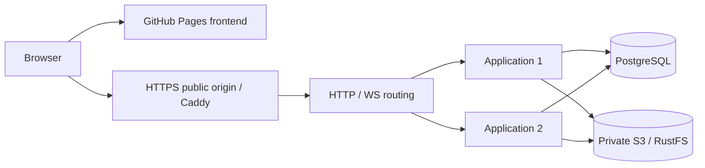

# How to Deploy Open Agricola

[English](HOW_TO_DEPLOY.md) | [中文](HOW_TO_DEPLOY_zh.md)

> 本文件是中文翻译镜像；[HOW_TO_DEPLOY.md](HOW_TO_DEPLOY.md) 是唯一权威版本。

本文档面向想要自行部署 Open Agricola 平台的开发者。

## 架构概览




GitHub Pages 在 `https://open-agricola.titanxxh.com/` 提供生产前端，API 保持 `https://openagapi.titanxxh.com`。两个 HTTPS 子域同站但跨源，保留仅属于 API host 的 HttpOnly 会话，不依赖第三方 Cookie。后端镜像另外包含可选的同源自托管前端。公共卡图和字体仍来自独立素材站。见 ADR 0035。

<a id="owner-operations"></a>

## Owner 运维

Owner 运维指 owner 在本机用私有工具执行的发布、部署和备份。这些工具及其 runbook 在私有仓库 [open-agricola-ops](https://github.com/titanxxh/open-agricola-ops)，外部读者无法访问；本仓库保留它们遵循的契约，以及主机从已部署检出运行的备份脚本。所有 owner 工具仍通过干净 protected-main 检出中的公开门禁使用[发布证据契约](#release-evidence-contract)。

本文命令用占位符表示 owner 主机信息：`<host>` 是正式后端的 SSH 目标，`<deploy-dir>` 是其部署检出，`<operations-dir>` 是监控目录，`<host-ops-dir>` 是主机上定时异机备份脚本所在目录。

<a id="release-evidence-contract"></a>

## 发布证据契约

发布证据契约判断一个固定候选能否发布和部署，由本仓库的代码强制执行：`scripts/ci/` 下的候选门禁、回执格式和镜像回执校验，从 protected-main producer 的干净检出运行。owner 工具只调用这些门禁，不能放宽它们。产生和发布证据的 owner 操作见 [Owner 运维](#owner-operations)。

### 本机回执

回执记录每条实际 `runCandidateTask` 命令、退出码与日志 SHA-256，以及执行时间、Node、平台、架构、受测提交、原始源码树和候选/producer 验证配置。完整十任务及其 canonical 命令必须全部通过。其中 `fast` 和 `slow` 任务运行 `pnpm test:fast` 与 `pnpm test:slow`，不含 `tooling` Vitest project：这些发布、部署与 CI 工具由受信 producer 而不是候选运行，由 PR 的 Routine 覆盖（见[测试架构](architecture/testing_zh.md)）。日常 affected 检查或单独的 owner 发布演练不满足此路径。rebase 后仅当完整原始树和验证配置与受测源码相同时，publisher 才能重绑 `candidateSha`；保留 `testedSha`，不把本机命令记为 GitHub job。

pre owner-local 必须使用 format 2 回执及 `execution: { kind: "docker-isolated", evidenceSha256: "<64 lowercase hex>" }`。owner 在候选之外收集的证据绑定实际 sandbox、前置服务源码闭包、命令、源码完整性、资源限制及 teardown，原始证据与日志一并不可变保留。已撤回的 format-1 pre 回执拒绝；stable format 1 不变。pre proof 的 `executionEvidenceSha256` 随镜像与接收端复核传递，并使用独立的原生 owner `owner-local-prerelease-verification` status；固定 beta Release 必须为 `prerelease=true`、`latest=false`。stable 与 pre 证明不能互相授权。公共 pre checker 重验固定源码、完整计划、双方配置、producer 祖先关系、原生 owner、tag 和绑定摘要的 asset ID/实际字节。完整同树 rebase 保留实际受测 SHA；源码树或 producer 配置不兼容时重新执行。owner、接收端 deploy/open/restore 和 candidate 镜像生产保留真实 typed 本机证明，不虚构 Actions ID。本机授权缺失或撤销时仍可用原生 workflow 回退；owner 最新 success 的证明无效时阻断。原生 PR/ref 规则、同步 lease、真实私有镜像生产/import 和目标验收仍为独立门禁；候选内工具不能自授权，必须先把 producer 正当交付到 protected main。

### owner status 选择或撤回本机证明

只有原生 owner 创建的 status 能选择本机证明，其他用户的同名 context 不能选择或撤销它。owner 最新 pending、failure 或 error 撤销本机授权，不复活较旧成功；随后继续普通原生 GitHub 证据路径。owner 最新 success 的证明若格式或内容无效，仍阻断，不静默回退。

### 后续阶段复核证明

Pages、后端交付和私有镜像生产通过公共候选门禁各自读取已发布证明，重新核对原生身份、未变更 tag、原始树、双方配置、命令、时间和回执摘要。不接受任意 URL、其他用户 status、不完整任务或虚构 Actions ID。GitHub 仍实际构建私有镜像与 Pages；镜像和 Pages 的 workflow 中只有 `container-image-build.yml` 和 `deploy-pages-broker.yml` 调用该门禁，构建 pre 运行时镜像的 `prerelease-runtime.yml` 不读取候选证据，只用到 `scripts/ci/container-images.ts` 中的 registry 常量。镜像来源、私有 registry、owner 传输和运行期门禁保持必需。独立 Bug Report 部署反馈命令也复用该门禁，保留 owner-local 权威依据而不虚构 Actions job。登记前须先部署支持此反馈证明类型的后端；命令本身不会升级应用。

---

## 本机标准发版

本节的 owner 操作步骤已迁入私有仓库，见 [Owner 运维](#owner-operations)。发版依赖的规则留在这里。

正式候选必须是所选仓库受保护 `main` 上某个已合入 PR 的最终集成快照。门禁明确解析 `refs/heads/main`，同名 tag 不能改变选择；同时核对原生仓库/PR 身份与原始 Git 对象可达性。未合入或中间快照在 dispatch、发布、安装候选和 SSH 前被拒绝。main 前进后，合格的旧最终快照仍可使用。独立固定的受保护 main producer P 为候选 C 定义编排；P 的原生 main 身份提供策略授权，双方源码配置哈希仅标识兼容执行。原生治理信任已授权的 override 权限，不证明历史策略；该新增准入策略见 ADR 0037。

只有固定候选的完整验证证据通过后，才能创建版本 tag 和 Release；即使 `main` 移动，Release 目标仍是该 SHA。已有 tag 或 Release 指向其他 SHA 时拒绝。通过网页或裸 `gh release create` 创建的 Release 可能尚无这些证据，Pages 与后端部署会各自拒绝未验证的候选。owner 本机的发布演练不能替代 GitHub 证据。

### 授权完整本机候选验证

正式版本与 pre 版本默认在 owner 本机验证固定候选（ADR 0046），GitHub 候选 workflow 作为回退。仓库原生 User owner 提交同一完整十任务候选计划的回执。准备、recorder 和发布命令属于 owner 操作，见 [Owner 运维](#owner-operations)。

`scripts/ci/owner-local-run.ts` 是 recorder，须在受信任的 protected-main checkout 中运行，其干净的 HEAD 即 producer。
- **一次性准备**：安装与已装引擎同版本的 rootless Docker 组件、用户命名空间工具，并在 `/opt/oa-owner-local` 放置 root 所有的可信 Node 工具链副本和可信 Playwright 浏览器缓存；不会升级 Docker。Playwright 升级后需重新执行。
- **隔离**：每次运行新建一次性 UID 61000 `oa-candidate` 及其独立 rootless Docker，与 GitHub runner 隔离方式一致。候选命令以 NoNewPrivileges unit 运行，使用私有 `/tmp`，owner 的 home 对其不可访问，取不到 owner 凭据、HOME、发布状态或 rootful Docker socket。owner 的 home 必须对其他用户不可访问（`chmod o-rwx ~`），候选的 rootless daemon 也因此读不到。候选源码树中包含 `data` 时直接拒绝，因为 recorder 会以 root 身份在该位置挂载共享测试数据。候选 slice 上限为 64 GiB 内存、16384 个任务、CPU 权重 50。
- **共享输入**：每个任务一份浅克隆源码副本，各副本共享同一个被忽略的 `data/` 目录，因此 `local-services --test` 只使用一套凭据，端口为本次运行选定的回环端口。候选还会得到可信浏览器缓存的副本，以及其 `public-assets.ref` 对应的干净公共资源 checkout（`PUBLIC_ASSET_VALIDATION_DIR`），构建时离线校验资源清单。
- **镜像**：在任何候选代码运行之前，受信任的 Docker CLI 先让本次运行要启动的所有镜像出现在新建的 daemon 里：隔离 smoke 固定 digest 的镜像、任务的 fixture 镜像，以及候选 `docker-compose.local.yml` 中固定 digest 的镜像。镜像来自 owner 私有缓存 `~/.local/state/open-agricola/owner-local-verification/images`：归档经标准输入流入 `docker load`，候选看不到缓存路径；载入后按 digest 重新打标签。只有 daemon 随后把引用解析到预期 digest（固定的 digest；tag 引用则是写入缓存时记录在 `tags.json` 的 digest），才算命中。否则从 registry 拉取，最多尝试三次；只有归档的 OCI index 指向 daemon 解析出的 digest 时，`docker save` 的输出才写入缓存。每一步都保留各自的准备日志。删除该目录只会让下一次运行重新下载。
- **流程**：镜像就绪后执行隔离 smoke、依赖安装、浏览器安装和一次服务启动；镜像拉取、依赖安装、浏览器安装和服务启动遇到临时下载失败时最多尝试三次，smoke 本身只执行一次。随后各任务共享一个 CPU 预算（`--cpu-budget`，默认等于本机核数）：`fast` 和 `slow` 各自独占运行，其余任务在预算允许时立即开始，浏览器每条 lane 计 2 核、`build` 计 3 核、其余计 2 核。每个 chromium 任务内部再分 `--lanes` 条并行 lane（`VERIFY_PARALLEL_LANES`，默认 2），因此 20 核预算下全部浏览器任务可同时运行；`--browser-jobs`（默认 6）再限制浏览器任务数。每个浏览器任务使用独立的 `TEST_PORT_RANGE` 端口段。E2E 开发服务器从锁定版本的素材 checkout 提供卡图（`E2E_PUBLIC_ASSET_DIR`），浏览器任务不会访问公共资源主机。`--test-workers` 设置 `VITEST_MAX_WORKERS`（默认 0，即 Vitest 默认值）。候选早于 #1779 的 E2E 素材与迁移锁改动时，使用 `--browser-jobs 2 --test-workers 10`。失败的任务在各波次结束后单独重试，次数为 `--retries`（默认 1），与 GitHub 重跑失败任务的做法一致。之后停止整个 cgroup、删除身份、用受信任 checkout 核对每份副本，并删除候选 home。
- **产出**：只有完全成功时才写出 `verification.json`（stable format 1）或 `pre-verification.json`（pre format 2），以及 `execution-evidence.json`。证据绑定 sandbox、工具链、准备阶段日志、每一次尝试、记录的命令、源码完整性、资源限制与 teardown 日志。日志每行带有距该命令开始的秒数。recorder 会按 publisher 的规则复核回执。`--profile` 额外记录输出时间线用于耗时分析，不写回执。
- **约束**：同一台机器同时只能有一次运行，由 `/tmp/oa-owner-local-verification.lock` 串行化；中断时仍会 teardown。输出目录须保持私有，其中还有日志和诊断。

回执必须包含的内容、owner status 怎样选择或撤回本机证明，以及 Pages、后端交付和镜像生产怎样复核，见[发布证据契约](#release-evidence-contract)。

### 查询交付状态与验收现场

本节的 owner 操作步骤已迁入私有仓库，见 [Owner 运维](#owner-operations)。线上浏览器验收本身是 `e2e-tests/helpers/live-smoke-cli.ts`：不写入对局，只允许已选参与者房间的 locate 与 join/resume 请求。

## 更新正在运行的 pre

本节的 owner 操作步骤已迁入私有仓库，见 [Owner 运维](#owner-operations)。

## 发布固定预发布候选

owner 验收独立目标前保持 `PRERELEASE_ENTRY_ENABLED=false`。正式 app 需要 `PUBLIC_APP_ORIGIN`、`PUBLIC_API_BASE`、`PRERELEASE_APP_ORIGIN` 及仅目标服务端持有的密钥，两个 Compose 入口均显式传入。正式大厅和设置只向 Beta 账号或管理员显示入口，目标缺失或关闭时明确不可用。应用发布消费新 pin 前，语言源及 packs 必须先发布并通过其独立 CI。

pre start 先建立 host-only HttpOnly verifier/state Cookie，再前往正式站根的 `?page=prerelease-handoff`，fragment 严格包含 `browserChallenge`、`state`、`targetOrigin`、`returnTo`。challenge 与 state 均为43字符base64url值。主站页面清除此片段，复核当前目标和正式根后只签发一次code。仅固定的 pre `/open-agricola/auth/handoff` 回调收到 `protocolVersion=1`、`code`、`state`、`browserChallenge`、`returnTo` fragment。pre 须校验自身state及verifier后服务端兑换。code过期由正式权威时钟在兑换时裁决，浏览器时钟偏差不参与授权。正式凭据留在正式API主机；pre认证及本地会话另行实现和验收。失败时回正式站根重新发起。

预发布使用独立通道。`prerelease` 日常 push 和 PR 运行 canonical routine plan，不自动部署。完整候选验证由可信 `main` 手动编排；候选任务只有仓库读取权限，不取得正式部署凭据。回执身份使用 VERIFICATION_CHANNEL=prerelease，普通回归命令使用正式运行默认值，预发布专用测试显式选择 prerelease。生产构建任务以 RELEASE_CHANNEL=prerelease 运行 build:hosted-frontend，包含正常类型检查及 Vite 构建。

选择候选前先同步当前 main，并在候选树维护 `prerelease-integration.json`：

```json
{
  "format": 1,
  "repository": "titanxxh/open-agricola",
  "baselineMainSha": "<full-main-sha>",
  "features": [
    { "id": "feature-name", "dependsOn": [], "sourceSha": "<source-commit>", "integratedSha": "<replayed-feature-commit>" }
  ]
}
```

各 SHA 均为完整提交身份。清单提交位于功能提交之后，`integratedSha` 指向实际集成功能提交。独立功能保留来源，以便只晋升选定功能。依赖必须指向清单中已有功能且不能成环；候选须继承 main 基线且无 merge commit。

同步集成分支、发布候选和完整本机候选验证的 owner 步骤见 [Owner 运维](#owner-operations)。同步使用公开的 `scripts/ci/prerelease-verification.ts sync`，它只以显式旧 SHA lease 更新 `refs/heads/prerelease`，功能来源集合发生增减时拒绝。选择和发布使用 protected-main producer 检出中的门禁。

pre 回执格式和 pre 证明规则属于[发布证据契约](#release-evidence-contract)。

N 从 1 开始。首次选择要求候选等于真实集成 ref 且清单以当前 main 为基线。选择固定 `verification/prerelease/<SHA>`，读取有效原生引用保护，然后在 main 派发 `prerelease-candidate-verification.yml`。回执绑定原生仓库 ID、prerelease 通道、候选 SHA、候选与可信策略配置以及 main producer 提交。producer 必须仍可从受保护 main 到达。兼容任务可分别补跑；缺失、失败、取消、跳过或配置不符均阻断。集成分支移动后仍可使用原固定候选。

所有必需任务通过后创建固定 tag 及原生 GitHub prerelease，并设置 latest=false。匹配的已有发布可复用；tag、SHA 或原生通道不符时拒绝。正式通道继续要求实际已合入 main 的最终 PR 快照，且版本只接受 vX.Y.Z；预发布回执不能授权正式发布。

配套 hosted 镜像使用 `GAME_BUILD_ID=<fixed-pre-sha>` 及 Docker build argument `RELEASE_CHANNEL=prerelease`，构建与运行通道相同。前端描述记录 releaseChannel 和 deploymentTarget=prerelease-hosted，镜像 label 记录 revision 和通道。正式产物使用 stable-hosted 或 stable-pages。预发布 Pages 构建在执行 builder 前拒绝，hosted 启动拒绝通道不匹配；旧版描述只允许正式运行。正式 Compose 固定 stable。安装时仍须核对完整候选回执及实际独立目标。

原生 prerelease published 事件不能授权正式 Pages。请求工作流排除 prerelease，main broker 还会独立读取原生已发布 Release 和未移动 tag 后才安装。发布、安装和现场验收分别记录；原生保护、资源初装、部署及开放入口由 [PRD #1655](https://github.com/titanxxh/open-agricola/issues/1655) 中 owner 票验收。

### 操作隔离的预发布目标

本节的 owner 操作步骤已迁入私有仓库，见 [Owner 运维](#owner-operations)。

#### 安装 owner 存储保护

本节的 owner 操作步骤已迁入私有仓库，见 [Owner 运维](#owner-operations)。

## 核验生产修复并重试站内信

本节的 owner 操作步骤已迁入私有仓库，见 [Owner 运维](#owner-operations)。命令对已发布 SHA 复用 `checkCandidateVerification`，并通过运行中容器内的 `BugReportFeedbackService` 记录结果。

## 一、部署后端

后端部署分两种情况：
- **情况 A**：全新 VPS，只有公网 IP，没有域名
- **情况 B**：有域名 + 已有 HTTPS（Nginx + Let's Encrypt / Certbot）

两种情况都需要先完成基础步骤。

### 1. 基础步骤（两种情况通用）

正式主机准备 Node.js 24.15+（不支持 Node 25）、Docker Compose、Git 和用户级 systemd/cgroup v2。生产 Compose 在同一台机器的 app 容器内启动两个独立应用进程，通过公开 HTTP/WS 路由进程接入，共享 PostgreSQL 18 和 RustFS。生产配置固定 `APP_INSTANCES=2`，即使 `.env` 中保留本地开发的 `1` 也会启动两个。无需申请外部服务。本地开发仍默认一个应用进程，使用 `./restart-local.sh --instances 2` 即可在本机验证相同的双进程路由。镜像用 Node 原生类型剥离运行 TypeScript：`scripts/typescript-runtime.mjs` 只把无扩展名的相对导入解析到 `.ts` 文件，路由进程把同一预加载传给应用进程和自定义 Session worker。开发环境仍用 tsx。去掉 tsx 的内存转译结果和 source map 后，应用进程才能与预发布通道共用主机。tsx 仍是生产依赖，供一次性运维命令和可能面对旧镜像的备份脚本使用。

旧 SQLite 单实例的性能报告仅是历史基线；继续保留应用的既有容量上限，不把这些数字当作 PostgreSQL、双实例或高可用认证。本次只验正常功能和重启，不做故障注入或恢复计时。

```bash
git clone https://github.com/YOUR_USER/open-agricola.git
cd open-agricola
cp .env.example .env
```

生产镜像同时保留冻结安装时使用的原始 `pnpm-lock.yaml`。工坊沙盒标识将它与部署源码和运行时版本一起计算摘要；缺少锁文件会使契约加载失败，不会静默忽略依赖变动。同源前端在裁剪生产依赖前构建，复制到 `/app/frontend-dist`，镜像将 `FRONTEND_ROOT` 设置为这个目录。

设置 `.env` 中原有 `PUBLIC_API_BASE`、`PUBLIC_APP_ORIGIN`、`CORS_ORIGIN` 和账号/OAuth 参数；已有 callback 不改。把 `DATABASE_URL` 与 `S3_*` 连接组留空即使用本机服务。配置外部 S3 时需要完整 endpoint、region、bucket、access key 和 secret，桶必须私有。

依赖初始化或网络变更使用既有 owner 工具单独安排维护；应用交付入口只消费已准备的依赖和已验证的 PostgreSQL cutover。不要在正式主机安装或构建应用。

依赖使用独立持久卷，生成凭据保存在 mode-600 的 `data/local-services.env`；主机工具使用 `data/dependencies.local`，容器使用 `data/dependencies.compose.env`。应用重建不清空数据库或资源。镜像包含 PostgreSQL 18 原生客户端和一个不可变 Viewer，启动时校验并上传到 S3。所有正式 Room 强制录制，资源不齐时拒绝开局。

需要额外持久化依赖网络时，owner 可在 `local-services.env` 旁创建 `data/local-services.compose.override.yml`，或放在 `LOCAL_SERVICES_DIR`。文件必须由当前 owner 所有且为普通文件，不得有 group/other 权限，软链会被拒绝。`local-services.mjs` 会把它同时传给 PostgreSQL 与对象存储的 Compose 调用。共享预发布依赖时，保留原网络，只给两个依赖服务增加连接：

```yaml
services:
  postgres:
    networks:
      default: {}
      prerelease: {aliases: [pre-postgres]}
  objects:
    networks:
      default: {}
      prerelease: {aliases: [pre-objects]}
networks:
  prerelease:
    external: true
    name: open-agricola-prerelease-main-dependencies
```

单独创建 external network。实际主机 helper 支持该 override 后才能宣称持久化；源码合入不会自动更新旧主机 helper。安装后可用 `docker network connect --alias` 给现有依赖原地接入，无需重启。使用 `docker compose --env-file data/local-services.env -f docker-compose.local.yml -f data/local-services.compose.override.yml config` 核对运行网络与 alias；手工协调配置时也须传入这两个文件。只有 PostgreSQL 和对象存储加入新依赖网络，候选服务不得加入任何正式网络。

原地接入不会更新 Compose 保存的配置哈希。后续第一次协调配置可能重建共享依赖，应安排在正式维护中，先排空应用写入者。`deploy-backend.sh` 仅复用已准备的依赖，不协调依赖；这类变更须单独维护。之后重建依赖会保留声明的网络与 alias；单独执行 `docker network connect` 不提供该保证。

公开 API origin 保持不变。浏览器先通过 API 查询 Room 目录，再通过其 `/nodes/<instanceId>/ws` 连接 owner；私有实例端口不开放到公网。默认 Compose 本地入口只绑定 loopback。Caddy 生产入口继续支持现有 443/8443，OAuth callback、cookie 和跨域配置沿用现有值。

Bug Report GitHub App、Workshop PR 和账号 OAuth 都仍是可选集成；配置表和独立 OAuth 文档保留它们的权限与回调要求。迁移 PostgreSQL/S3 不要求重新授权第三方账号。

---

### 情况 A：全新 VPS，只有公网 IP，没有域名

> 适用于：刚买的 VPS，没有域名，想用最简单的方式让后端跑起来。

#### 方案 A1：纯 HTTP（仅限测试，前端也需 HTTP）

最简单的方式。缺点：**GitHub Pages 是 HTTPS，无法直接连接 HTTP 后端**（浏览器会拦截混合内容）。所以前端也必须用 HTTP 方式部署（不用 GitHub Pages，用 VPS 自身提供静态文件）。

**步骤：**

1. 编辑 `.env`：

   ```env
   CORS_ORIGIN=*
   ```

2. 修改 `docker-compose.yml`，在 app 容器中挂载前端构建产物：

   ```bash
   # 本地构建前端（指向 VPS 公网 IP）
   VITE_API_BASE=http://YOUR_VPS_IP:5175 pnpm run build
   ```

3. 把 `dist/` 目录上传到 VPS，然后用简单 HTTP 服务器托管：

   ```bash
   # 在 VPS 上
   cd dist
   python3 -m http.server 8080 &
   ```

4. 访问 `http://YOUR_VPS_IP:8080`

5. WebSocket 地址：`ws://YOUR_VPS_IP:5175/ws`

> ⚠️ 此方案不安全（明文传输密码），仅用于本地测试或内网。

#### 方案 A2：Caddy 自签 / IP 直连 + 自动 HTTPS（推荐，需要域名）

如果你有域名（即使是免费的），Caddy 可以自动申请 Let's Encrypt 证书，零配置 HTTPS。

**获取免费域名（可选）：**

- [DuckDNS](https://www.duckdns.org/) — 免费子域名，如 `your-game.duckdns.org`
- [No-IP](https://www.noip.com/) — 免费 DDNS
- [FreeDNS](https://freedns.afraid.org/) — 免费子域名

**步骤：**

1. 把域名 DNS A 记录指向你的 VPS IP

2. 创建 `deploy/Caddyfile`：

   ```
   your-game.duckdns.org {
       reverse_proxy app:5175
   }
   ```

3. 使用仓库中的 `docker-compose.prod.yml`，保留完整 PostgreSQL/S3、OAuth 和入口配置。

4. 先完成下方「后端」的 owner 固定镜像交付，取得已验收的 `.env` 绑定后再启动：

   ```bash
   docker compose -f docker-compose.prod.yml up -d --no-build --pull never
   ```

5. 验证：

   ```bash
   curl https://your-game.duckdns.org/api/health
   ```

6. 前端 `VITE_API_BASE` 设为 `https://your-game.duckdns.org`

> Caddy 会自动申请和续期 Let's Encrypt 证书，你无需手动管理。

**维护应答（#1816）**：app 停止时，Caddy 默认返回不带 CORS 头的空白 502，Pages 前端读不到它，只能显示为网络错误。在 API 站点里加入 `deploy/Caddyfile.example` 中的 `handle_errors 502 503 504` 块，允许的来源填 `CORS_ORIGIN` 中的前端地址。它对预检返回 204（每个 API 请求都带自定义头，预检失败会遮住随后的 503），对其余请求返回 503 `{"ok":false,"code":"server_unavailable"}`、`Retry-After: 30`，并为该来源带上 CORS 头。app 自己的响应（包括它返回的 503）原样透传。前端据此显示维护页，或在进行中的对局上显示覆盖层，并每 15 秒重试。在运行中的主机上应用时，编辑 `deploy/Caddyfile` 后执行 `docker compose -f docker-compose.prod.yml exec caddy caddy reload --config /etc/caddy/Caddyfile`，app 不停机。前端部分随下一次 Pages 发布上线。

---

### 情况 B：已有域名 + HTTPS（Nginx + Let's Encrypt）

> 适用于：VPS 上已经跑了 Nginx，已通过 Certbot 配了 HTTPS 证书。

这种情况最简单——Docker 只暴露 HTTP 端口，Nginx 做反向代理 + TLS 终止。

**步骤：**

1. 编辑 `.env`：

   ```env
   CORS_ORIGIN=https://YOUR_USER.github.io
   ```

2. 确保 `docker-compose.yml` 端口映射绑定到 `127.0.0.1`（仅本地可访问）：

   ```yaml
   ports:
     - "127.0.0.1:5175:5175"
   ```

3. 启动 Docker：

   ```bash
   docker compose up -d --build
   ```

4. 为后端 API 添加一个 Nginx server block 或 location。

   因为下面配置会覆盖 `X-Forwarded-For`，同时在后端 `.env` 设置 `REPLAY_TRUST_PROXY=true`。

   **方式一：子域名（推荐）**，如 `api.your-domain.com`

   先申请子域名证书：

   ```bash
   sudo certbot --nginx -d api.your-domain.com
   ```

   然后添加 Nginx 配置 `/etc/nginx/sites-available/open-agricola-api`：

   ```nginx
   server {
       listen 443 ssl;
       server_name api.your-domain.com;

       ssl_certificate     /etc/letsencrypt/live/api.your-domain.com/fullchain.pem;
       ssl_certificate_key /etc/letsencrypt/live/api.your-domain.com/privkey.pem;

       location / {
           proxy_pass http://127.0.0.1:5175;
           proxy_http_version 1.1;

           # WebSocket 支持（必须，否则多人游戏不工作）
           proxy_set_header Upgrade $http_upgrade;
           proxy_set_header Connection "upgrade";

           proxy_set_header Host $host;
           proxy_set_header X-Real-IP $remote_addr;
           proxy_set_header X-Forwarded-For $remote_addr;
           proxy_set_header X-Forwarded-Proto $scheme;

           # WebSocket 超时设长一些
           proxy_read_timeout 86400s;
           proxy_send_timeout 86400s;
       }
   }

   server {
       listen 80;
       server_name api.your-domain.com;
       return 301 https://$host$request_uri;
   }
   ```

   **方式二：子路径**，如 `your-domain.com/agricola-api/`

   在现有 server block 里添加：

   ```nginx
   location /agricola-api/ {
       rewrite ^/agricola-api/(.*) /$1 break;
       proxy_pass http://127.0.0.1:5175;
       proxy_http_version 1.1;
       proxy_set_header Upgrade $http_upgrade;
       proxy_set_header Connection "upgrade";
       proxy_set_header Host $host;
       proxy_set_header X-Real-IP $remote_addr;
       proxy_set_header X-Forwarded-For $remote_addr;
       proxy_read_timeout 86400s;
       proxy_send_timeout 86400s;
   }
   ```

5. 启用配置并重载 Nginx：

   ```bash
   # 仅子域名方式需要
   sudo ln -s /etc/nginx/sites-available/open-agricola-api /etc/nginx/sites-enabled/

   sudo nginx -t          # 测试配置
   sudo systemctl reload nginx
   ```

6. 验证：

   ```bash
   curl https://api.your-domain.com/api/health
   ```

7. 前端 `VITE_API_BASE` 设为 `https://api.your-domain.com`（或 `https://your-domain.com/agricola-api`）

   后端使用子路径时，生产 `PUBLIC_API_BASE` 需设置为相同的公开 API base（包含 `/agricola-api`，末尾不加斜杠）。Nginx 转发前去掉该前缀；运行看板交接、Cookie 路径和私有 Grafana 代理保留此前缀供浏览器访问。Grafana root URL 使用同一 base 加 `/ops/`。

> **关键：Nginx 必须转发 WebSocket**。如果忘了 `Upgrade` / `Connection` 头，HTTP API 正常但多人游戏会断连。

---

## 二、部署前端

### GitHub Pages 使用同站的前端域名

生产前端保留 GitHub Pages 托管，使用与 API 同一可注册域的独立子域：

```env
PUBLIC_APP_ORIGIN=https://open-agricola.titanxxh.com/
PUBLIC_API_BASE=https://openagapi.titanxxh.com
CORS_ORIGIN=https://open-agricola.titanxxh.com
```

`CORS_ORIGIN` 只包含前端 origin，不含路径。账号 Cookie 仅属于 API host，使用 `HttpOnly; Secure; SameSite=Lax`，不要把 Domain 扩大到 `titanxxh.com`。两个 HTTPS 子域跨源但同站，携带凭据的 HTTP 和 WS 不依赖第三方 Cookie。OAuth provider callback 保持在 `PUBLIC_API_BASE`。

1. 修改生产配置前，先验证目标代码与实际 Pages 生产构建。
2. 仓库 Pages custom domain 设置为 `open-agricola.titanxxh.com`，发布来源保留 GitHub Actions。添加精确 DNS CNAME：`open-agricola.titanxxh.com → titanxxh.github.io`，不带仓库路径。等待证书签发，再启用 HTTPS。Actions 发布不需要 `CNAME` 文件。见 [GitHub 自定义域名文档](https://docs.github.com/en/pages/configuring-a-custom-domain-for-your-github-pages-site/managing-a-custom-domain-for-your-github-pages-site#configuring-a-subdomain)。
3. 发布匹配的根路径 Pages 前端，并通过既有备份、目标恢复校验和部署流程应用上述 API 配置。保留上一份已验证镜像及配置，供回退使用。
4. 比较 Pages host 实际 HTML、JS/CSS、语言包和卡牌 manifest 字节与目标构建。验证严格 WebKit 与 Chromium 下的登录、刷新、持久 profile 浏览器重开、工坊、routed WS 和原 Room 恢复，再登出。Linux WebKit 覆盖不能替代实体 Safari/iPhone 验收。

上线验收不创建正式对局，也不向已有 Room 发送游戏操作。开局、起始交互和持久化测试只通过 owner 本机隔离的发布演练执行，见 [Owner 运维](#owner-operations)。

`pnpm run build:pages-frontend` 将根路径 `/` 的构建写入 `dist-pages/`，显式使用 `VITE_API_BASE` 与可选 `VITE_WS_BASE`。`frontend-build.json` 记录 `{ format: 1, gameBuildId, basePath }`，标识须匹配所选后端。社区卡默认启用，仍允许显式 `VITE_ENABLE_COMMUNITY_DECK` 覆盖；工坊沙盒始终在浏览器中运行。

应用保留在 Pages origin。旧 API 的 `/open-agricola`、`/open-agricola/`、`/open-agricola/index.html` GET/HEAD 入口跳转到配置的同站前端，保留公开 Room/Replay 查询参数。跳转显式清除 fragment，旧源 onboarding 重新开始，不跨源传递绑定凭据。GitHub 管理旧 `github.io` 入口到自定义域名的跳转。浏览器本地草稿、LLM 设置、偏好和命令 journal 不自动跨源迁移；账号、Room、座位和存档仍在同一后端。

### 可选的同源自托管

生产镜像保留 `FRONTEND_ROOT=/app/frontend-dist` 以及 `pnpm run build:hosted-frontend`，供 `/open-agricola/` 同源自托管使用。仅 `PUBLIC_APP_ORIGIN` 位于 API origin 且路径匹配时启用静态托管；缺失文件或构建元数据不一致时启动失败。公开 `/api/app-location` 描述这个可选入口，前端启动不再通过它迁移访客。API、WS、运行看板和不可变 Replay Viewer 路由保留在网页 base 之外。

### GitHub Pages 前置条件

- GitHub 仓库 Settings → Pages → Source 选 **GitHub Actions**
- 默认分支保持 `main`。仓库 Settings → Environments → `github-pages` → Deployment branches and tags 使用自定义策略，只允许名为 `main` 的 **branch**。删除全部 tag 策略，包括 `v*`。broker 在构建前读取并核验该设置。
- 保持已退役的 `.github/workflows/deploy-pages.yml` workflow 为禁用状态。从 main 删除 YAML 不会禁用历史版本。仅允许 main 的环境能阻止旧 tag 部署，但无法阻止原来记录于 `main` 的旧手动运行被重新执行，必须同时禁用旧 workflow。[GitHub 禁用 workflow 后同时阻止触发和重新运行](https://docs.github.com/en/actions/how-tos/manage-workflow-runs/disable-and-enable-workflows)。

### 迁移已有的 Pages 部署

新请求 workflow 和 broker 合入 `main`、本地入口测试通过后，完成以下原生配置变更：

1. 通过 GitHub API 保存 `github-pages` 环境、部署分支策略和旧 workflow 元数据。入口为 `GET repos/<owner>/<repo>/environments/github-pages`、其 `/deployment-branch-policies` 端点，以及 `GET repos/<owner>/<repo>/actions/workflows/deploy-pages.yml`。
2. 先等待旧 Pages 运行结束，或取消仍在运行的旧任务，再修改规则。禁用 workflow 不会取消已经运行的任务。
3. 按记录的 ID 禁用旧 workflow。`titanxxh/open-agricola` 的旧 ID 为 `253270751`。保持新建的 `pages-release-request.yml` 和 `deploy-pages-broker.yml` 启用。
4. 删除全部 tag 策略和 `main` 之外的分支策略，保留原 main 策略及无关环境设置。主仓迁移时，`v*` tag 策略为 `56008318`，保留的 main 策略为 `56205883`。修改前先读取当前 ID。
5. 重新读取旧 workflow 状态和环境策略，确认旧 workflow 为 `disabled_manually`，自定义允许列表只有 `name=main,type=branch`。这些原生设置也是部署门禁的一部分。

应用回退时保留两项保护，通过 main broker 指定此前完整验证通过且符合最终集成准入的 SHA。缺少所需验证配置的历史提交仍被拒绝。若要回退门禁本身，先停止 Pages 发布，再有意恢复已备份的 workflow 状态和策略。策略按名称和类型恢复，因为 GitHub 会分配新 ID。重新启用旧 workflow 或允许 tag 都会撤销历史 workflow 保护。

### GitHub Pages 配置

在 Settings → Secrets and variables → Actions → **Variables** 标签中添加：

| Variable | 值 | 示例 |
|----------|---|------|
| `VITE_API_BASE` | 后端完整 URL | `https://api.your-domain.com` 或 `http://VPS_IP:5175`（仅 HTTP 方案） |
| `VITE_WS_BASE` | WebSocket URL（可选，自动推导） | `wss://api.your-domain.com/ws` |

### 触发部署

使用[本机标准发版](#本机标准发版)，先固定候选并完成验证，再创建 Release；命令见 [Owner 运维](#owner-operations)。

Release 指向的提交包含 `.github/workflows/pages-release-request.yml` 时，发布后启动 **Pages Release Request**。该 workflow 只记录请求。它成功完成后，通过 `workflow_run` 启动 `.github/workflows/deploy-pages-broker.yml`；[该事件从默认分支执行 broker](https://docs.github.com/en/actions/reference/workflows-and-actions/events-that-trigger-workflows#workflow_run)。

手动部署或回退历史版本时，从 `main` 运行 broker，并传入固定的候选 SHA：

```bash
gh workflow run deploy-pages-broker.yml --ref main -f candidate_sha='<full-sha>'
```

broker 分别固定 main 策略 SHA 和候选 SHA。Release 请求使用原始请求 run 的 `head_sha`，同时核对 GitHub 返回的 workflow ID、路径、仓库、事件和成功完成的 run 元数据。手动请求必须提供完整小写提交 SHA。broker 不会重新解析 release tag；从其他分支或 tag 运行会被拒绝。

共享 `pages` 并发锁只在验证构建成功后的 deploy job 上获取，不取消正在执行的部署；被拒绝的请求不会获取该锁。该串行约束不定义版本先后顺序。

`node scripts/ci/pages-deployment.ts` 使用 Node.js 24 原生 TypeScript 支持，无需先安装策略依赖。它先确认受保护 main 上的最终 PR 快照，再从 Git 对象计算候选验证配置，在检出或安装候选代码前核验可信完整 GitHub 证据。必需任务缺失、失败、取消、跳过或不兼容时，任务在上传 artifact 和部署前停止。普通 PR 检查不能满足该门禁。只有通过后，可信 helper 才创建独立临时 worktree、安装依赖并构建固定候选。复制发布产物前检查源码干净状态和 `frontend-build.json` 中的 SHA。候选版本的 gate 不会被执行。

仍可通过 Releases → Draft a new release 或裸 `gh release create` 创建尚未验证的 Release，但无法绕过部署门禁。较旧版本可能没有新的请求 workflow，完成候选验证后使用手动 broker。查看失败 broker 步骤中的阻塞任务，补齐验证后用同一完整 SHA 重试。Release 不会自动部署后端。

部署成功后的生产入口是 `https://open-agricola.titanxxh.com/`，由 GitHub Pages 提供。自托管部署可按相同拓扑配置自己的 Pages 自定义域名。

### 本地构建

```bash
VITE_API_BASE=https://api.your-domain.com pnpm run build:pages-frontend
```

该命令将构建写入 `dist-pages/`，供本地检查。发布时使用上述 Release 或手动 Actions 工作流，在部署前执行候选门禁。

### 主站图片资源

`public-assets.ref` 固定图片仓的 Git commit，`public-assets.required.json` 声明主站需要的全部路径。构建和默认本地启动读取图片站的 `asset-version.txt` 和 `asset-manifest.json`；两者都必须与 `public-assets.ref` 一致，且清单必须包含所有必需路径。元数据不可达、响应无效、版本不一致或缺少文件都会使启动/构建失败。请求只访问公共 Pages 地址，不携带 GitHub API 凭据。测试配置只读取本地契约，不依赖网络。新构建统一从 `https://titanxxh.github.io/open-agricola-assets/assets/...` 加载公共图片和字体，不带版本查询参数，图片版本升级时未变化文件的 URL 保持不变。GitHub Pages 固定返回 `max-age=600` 并用 ETag 重新验证；原路径替换的文件可能在这段时间内仍是旧内容，需要与应用同时生效的内容应使用新路径。主站、初始 HTML 背景预加载、生成的 CSS 和不可变 Replay Viewer 对所有访客使用同一 Pages 来源，Replay CSP 允许该图片站路径的图片和字体，也保留旧 raw 图片仓路径的许可，供已有房间锁定的不可变 Viewer 使用；新构建仅包含 Pages 资源 URL。不按地域分流，也不在运行时回退 raw。公共资源本身不再打进主站 Pages artifact。已有 Viewer 保留其 `?v=` URL，Pages 会忽略该参数。图片仓按既有设计只发布当前文件；删除或重命名已发布路径会使引用它的已有 Viewer 失效。

本地修改图片时可全量切到一个资产仓 checkout：

```bash
PUBLIC_ASSET_LOCAL_DIR=../open-agricola-assets pnpm dev
```

启动前会检查全部必需文件；缺少任一文件即失败，不会混用或回退到远端。该覆盖仅用于本地开发服务器，CI 和生产构建不接受它。

本地验收或构建时，可直接校验固定版本的素材仓，避免联网获取 Pages 元数据：

```bash
PUBLIC_ASSET_VALIDATION_DIR=/absolute/path/open-agricola-assets pnpm verify prepush
```

素材仓 HEAD 必须等于 `public-assets.ref`，`assets/` 必须干净，全部必需文件必须已纳入该提交且实际存在。该设置同样适用于 `pnpm verify` 和 Replay Viewer 构建。构建 URL 仍使用固定版本的 Pages 来源。这证明本地素材内容有效，不代表线上 Pages 已验证；未显式设置时仍检查远端元数据。

正式 Pages 构建还读取同次资产发布的 `asset-digests.json`。它核对固定版本以及 `asset-manifest.json` 中每个路径对应的 SHA-256，再将哈希表打入 `/sw.js`。设置 `PUBLIC_ASSET_VALIDATION_DIR` 时，从干净的素材仓 checkout 计算同样的摘要。开发、自托管、预发布和 Replay Viewer 均不注册此 Worker。

缓存按 URL 和 SHA-256 跨应用版本复用已校验素材。未命中时用不带凭证的 CORS 请求重新验证。哈希不符的字节仍可供页面使用，Worker 跳过写入。常规激活等待受控页面退出，只清理自身缓存的旧条目。

同一 Worker 还以缓存优先方式提供应用的内容寻址文件：打包产物 `assets/*`、带哈希的语言包、`cards-manifest.<sha256>.json` 以及百科带哈希的目录和搜索文件。构建时嵌入每个文件的 SHA-256，只写入哈希相符的 200 响应。文档、`/sw.js`、无哈希的 manifest 和 API 始终走网络，发布仍通过新的 `index.html` 切换客户端。激活时删除新构建未列出的条目。页面首屏出现后，把已下载的同源文件报告给该注册中最新的 Worker；后者从 HTTP 缓存存入清单列出的文件，并在后台下载对局页面的分包。这样即使本次访问尚未受控，下一次访问也能从本地读取。

### 暂停单项 Service Worker 功能

在 `scripts/vite-service-worker.ts` 修改对应开关，按正常发布门禁发布正式 Pages 候选。

| 开关 | 关闭后的行为 |
|---|---|
| `PUBLIC_ASSET_CACHE_ENABLED` | 图片和字体恢复普通 HTTP 请求。 |
| `APP_SHELL_CACHE_ENABLED` | 带哈希的脚本、样式、语言包和卡牌 manifest 改用 HTTP 缓存。 |
| `ROOM_OFFLINE_RETRY_ENABLED` | 回房文档请求恢复普通浏览器导航。 |
| `OFFLINE_ENCYCLOPEDIA_ENABLED` | Pages 隐藏下载入口并暂停离线阅读。浏览器保留已下载副本。 |

保持 `/sw.js` 地址和根作用域。需要紧急接管时，在同一候选将 `SERVICE_WORKER_EMERGENCY_TAKEOVER` 设为 `true`。在线浏览器发现并安装该版本后会激活新 Worker，已打开的页面无需刷新，WebSocket 无需重连。后续常规发布将开关恢复为 `false`。已安装的 Worker 需要在 `/sw.js` 收到有效的替换脚本。

### 启用或暂停浏览器通知

`server/web-push/` 管理设备开关、发送和点击解析。Room Commit 在持久化对局状态时记录轮抽机会。反馈服务在正式流程写入新补资料请求或首封上线通知时记录站内信事件。持久队列面向已开启的设备，每次尝试重新核对账号、设备和事件资格。加密载荷只含通知类别、不透明投递 ID 和通用本地化文案。测试见 `web-push-draft.test.ts` 和 `bug-report-{feedback,release-feedback}.test.ts`。

正式 Pages 提供 `/sw.js` 后，在后端环境配置 `WEB_PUSH_VAPID_SUBJECT`、`WEB_PUSH_VAPID_PUBLIC_KEY` 和 `WEB_PUSH_VAPID_PRIVATE_KEY`。使用 HTTPS 地址或 `mailto:` 邮箱作为联系地址，将私钥留在后端。各次部署沿用同一对密钥，以保留设备订阅。

将 `WEB_PUSH_DRAFT_ENABLED`、`WEB_PUSH_INBOX_ENABLED` 或两者设为 `true`，开放设备设置并启用发送。两个开关默认关闭。暂停某一类时，将对应开关设为 `false` 并重启后端。正式 Pages 的 Worker 继续处理此前已送达的通知点击。

在每台支持的设备上通过浏览器通知设置开启。iOS 使用已安装到主屏幕的应用。各验证一次轮抽和站内信通知，再分别关闭两类通知。确认在已有房间中点击站内信通知能打开指定消息，对局连接保持有效。

图片站按来源地址限流，同一台机器并行运行多个浏览器任务时，卡图请求会收到 HTTP 429。浏览器验收可让开发服务器直接提供同一个固定版本的 checkout：

```bash
E2E_PUBLIC_ASSET_DIR=/absolute/path/open-agricola-assets PUBLIC_ASSET_VALIDATION_DIR=/absolute/path/open-agricola-assets pnpm verify <spec>
```

- 只有主站的 Vite 开发服务器接受 `E2E_PUBLIC_ASSET_DIR`，设置了 `CI` 时同样生效。它先做上述固定版本干净 checkout 校验，再从 `/__public-assets__/` 提供全部图片和字体，未知路径返回 404；不发远端请求，也不回退。
- GitHub 上的浏览器任务同样使用它：日常浏览器分区，以及候选验证的 chromium、sandbox、WebKit 任务，都先运行 `scripts/ci/checkout-public-assets.sh`。该脚本从 Git 对象读取固定 SHA，并在 checkout 之外浅抓取素材仓；候选准备步骤把它复制到候选 home。`build` 任务、Pages 构建和线上发布验收仍使用 Pages。
- hosted、Pages、Replay Viewer 构建，以及 preview 和 Vitest 都忽略该变量，继续使用 Pages URL 和各自的校验；要让这些构建也不联网，同时设置 `PUBLIC_ASSET_VALIDATION_DIR`。
- 在 Chromium 浏览器测试中，这些构建产物同样不访问远端：设置该变量后，Playwright 的 global setup（`e2e-tests/helpers/pinned-asset-host.ts`）用一把新生成的密钥，在回环地址的 HTTPS 服务上提供同一份 checkout，Chromium 把素材站域名解析到该服务，并且只信任这把密钥。URL 不变，单个卡住的请求不会再拖住页面的 load 事件。WebKit 带主机映射无法启动，因此 WebKit 运行，以及浏览器测试之外的不可变 Viewer，仍从 Pages 加载卡图和字体。
- 该设置计入验证指纹。它不验证线上 Pages 部署；未设置 `PUBLIC_ASSET_VALIDATION_DIR` 的构建仍会验证。

更新公共资源时先把 `open-agricola-assets` 发布到图片仓 Pages，等待其 workflow 将所有线上文件与该 commit 逐一校验，再把主仓 `public-assets.ref` 更新为线上 `asset-version.txt`，同步 `public-assets.required.json`，随后走主仓正常 Release。只修改文档的图片仓 commit 也会改变部署版本标记。旧 Viewer Build 保留代码，公共卡图和字体跟随图片站当前文件。

---

## 三、更新部署

### 保留对局的升级兼容性

Open Agricola 已上线。升级必须保留所有尚在保留期内的 Room，包括离线存档，以及颜色确认、父母选择、轮抽、单人选牌和正式游戏阶段。支持的来源格式包括当前部署版本，以及实际保留快照中仍存在的更旧格式。本地测试夹具可以重建；没有保留状态或受支持客户端依赖的内部 API 与 action alias 无需永久保留。

修改存档状态、引擎游标、pending continuation、action ID 或命令格式时：

1. 盘点保留数据中受影响的格式和阶段。所有玩家离线，或写入存档的版本早于当前部署，都不代表该存档可以丢弃。
2. 新代码不能直接读取保留格式时，提供明确、有版本的迁移。重复迁移不得改变已迁移的存档。保留座位、已确认选择、资源、私密信息、未完成流程、撤销历史和命令回执。迁移与普通 Session 恢复分开；恢复对局不得重新发牌、重置进度或静默过期 Game Context。
3. 验证旧状态恢复后的下一条真实命令、快照发布和重连。覆盖受影响的中间态与重试，包括部分玩家已提交的轮抽和 pending 选择。仅能构造 Session 或加载 JSON，不足以证明玩家能继续游戏。浏览器命令变化时，明确支持的新旧构建重叠范围，并在接受不兼容输入前要求不受支持的客户端刷新。
4. 启动新应用代际前，执行现有目标构建的归档恢复及实际数据校验。这些部署检查仍是必需项，也不能替代格式变化的行为测试。缺少必要迁移、丢失已确认状态或恢复后不能继续游戏，均阻断 PR 批准与部署。

已完成 Replay 保留原始 Frame、哈希和固定 Viewer Build，历史播放不运行当前后端规则。这项策略不要求永久支持所有历史存档或浏览器构建。退役线上保留对局是独立的运维决定，需要对受影响对局的明确授权，不能从功能、合入或发布请求中推定。遇到不兼容升级，延后部署，直到受影响存档完成迁移，或已核实这些对局离开受影响状态。

[#1661](https://github.com/titanxxh/open-agricola/issues/1661) 的 Beta 业务直接迁出将旧 Team、Multihand 与协作存档排除在此次切换之外。main 移除这些业务路径，不新增旧 Beta 排空、库存门禁、迁移或参与者补偿。此例外不减弱普通保留局恢复要求，也不授权修改生产数据。已执行迁移 034/035 和不可变历史 Replay、Viewer 产物继续作为历史记录保留。pre 以干净 main 为基线正向重建业务；整体反转清理会覆盖正式身份、入口和运维基础设施。

<a id="supported-browser-and-backend-overlap"></a>

### 支持的浏览器与后端版本重叠

HTTP 游戏请求携带 `X-Open-Agricola-Client-Capabilities`。CORS 预检不允许此 header 的后端不能服务当前 Pages，普通 HTTP 沙盒请求也会受影响。先部署后端能力与 CORS 支持，再发布 Pages。普通客户端可省略能力声明；空声明或未知 token 不授予额外行为。

本次升级按以下顺序使用现有独立验证与部署入口：

1. 固定合格的已合入候选 SHA，以及指向它的 ref。只有 `main` 仍等于该 SHA 时才能使用 `main`。请求完整验证，等待 `check` 返回 `status: passed` 且退出码为0：

    ```bash
    pnpm exec tsx scripts/ci/candidate-verification.ts request --repository titanxxh/open-agricola --sha <full-sha> --ref <fixed-ref> --tasks all
    pnpm exec tsx scripts/ci/candidate-verification.ts check --repository titanxxh/open-agricola --sha <full-sha>
    ```

2. 在 owner 本机用固定镜像的[后端交付](#后端)部署同一固定后端候选（见 [Owner 运维](#owner-operations)）。后端门禁不要求已有已发布的 Release。

3. 按现有部署流程核对后端构建标识、保留数据检查和健康状态。发布 Pages 前，确认公共 API 对以下预检返回204，并允许能力 header。将两个 origin 占位符替换为实际地址：

    ```bash
    curl -i -X OPTIONS '<api-origin>/api/game/state' \
      -H 'Origin: <frontend-origin>' \
      -H 'Access-Control-Request-Method: GET' \
      -H 'Access-Control-Request-Headers: X-Open-Agricola-Client-Capabilities'
    ```

4. 用标准发版命令按完整 SHA 发布同一固定候选。它复用完整验证，已发布的 Release 会请求 Pages 部署。

除已有 `VITE_API_BASE` 外，仓库 variable `PUBLIC_APP_ORIGIN` 应配置正式 Pages 的 HTTPS origin。main broker 在构建前，以及部署 job 完成 environment 等待后，读取公开的 `/api/auth/browser-policy` 与 `/api/health`。后端必须健康，构建标识等于固定候选，浏览器协议及应用/API 来源均匹配。请求不带凭据、不跟随重定向，并限制响应体积和耗时。公开探针只覆盖实际响应的应用，不能替代 owner 对保留数据与全部实例的验证。

等待 Pages workflow 完成，并核对前端实际构建标识。自动 Release 请求与手动 `deploy-pages-broker.yml` 都走同一运行期门禁。Release 早于后端完成时，Pages 在安装前阻断；owner 确认后端后，重试同一固定候选的 workflow 即可。requester 保持启用，无需全局禁用再恢复。后端安装和 Pages 仍是独立的 owner 控制阶段。

### 后端

owner 在本机运行标准入口，并绑定可信 producer `P` 的干净 checkout。需 Node.js 24.15+（不支持25）、已认证的 `gh`、本机 Unix Docker daemon（classic image store，导出含 OCI index）、SSH 和 SCP。正式主机需要同版本 Node、Docker Compose、用户级 systemd/cgroup v2 和已有依赖/已验证 PostgreSQL cutover；无需安装应用依赖。

1. 固定已合入的正式源码 `F` 并完成其全部候选验证。在可信 main `P` 上请求镜像，等待成功：

    ```bash
    gh workflow run container-image-build.yml --ref main -f purpose=formal-candidate -f source_sha=<F>
    ```

2. 从该次成功 run/attempt 取得唯一 receipt artifact ID，用 owner 入口 `deploy-backend.sh` 交付，使用既有私有 GHCR 包、owner 本机0600凭据文件和独立0600资源预算。命令属于 owner 操作，见 [Owner 运维](#owner-operations)。

    预算仅授予临时导入与空存储证明资源，不授予镜像或目标权限。结构如下；数值须由 owner 根据实时余量选择，示例不是主机容量认证：

    ```json
    {"format":1,"import":{"maxArchiveMiB":2048,"memoryHeadroomMiB":512,"intake":{"memoryMiB":384,"cpus":1,"pids":64}},"diskMiB":8192,"reserveMemoryMiB":512}
    ```

默认 host/ref/directory 为 owner 的部署（`<host>`、`main`、`<deploy-dir>`），但五个镜像/资源参数必需，缺失时不回退为构建。命令拒绝在 CI 中运行。首次 SSH 前，入口固定 `F`、核对同 SHA 完整正式验证、原生 workflow/attempt/artifact 和 `formal-candidate/stable` 来源，再以 owner 私有凭据 digest pull、检查实际镜像并导出无 tag 的固定 archive。凭据和 Docker auth 不传服务器。

每次操作在主机上暂存两份 archive：控制器从 `P` 导入的公开文件，以及 owner 私有工具版本中的控制器本身，后者取自 owner 推送的主机 mirror。主机按各自的树核对两份文件，拒绝运行其他组合（见 [Owner 运维](#owner-operations)）。owner 先发送小型私有请求；大 archive 上传前，`preflight` 按已知字节数和配置的 reserve 检查实际 staging 与 Docker 数据文件系统。两类 SCP 输入均保留私有文件权限。archive 传输失败时，只能凭同一操作的私有 preflight 证明，在 30 分钟内请求清理该 stage 的 `image.tar`。过期 client stamp 仅可用于这次清理，不能执行应用操作；已有 intake、已接收 image 或 maintenance 证据会阻断清理。request 与诊断记录保留；清理失败与原传输错误一起报告。

intake 和 maintenance 各自在排队前接纳一次 fresh、不可变请求，随后最多等待共享备份锁 30 分钟。owner 仍签发五分钟 stamp；receiver 使用有界十分钟未来上限容忍时钟偏差，并在接纳时拒绝过期输入。server 记录原 stamp、完整 binding 与 queue deadline。刷新 stamp 不能续期已接纳阶段，没有原 admission 的过期请求不能执行。排队在停 app 前，且不占 intake unit 的工作时间。实际 intake 保持 20 分钟 unit 上限、零额外 swap 与原资源限额；maintenance 用单调时钟限定最多 40 分钟工作，清理另有最多五分钟。owner SSH 包络为 intake 56 分钟、maintenance 76 分钟，包含最大排队与边界余量。失败 stage 保留供检查；重试使用新操作，不延长旧 admission。

在线目标验证使用 maintenance 单调时钟的剩余预算，并受存储工具 30 分钟 deadline 的限制。验证容器使用本次 operation 专属名称和标签。命令失败或超时后，控制器先核对该原生容器的镜像与 operation 标签，再精确删除；不会清理无关容器。无法确认清理成功时，maintenance 保持关闭。

receiver 接收导入前仍复查内存/磁盘余量、完整 archive、不可变 image ID 与镜像内前端描述。传输、排队和导入期间旧应用继续运行。导入后 owner 重新核验正式授权，再为下一阶段签发短期请求；不能用旧 #1662 验收或工具镜像代替该应用证据。

维护锁内再次绑定目录、`F`、`P` 和实际 image。保留精确的旧 container/image/Build，检查固定 fetch/checkout 与数据目标，然后干净停止旧应用。旧 image 负责导出 PostgreSQL/S3，新 image 负责隔离恢复验证；通过后才执行 `check-live`，以 `--no-build --pull never` 启动 app 和原 Caddy image。正式主机没有 `pnpm install`、应用构建、registry 登录或自动依赖升级。共享依赖变更仍须单独维护。

默认由 owner 本机校验停机切换（ADR 0045）。停机前，`deploy-backend.sh` 尽力刷新最新一份本机备份，作为 rsync 基准。控制器随后探测源镜像与目标镜像中的 `scripts/storage-capabilities.ts`。源镜像能导出目录格式 dump、目标镜像支持 `check-live --counted` 时，部署前备份以目录格式导出，并在操作目录写出 `owner-request.json`。主机等待期间同时打包归档。本机以该基准拉取捕获，校验摘要后在临时本地服务中还原，用下文候选版本的校验镜像做完整校验。随后本机写回 `owner-report.json`。只有报告绑定了请求 nonce、源构建、候选 SHA 与镜像、校验镜像及其平台、捕获时间与 dump 摘要时，主机才封存备份。之后执行迁移、应用当前删除事实、运行计数式 live 检查，并要求七项计数与报告一致。

owner 机器是 aarch64，无法在 Docker 中运行部署用的 linux/amd64 镜像，因此本机校验使用同源的 linux/arm64 **校验镜像**（#1817）。owner 的校验镜像工具从受信任的 protected-main producer 构建它：它持有 owner-local 锁，在本机记录器的候选隔离中构建（一次性 UID 61000、独立 rootless Docker、不带任何凭据），使用 GitHub 镜像构建的同一 BuildKit 脚本，只换平台。拆除隔离后，owner 核对归档并载入本机 Docker，检查 arm64 身份、源码标签、通道、托管前端和原生模块，再把私有回执写到 `~/.local/state/open-agricola/validator-images/<F>-<channel>.json`；`show --sha <F>` 会重新核对。`deploy-backend.sh` 在导出镜像之前复用或构建它（ADR 0047）；拿不到时，发布在接触后端之前就停止，并提示改用 `--full-maintenance`。

失败报告、绑定不符或 15 分钟内未收到报告时，备份在迁移前终止，原样重启源。镜像缺少能力、指定 `--full-maintenance` 或空安装时，仍由主机校验；`validation-mode.json` 记录所选方式及原因。主机进程在等待中自身退出时保持停机。从本次操作暂存的控制器运行 `backend-image-maintenance.ts restore-source <request> <directory> <F> <P>`，它会获取维护锁，仅当 live 迁移尚未开始、镜像选择器仍指向源、且源保持原有身份并干净停止时，才会重启源。

只有停机前正在运行、此次干净停止且身份未变化的旧容器，才会在 live migration 前的备份失败后恢复。OOM、未干净排空或开始 live migration 后的失败保持维护，不把旧程序接到可能已变化的 schema。`data_imports` 屏障和容器健康检查继续生效。私有操作目录保存导入、source 身份和 resolved Compose；后者含环境凭据，勿公开。

owner SSH 使用约两分钟的 keepalive。若会话仍在维护中断开，后端继续执行，`deploy-backend.sh` 不再直接失败，而是每 30 秒跟进一次 status：只有原生 accepted 后才报告成功；操作变为 `resumable` 时执行一次续跑；遇到 `blocked`/`unknown`，或后端超过 owner 截止时间仍不可达时，停止并给出对应的 status 命令。

先用 owner 入口的 `status` 模式查询中断操作，再用 `resume` 决定续跑，两者都绑定同一 clean exact producer（见 [Owner 运维](#owner-operations)）。

status 不需要 GitHub 或 registry 访问，不改原 request、admission 或 progress。临时原生 checkpoint probe 使用只读数据库事务，只清理自己的容器。输出含 `state`、`phase`、`nextAction` 和 `validatorExitCode`；原进程退出码未知时保留 `null`。维护锁或 validator 仍活跃时返回 `running` 和 `wait`。

resume 在原锁内接受独立的新鲜十分钟授权，清理另有有限预算。它重新核对暂存的 producer 与控制器字节、原生镜像、数据配置、封存存储证据，以及精确目标构建已提交的完整验证报告和时间。启动前有活跃 writer、失败 import、foreign writer 或证据改变都会阻断。只续已验证、启动和接受后缀，原 request/admission 字节不变，不再次上传、备份或执行 live validation。Compose 已替换旧容器时，精确同操作的干净停止目标仍可续跑。已接受操作只补缺失接受步骤或清理自己的 archive，不重建容器。没有封存 progress 的早期操作需要调查，unknown 不授予启动资格。

锁被占用时，`status` 成功报告 running，`resume` 则以非零状态退出。owner 只有确认同一操作与 binding 已接受后才报告续跑成功。续跑时间戳允许最多 60 秒时钟偏差，每次实际工作仍最多十分钟。

`data/deployed-build-id` 与审计证据 `data/deployed-image.json` 记录成功交付，随后在实际部署目录的 owner 私有 `.env` 中原子写入无引号的 `BACKEND_IMAGE=sha256:...` 与 `CADDY_IMAGE=sha256:...`，固定已验收的原生不可变镜像。两项选择器共用一次原子写入。其他配置保持原字节；重复、带引号或使用可变 tag 的镜像配置会被拒绝。普通 Compose 默认读取该 `.env`，显式 `--env-file .env` 也读取同一绑定，不再回退旧 tag。不要用 shell、其他环境文件或备份配置覆盖该绑定。迁移前失败保留旧绑定；开始 live migration 前先写空绑定，此后失败会让普通 `run/up` 保持拒绝，直到固定镜像交付成功。JSON 回执是历史证据，不是另一套镜像选择。真实浏览器、保留对局和双实例现场验收仍须另做。

验收成功并完成备份轮换后，maintenance 只删除当次操作上传的 `image.tar`。request、import/source 回执和解析后的 maintenance Compose 保留为私有审计记录；此前失败保留 archive 供诊断。验收后的 unlink 失败会明确报告清理失败，并保留已验收 app 运行，不递归删除操作目录。

仅全新安装可使用显式 bootstrap。先单独准备依赖和连接配置，保持应用 PostgreSQL 数据库与 S3 namespace 为空。cutover 标记记录独立准备完成，不能替代后续空存储证明。不要先运行旧迁移说明中的 `check-live`。在独立主机准备阶段预置 owner 选定的不可变 Caddy digest，再把相同 digest 作为 `--bootstrap-caddy-image` 传给本机交付命令：

```bash
# 独立依赖/连接准备后，不运行应用迁移：
mkdir -p data
touch data/postgres-cutover.validated
# 预置明确选择的 Linux AMD64 Caddy digest。
docker pull --platform linux/amd64 caddy@sha256:<approved-manifest-sha256>
```

默认路径仍是既有部署升级。显式 bootstrap 要求不存在 app/Caddy 容器或保留的项目 volume、既有镜像选择器、部署记录、备份/ledger 或本地旧数据。同一维护锁内，固定目标镜像的 `check-empty` 只读查询所有非系统 schema 的 PostgreSQL relation，并列出 S3 namespace，不写表或 ledger。应用 S3 身份须有列举权限；未知响应、权限错误、任意数据库 relation 或对象（包括空删除 ledger）都会拒绝。旧候选没有该命令也会拒绝。证明使用直接创建的只读临时容器，仅接依赖网络和选定私有数据环境，沿用临时资源限额及内存临时目录，不挂载 host 或项目 volume；失败时也按返回的 container ID 清理。空证明前不执行 `docker compose run`，因此临时证明失败不会创建保留的项目 volume。预置 Caddy 的 digest、原生 image ID、Linux AMD64 平台须匹配，交付中不 pull 或 build。仅同一 digest 的官方 `caddy@sha256:...` 与 `docker.io/library/caddy@sha256:...` 等价名称可接受，其他 registry 或仓库拒绝。仅空证明成功后才复用 `check-live` 初始化和目标验证，随后核对 app/Caddy 实际身份并原子发布选择器。bootstrap 失败保持关闭，排空新启动的服务。既有数据升级仍执行旧 source 捕获、新 target 恢复验证，不能因为容器不存在就当成新数据。初始化失败后须明确设计既有数据恢复，不自动重试 bootstrap。

### 清理正式应用旧镜像

正式部署验收通过后，先用 owner 维护入口查看服务器当前库存。主机从私有工具的 mirror 取出清理代码运行（见 [Owner 运维](#owner-operations)），默认只生成只读计划：

```bash
./cleanup-backend-images.sh <host> <deploy-dir> > image-cleanup-plan.json
```

核对全部 `remove` 项，再固定已验收的完整 build SHA 执行：

```bash
./cleanup-backend-images.sh <host> <deploy-dir> \
  --execute --expected-build <accepted-full-sha>
```

两种模式均取得 `backups/.maintenance.lock`。执行模式在锁内重新盘点并生成计划，每个候选删除前再次核对。预期 build 必须与运行中的正式 app、`data/deployed-build-id`、`data/deployed-image.json` 和 `.env` 中的不可变选择器一致。保存的计划不能直接授权删除。

清理会保护任意容器引用的镜像，包括已停止的容器，以及当前部署绑定和最近 30 天内创建的最多 5 个历史应用 build。所有仍保留的备份 archive 及其 manifest 都会保护 source 和 target build。最近 30 天内最新 5 次 image import/source 审计记录也保护绑定的镜像。owner request 或 maintenance admission 尚未过期的已导入镜像，在这 5 次限制之外继续保护。更早的审计文件继续保留为证据，不永久固定镜像。已确认属于正式应用、但没有 build 标识的旧镜像，在创建后的前 30 天内保护；时间窗口依据原生创建时间。

单独进行恢复时，可创建 owner 拥有的 `data/backend-image-recovery.json`，字段为 `format: 1`、UTC 格式的 `createdAt` 与 `expiresAt`、包含完整原生 ID 的 `images` 和包含完整 build SHA 的 `builds`。到期时间必须晚于创建时间，间隔最多 30 天。到期绑定不再保护镜像；保留备份的绑定则持续有效，直到备份保留策略删除对应 archive。

候选必须由 formal-candidate 导入回执，或旧版 Compose 的 `open-agricola` 项目及 `app` service 标签证明归属。仅有 stable 通道标签不足以证明正式应用归属，因为预发布 policy 工具镜像也使用该通道。全部历史正式导入回执都可证明归属，但不会延长保护窗口。同一原生镜像的 source 或 config 绑定冲突会阻止清理；相同 source 和 config 使用不同 producer 仍允许。归属、build 元数据、tag 或 digest repository 未知的镜像保持不动。历史镜像有多个已知项目引用时，工具逐个重验后用 `docker image rm --no-prune` 删除多余引用，再按完整原生 image ID 无 force 删除。新增容器引用会让镜像保留，或由 Docker 拒绝删除。工具不停止容器，不清理 volume、依赖、Caddy、监控镜像、其他项目、owner 本机 Docker 或 GHCR package。

执行计划与结果写入服务器私有的 `backups/.image-cleanup-<UUID>/result.json`，目录权限为 `0700`，文件权限为 `0600`。失败保留诊断并返回非零状态。重试前检查结果；每次重试都会重新生成计划。盘点使用 `docker image ls --all`：containerd 镜像存储默认不列出无 tag 镜像，导入的正式候选镜像也在其中。库存输出只包含镜像身份、引用、选定标签、创建时间、大小和 build 绑定，不打印应用环境变量值或凭据。

### 前端

Pages 前端与后端使用相同的目标构建标识。发布 GitHub Release 后，既有 workflow 部署 `dist-pages/`（见上文「触发部署」），随后校验前端域实际提供的文件。可选同源前端仍随后端镜像交付。

---

## Auth OAuth

生产环境可启用密码注册（需要 Resend 邮箱验证）和 GitHub / Google OAuth；`ACCOUNT_REGISTRATION_POLICY` 统一控制注册入口。

OAuth 所需后端环境变量：

- `PUBLIC_APP_ORIGIN`：用户在浏览器中打开的前端地址，须包含 base path。生产使用 GitHub Pages 上的 `https://open-agricola.titanxxh.com/`，API origin 保持独立。
- `PUBLIC_API_BASE`：用户浏览器可访问的后端 origin，例如 `https://api.your-domain.com`，用于 OAuth provider callback URL 和邮箱验证链接；生产环境必填。
- `CORS_ORIGIN`：前后端不同源时必须等于前端 origin。
- `ACCOUNT_GITHUB_OAUTH_CLIENT_ID` / `ACCOUNT_GITHUB_OAUTH_CLIENT_SECRET`：账号登录/注册用 GitHub OAuth App 凭据。
- `ACCOUNT_GOOGLE_OAUTH_CLIENT_ID` / `ACCOUNT_GOOGLE_OAUTH_CLIENT_SECRET`：账号登录/注册用 Google OAuth Client 凭据。

OAuth callback URL 填后端 origin：

```text
https://<backend-origin>/api/auth/oauth/github/callback
https://<backend-origin>/api/auth/oauth/google/callback
```

生产环境不要设置：

- `ALLOW_ANONYMOUS_WS=true`
- `ENABLE_AUTH_TEST_HELPERS=1`

---

## 四、验证清单

部署完成后逐项验证：

- [ ] `curl https://your-backend/api/health` 返回 `{"ok":true}`
- [ ] 访问前端 URL，能看到登录页
- [ ] 首次部署时先用 `ACCOUNT_REGISTRATION_POLICY=open` 注册 `ADMIN_USERS` 中的第一个管理员账号
- [ ] 管理员能进入 Settings 生成邀请码后，将 `ACCOUNT_REGISTRATION_POLICY` 改为 `invite_only` 并重启后端
- [ ] 通过 GitHub 或 Google + 邀请码注册新用户
- [ ] 登录成功，进入大厅
- [ ] 创建房间，开始游戏
- [ ] WebSocket 连接正常（浏览器 Console 无 WS 错误）
- [ ] 双人模式：两个浏览器窗口加入同一房间
- [ ] 进行局与结束局原参与者都能打开三步 Bug Report，非参与者被拒绝
- [ ] 本人 GitHub 与 Hosted Identity 各创建一个 Issue，正文只含现象、Reporter ID 和对局锚点
- [ ] Settings 能断开 Issue Submission Connection，GitHub 撤销授权后连接状态失效
- [ ] Workshop：创建/浏览自定义卡牌
- [ ] Card art 上传和显示正常
- [ ] `docker compose down && docker compose up -d` 后数据仍在（PostgreSQL 与对象存储持久化）

---

## 五、环境变量参考

房间保留时间通过管理员的 **设置 → 平台运行看板 → 房间保留时间** 配置，不使用环境变量。等待房间默认 3 天，进行中对局默认 7 天，允许 1 到 90 天的整数。保存后两个应用实例共享配置，无需重启；新值从下次全员离线时生效，已有截止时间保持不变。离线 Session 可在闲置 30 分钟后卸载内存，存档仍保留。见 [ADR 0039](adr/0039-runtime-room-retention-policy.md)。

### 后端（Docker / .env）

| 变量 | 默认值 | 说明 |
|------|--------|------|
| `DATABASE_URL` | 本机自动生成 | PostgreSQL URL；外部切换前先搬迁、校验数据 |
| `S3_ENDPOINT`, `S3_REGION`, `S3_BUCKET` | 本机自动生成 | 私有 S3 地址和桶 |
| `S3_ACCESS_KEY_ID`, `S3_SECRET_ACCESS_KEY` | 本机自动生成 | S3 凭据，不写入 Git |
| `S3_PREFIX` | 空 | 当前环境对象 namespace |
| `APP_INSTANCES` | 本地：`1`；生产：`2` | 本地启动可选 `1` 或 `2`；生产 Compose 固定同机两个应用进程 |
| `BACKEND_PORT` | `5175` | HTTP/WS 监听端口 |
| `BACKEND_HOST` | `0.0.0.0` | 绑定地址 |
| `NODE_ENV` | — | 设为 `production` 启用生产模式 |
| `ALLOW_ANONYMOUS_WS` | `true`(dev) / `false`(prod) | 是否允许未登录调用者使用匿名 WebSocket 房间和 HTTP 调试沙箱（`/api/game/*`） |
| `CORS_ORIGIN` | `*` | 允许的前端域名，生产环境必须设置 |
| `PUBLIC_APP_ORIGIN` | — | 前端公开地址；Pages 子路径部署要包含 `/open-agricola/` |
| `PUBLIC_API_BASE` | — | 后端公开 origin，用于 OAuth provider callback URL 和邮箱验证链接；生产环境必填 |
| `EMAIL_DELIVERY` | `log` | 邮件发送模式；生产用户名密码注册必须设为 `resend` |
| `RESEND_API_KEY` | — | Resend API key，只给后端容器 |
| `EMAIL_FROM` | — | 发信地址，例如 `Open Agricola <no-reply@mail.example.com>` |
| `EMAIL_REPLY_TO` | — | 可选回复地址 |
| `ACCOUNT_GITHUB_OAUTH_CLIENT_ID` | — | 账号 GitHub OAuth App client id |
| `ACCOUNT_GITHUB_OAUTH_CLIENT_SECRET` | — | 账号 GitHub OAuth App client secret |
| `ACCOUNT_GOOGLE_OAUTH_CLIENT_ID` | — | 账号 Google OAuth client id |
| `ACCOUNT_GOOGLE_OAUTH_CLIENT_SECRET` | — | 账号 Google OAuth client secret |
| `BUG_REPORTS_ENABLED` | `false` | 是否允许创建新的 Bug Report 草稿 |
| `BUG_REPORT_GITHUB_APP_ID` | — | 独立 Bug Report GitHub App ID；唯一可写权限为 `Issues: write` |
| `BUG_REPORT_GITHUB_CLIENT_ID` | — | GitHub App Client ID |
| `BUG_REPORT_GITHUB_CLIENT_SECRET` | — | GitHub App Client secret |
| `BUG_REPORT_GITHUB_PRIVATE_KEY` | — | GitHub App private key，使用单行 `\n` 转义 |
| `BUG_REPORT_GITHUB_WEBHOOK_SECRET` | — | GitHub App webhook secret |
| `BUG_REPORT_GITHUB_INSTALLATION_ID` | — | 可访问 `titanxxh/open-agricola` 的 App installation ID |
| `BUG_REPORT_GITHUB_REPOSITORY_ID` | — | `titanxxh/open-agricola` 数字 repository ID：`1164782262` |
| `BUG_REPORT_TOKEN_ENCRYPTION_KEYS` | — | AES-256-GCM key ring JSON；每个值为 32 字节 base64 |
| `BUG_REPORT_TOKEN_ACTIVE_KEY_ID` | — | 新令牌使用的 key ring key ID |
| `ENABLE_AUTH_TEST_HELPERS` | — | 仅本地/E2E 可设 `1`，生产禁止设置 |
| `REPLAY_VIEWER_BUILD_ID` | — | 新 Room 锁定的不可变 Viewer Build ID |
| `REPLAY_TRUST_PROXY` | `false` | 仅当后端只能经会覆盖 `X-Forwarded-For` 的可信反向代理访问时设为 `true` |
| `GAME_BUILD_ID` | — | 当前后端 Git commit；自动部署脚本会填入 |
| `FRONTEND_ROOT` | 生产镜像内为 `/app/frontend-dist` | 打包的前端目录；托管模式还要求匹配的同源 `PUBLIC_APP_ORIGIN` |
| `ADMIN_USERS` | — | 管理员用户名，逗号分隔 |
| `ACCOUNT_REGISTRATION_POLICY` | 必填 | 账号注册策略：首次部署用 `open` 创建第一个管理员，之后改为 `invite_only`；`disabled` 禁止新账号注册 |
| `GITHUB_UPSTREAM_OWNER` / `GITHUB_UPSTREAM_REPO` | `titanxxh` / `open-agricola` | Workshop PR 目标仓库 |
| `WORKSHOP_PR_ENABLED` | `false` | 是否开放 Workshop → PR |
| `WORKSHOP_REVIEW_GITHUB_APP_ID` | — | Workshop submission and review GitHub App ID |
| `WORKSHOP_REVIEW_GITHUB_PRIVATE_KEY` | — | App private key，使用单行 `\n` 转义 |
| `WORKSHOP_REVIEW_GITHUB_INSTALLATION_ID` | — | App 在主仓库的 installation ID |
| `WORKSHOP_REVIEW_GITHUB_WEBHOOK_SECRET` | — | `/api/github/webhook` HMAC secret |
| `WORKSHOP_REFERENCE_GITHUB_TOKEN` | — | 可选的项目 GitHub 只读凭据，用于公开工坊资料元数据；未设置时使用 Workshop App 的只读 token。仅后端使用，禁止加 `VITE_` 前缀或填入 LLM key。 |
| `OFFSITE_BACKUP_TARGET` | — | 定时异机备份的 ssh 目标（如 `root@1.2.3.4`）；仅主机备份脚本读取，不进应用容器 |
| `OFFSITE_BACKUP_REMOTE_DIR` | `/root/open-agricola-backups` | 异机上的备份存放目录；仅主机备份脚本读取 |

### Bug Report 仓库

Game Bug Reports 交付到公开的 `titanxxh/open-agricola` 仓库。将独立 Bug Report GitHub App 安装到该仓库，仅授予 `Issues: write` 可写权限，并在部署后端前配置对应 installation ID 和 repository ID（`1164782262`）。沿用现有 callback、webhook 和令牌加密配置。当提交身份无法设置标签时，`bug-report-triage.yml` workflow 为游戏内报告补上 `needs-triage`。

修改目标不会转移已有 GitHub Issue，也不会重写已保存的报告引用。切换已有部署前，先对账未完成的提交，再转移需要保留的报告，并将已保存的 Issue 编号和 URL 更新为目标仓库中的引用；完成后再废弃原仓库。

### Resend 邮箱验证

1. 在 Resend 添加并验证发信域名。
2. 创建 Sending access API key。
3. 在后端 `.env` 中设置：

   ```bash
   EMAIL_DELIVERY=resend
   RESEND_API_KEY=re_xxx
   EMAIL_FROM="Open Agricola <no-reply@mail.example.com>"
   ```

4. 确认 `PUBLIC_API_BASE` 是用户可访问的后端 HTTPS 地址，`PUBLIC_APP_ORIGIN` 是前端地址。

### 前端（构建时注入）

| 变量 | 默认值 | 说明 |
|------|--------|------|
| `VITE_API_BASE` | `''`（空=同源） | 后端 API 地址 |
| `VITE_WS_BASE` | 从 API_BASE 推导 | WebSocket 地址 |
| `PUBLIC_ASSET_LOCAL_DIR` | — | 仅本地开发：完整图片仓 checkout；设置后禁止远端混用或回退 |
| `PUBLIC_ASSET_VALIDATION_DIR` | — | 直接校验 `public-assets.ref` 对应的干净素材仓，替代 Pages 元数据请求；构建 URL 仍使用 Pages 来源 |
| `E2E_PUBLIC_ASSET_DIR` | — | 仅浏览器验收：开发服务器提供 `public-assets.ref` 对应的干净素材仓，`CI` 下同样生效，Chromium 测试也把素材站解析到它；所有构建忽略它 |

---

## 六、常见问题

### WebSocket 连接失败

- 确认后端 HTTPS 配置正确（GitHub Pages 是 HTTPS，WS 必须用 `wss://`）
- 确认反向代理转发 WebSocket upgrade 头（Nginx 需要 `proxy_set_header Upgrade`）
- 检查 `VITE_WS_BASE` 是否正确设置
- Nginx `proxy_read_timeout` 太短会导致 WS 连接被切断，建议 `86400s`

### CORS 错误

- 检查 `.env` 中 `CORS_ORIGIN` 是否与前端域名完全匹配（含 `https://`，不含尾部 `/`）
- 如果使用自定义域名，确保 `CORS_ORIGIN` 与实际访问域名一致

### 混合内容被拦截（Mixed Content）

- 浏览器会阻止 HTTPS 页面加载 HTTP 资源
- 解决：后端必须配置 HTTPS（方案 A2 或情况 B）
- 临时方案：前端也用 HTTP 部署（方案 A1），但不安全

### 卡牌图片不显示

- 不影响游戏功能，仅影响显示
- 确认 `public-assets.ref` 指向已发布的素材仓 commit，且 `public-assets.required.json` 列出了所有需要的路径

### 数据备份

普通归档包含 PostgreSQL 原生 custom-format dump、S3 不可变对象及 SHA-256/长度清单。最新删除 ledger 独立保存，绝不从旧归档恢复覆盖。`env-<stem>` 是 mode-600 的配置 tar，包含 `.env`、容器连接配置和本机凭据/加密密钥；不要当作明文 `.env` 直接复制。

```bash
bash scripts/backup-storage.sh "manual-$(date -u +%Y%m%dT%H%M%SZ)"
<host-ops-dir>/backup-offsite.sh               # Host-only offsite copy
<host-ops-dir>/backup-offsite.sh ledger-only   # Refresh deletion facts without stopping applications
```

正式站的每日和普通手动备份在线执行。脚本检查运行中应用镜像及其资源删除协议，再使用该不可变的受保护 main 镜像完成捕获和隔离恢复验证。启用这些脚本前，先部署支持在线备份的完整应用代际。旧镜像或混合代际会使备份失败，不会停止或重启应用。

捕获先保护资源字节免受物理回收，再为数据库 dump 和对象清单固定同一个 PostgreSQL 快照。游戏命令和上传继续执行。逻辑下架仍立即禁止访问，恢复时以最新删除事实为准。快照后的新对象属于后续备份。发布前调用者显式传 `--already-stopped`，维护停机由部署调用者持有。

捕获、验证、打包、异机同步及有界清理共用 30 分钟预算。取得资源删除保护最多等待 60 秒。超时使本轮失败，不降级停机，也不立即自动重试。具名工具容器有独立的截止时间监督；后续备份回收过期工具和已记录的临时资源。`backups/.backup-scratch-*.json` 私有记录只含资源身份和期限，不含凭据，清理成功前应保留。

验证使用隔离 PostgreSQL 数据库和 S3 prefix。报告记录源/目标构建以及归档、配置的 hash 和长度；先发布数据和配置，最后发布 manifest。仅完整且验证成功的组合会进入异机暂存，远端校验 hash 后才提交 manifest。半成品不占保留份额，也不替换上次验证成功的报告。默认验证账号需要 `CREATEDB`；托管服务可提供单独的空 `VALIDATION_DATABASE_URL`，工具会独占该验证目标并在使用后恢复为空。旧 SQLite 的写入/容量数字不能用于这些能力的声明。

回放步骤解码占校验时间的绝大部分，默认单线程执行，因此在线备份最多与玩家争用一个 CPU。应用停止时，正式环境的发布前备份校验和 `check-live` 设置 `STORAGE_VALIDATION_CONCURRENCY=auto`，用全部可用 CPU 并行解码回放；也可以设为不超过 64 的正整数，指定 worker 数。任一设置得到的报告完全相同。

每日备份与部署共用 `backups/.maintenance.lock`。保留策略仍是本地 daily 7 份、pre 5 份，正式环境只把 daily 送异机，所有普通归档及其配置快照最多 30 天。删除 ledger 不受归档清理影响。定时异机脚本及其提交、保留辅助脚本和 cron、logrotate 配置只放在主机 `<host-ops-dir>`，不在本仓库；其 README 说明模式（`full`、`capture`、`sync-only`、`ledger-only`）、异机选择、保留和调度。它通过 `BACKUP_POLICY_ROOT` 读取本仓库的 `scripts/backup-storage.sh`、`scripts/backup-process.sh` 和 `scripts/backup-files.mjs`。无异机时仍可执行本机手动备份。

异机 ledger 同步先读远端副本，合并到当前 S3 的 CAS ledger，再导出其并集。旧普通备份、旧本地副本都不能抹掉较新的删除事实。立即删除后的异机同步仍使用 `ledger-only`。

#### 本机备份

owner 本机保留在线捕获的自有副本（ADR 0045）；主机的每日备份、主机上的验证和异机同步保持不变。主机侧是 `scripts/owner-sync-capture.sh capture`：在维护锁下做一次在线、快照一致的捕获，使用运行中的镜像，包含目录格式 dump、对象和当前删除记录，不含任何配置。主机最多保留一份 owner 捕获。副本可按下面的流程恢复，以其 `capture/` 目录作为归档。owner 操作步骤已迁入私有仓库，见 [Owner 运维](#owner-operations)。

#### 恢复或切换外部服务

停止全部应用。准备目标版本镜像、原始归档、配对 manifest、最新独立 ledger、保留的加密密钥，以及一个空目标数据库和隔离的目标对象 namespace。先核对 tar 的 SHA-256/长度与 manifest，然后解包到私有目录；恢复工具还会核对内层数据库和每个对象的 hash/长度。配置目标连接组时保留本部署 `.env` 中已验收的 `BACKEND_IMAGE`，随后运行。备份配置属于源版本，不得覆盖此绑定；缺失或为空时，须先完成固定镜像交付才能使用这些命令：

```bash
# /restore/archive contains archive.json, database.dump, and objects/.
# The current ledger was obtained independently, not extracted from the archive.
docker compose -f docker-compose.prod.yml run --rm --no-deps \
  -v "$PWD/restore:/restore"   -e CURRENT_ERASURE_LEDGER=/restore/replay-removals.latest.json app \
  node --import tsx scripts/storage-archive-cli.ts restore /restore/archive --applications-stopped
docker compose -f docker-compose.prod.yml run --rm --no-deps app \
  node --import tsx scripts/storage-archive-cli.ts check-live "$(git rev-parse HEAD)" --applications-stopped
docker compose -f docker-compose.prod.yml up -d --no-build --wait app caddy
```

恢复先合并当前删除事实，再放置允许保留的对象、恢复 PostgreSQL、应用目标 migration，并验证 Room-owned 恢复、Replay 全链及资源。恢复出的路由租约会与来源的运行中进程解除关联，保留 ownership epoch、游戏记录和座位。失败不能启用目标库；保留原数据端点并处理报错。切换配置不是迁移数据，不能省略导出/恢复/校验。当前单机功能不承诺故障时间或物理主机高可用。

### Replay 下架

CLI 只接受精确 Room ID 和 `removed`、`moderation`、`legal` 三种原因。在实际部署目录使用已验收的 `.env` 镜像绑定，先停后端并 dry-run，确认输出的 Room 与资源 Hash 后再执行：

```bash
OA_ROOM_ID=replace-with-exact-room-id
docker compose -f docker-compose.prod.yml stop app
docker compose -f docker-compose.prod.yml run --rm --no-deps app \
  node --import tsx scripts/replay-removal.ts remove \
  --room-id "$OA_ROOM_ID" --reason moderation --dry-run
docker compose -f docker-compose.prod.yml run --rm --no-deps app \
  node --import tsx scripts/replay-removal.ts remove \
  --room-id "$OA_ROOM_ID" --reason moderation
mkdir -p backups
docker compose -f docker-compose.prod.yml run --rm --no-deps \
  -v "$PWD/backups:/backup" app node --import tsx scripts/storage-archive-cli.ts \
  ledger-export /backup/replay-removals.latest.json
docker compose -f docker-compose.prod.yml up -d app
```

法律请求明确要求删除 Game Result Archive 时，仅可使用 `legal` 原因并追加 `--erase-result`；该模式不能和 `--asset-hash` 组合：

```bash
OA_ROOM_ID=replace-with-exact-room-id
docker compose -f docker-compose.prod.yml stop app
docker compose -f docker-compose.prod.yml run --rm --no-deps app \
  node --import tsx scripts/replay-removal.ts remove \
  --room-id "$OA_ROOM_ID" --reason legal --erase-result --dry-run
docker compose -f docker-compose.prod.yml run --rm --no-deps app \
  node --import tsx scripts/replay-removal.ts remove \
  --room-id "$OA_ROOM_ID" --reason legal --erase-result
mkdir -p backups
docker compose -f docker-compose.prod.yml run --rm --no-deps \
  -v "$PWD/backups:/backup" app node --import tsx scripts/storage-archive-cli.ts \
  ledger-export /backup/replay-removals.latest.json
docker compose -f docker-compose.prod.yml up -d app
```

若违规对象是自定义卡图片本身，再传精确的 64 位内容 Hash；dry-run 会列出所有引用该资源、将一并 Tombstone 的 Room：

```bash
OA_ASSET_HASH=replace-with-64-character-sha256
docker compose -f docker-compose.prod.yml stop app
docker compose -f docker-compose.prod.yml run --rm --no-deps app \
  node --import tsx scripts/replay-removal.ts remove \
  --room-id "$OA_ROOM_ID" --reason legal \
  --asset-hash "$OA_ASSET_HASH" --dry-run
docker compose -f docker-compose.prod.yml run --rm --no-deps app \
  node --import tsx scripts/replay-removal.ts remove \
  --room-id "$OA_ROOM_ID" --reason legal \
  --asset-hash "$OA_ASSET_HASH"
mkdir -p backups
docker compose -f docker-compose.prod.yml run --rm --no-deps \
  -v "$PWD/backups:/backup" app node --import tsx scripts/storage-archive-cli.ts \
  ledger-export /backup/replay-removals.latest.json
docker compose -f docker-compose.prod.yml up -d app
```

资产下架可使用 ledger 已证明引用关系的既有 Tombstone Room 作为入口。违规 Hash 会作为永久规则写入 ledger：旧备份恢复时自动下架新增引用，后续 Room 也不能重新归档同一内容。操作幂等；普通整局下架只删除不再被其他 Replay 引用的资源。成功后立即执行主机上的 `backup-offsite.sh ledger-only` 异机备份最新 `replay-removals.jsonl`。

### Bug Report token 密钥轮换

1. 生成新的 32 字节随机 key，加入 `BUG_REPORT_TOKEN_ENCRYPTION_KEYS`，保留旧 key。
2. 把 `BUG_REPORT_TOKEN_ACTIVE_KEY_ID` 改为新 key id，重启后端；新连接和后续 token refresh 会使用新 key。
3. 旧 key 仍用于解密尚未刷新连接，不能提前删除。检查 `issue_submission_connections.key_id`，并等待旧 key 行数归零；仍有效的旧 `oauth_states.pkce_verifier_key_id` 也必须归零或过期。
4. 确认 Hosted 与本人 GitHub 提交都成功后，才从 key ring 删除旧 key 并再次重启。轮换期间不要修改已有 key id 对应的 key 内容。

### 本地开发与自包含依赖

```bash
pnpm install
./restart-local.sh
```

`VITE_API_BASE` 未设置时默认为空字符串（同源），开发模式下前端自动连接 `localhost:5175`。

## 运行监控

预置 Grafana 看板使用中文标题、指标说明、图例及回合筛选显示标签。Grafana 默认界面语言为简体中文（`zh-Hans`）；指标名称、标签值及 PromQL 保持不变。

Grafana 关闭预装插件自动更新（`plugins.preinstall_auto_update=false`），数据源插件使用固定镜像内自带的版本。插件随监控镜像升级，避免启动时替换正在服务的数据源。

在线用户与已连接座位、房间数量、完成对局数量分别展示。在线房间分类要求当前 epoch 的连接数大于零，Room ownership 为 active，所属应用实例为 ready，且两者租约均有效。`rooms_retained` 单独统计没有有效在线 presence、仍保留未完成存档的普通和 hotseat 房间；这些存档不占在线房间容量。受阻、重试和永久失败的房间数量放在计数图中。最早待保存提交的阻塞时间单独按秒展示，不包含回放头加载重试或永久失败的等待时间。

本地监控在启动前用 host-network 容器访问宿主机临时 loopback HTTP 服务。有限时检测失败时打印提示，继续启动普通应用；缺失监控数据保持未知。[Docker Desktop host networking](https://docs.docker.com/engine/network/drivers/host/#docker-desktop) 需 4.34+，并在 Settings → Resources → Network 中启用 Enable host networking。启用功能、准备好监控镜像后重新运行启动脚本。Docker Desktop 的 Node Exporter 主机指标对应其 Linux VM，不代表 macOS 物理主机。

`./restart-local.sh` 先启动后端，等待数据库初始化后的监听就绪，再初始化并启动 Prometheus、Grafana、Node Exporter 和账户采集器；`--instances 2` 验证两个应用 slot。Grafana 使用选定的本地后端绑定地址（包括 `--intranet`），不受 `.env` 中生产 `PUBLIC_API_BASE` 影响；Prometheus 采集该绑定地址，监控服务端口仍仅监听 loopback。关联 worktree 显式传递共享数据目录，继续使用主 checkout 的观测数据。本地监控也初始化同一个受限登录；密码以 0600 权限保存在 `data/observability/accounts-password`，owner URL 仅传给一次性初始化进程。本地监听仅绑定 **127.0.0.1**：Prometheus 19090、Grafana 13000、Node Exporter 19100、账户采集器19201。`OBSERVABILITY_ENABLED=false ./restart-local.sh` 跳过监控启动，不删除已有数据。运行密钥、配置及 TSDB/Grafana 数据位于主 checkout 的忽略目录 `data/observability/`。metrics bearer secret 在 `data/local-services.env` 生成，以 0600 权限复制，不交给浏览器。

生产监控使用独立 Compose project 和 owner 本机部署入口 `deploy-operations.sh`，操作步骤见 [Owner 运维](#owner-operations)。该命令只发布指定提交的 `operations/`，构建轻量账户采集器，启动 Prometheus、Grafana、Node Exporter 和账户采集器。不创建 GitHub Release、不构建游戏镜像、不运行游戏迁移、不停止应用。每次部署核对游戏容器 ID、镜像和启动时间保持不变。`deploy-backend.sh` 只管理 app/Caddy，并跳过监控配置生成。

首次部署先停止旧监控容器，再复用现有 TSDB、Grafana 数据目录和采集密钥；启动失败时重新启动旧容器。后续失败恢复上一个运维版本。版本化源码和私有配置保存在 `<operations-dir>/releases/<sha>/`，仅成功后写入 `deployed-build-id`。回滚时仅可选择支持聚合函数的运维提交，并以同一命令重新部署。权限收紧后，旧的原始查询采集器无法工作；监控切换失败也保留聚合权限，应使用支持聚合函数的版本恢复。应先完成首次独立运维部署，再部署新版游戏，因为游戏部署会清理旧监控容器。移除容器时保留 `data/observability/{prometheus,grafana}`。

账户采集器使用专用 PostgreSQL 登录，事务默认只读。应用数据只能通过固定的 `operations_account_metrics()` 和 `operations_opening_metrics()` 聚合函数读取；账号、房间、关联和快照的原始列均不可读。数据库将观测截止时间固定到当前 Unix 分钟，调用者不能传入历史时间；带时间参数的重载仅供 owner 验证精确边界。owner 初始化为函数固定关系名及 `pg_catalog,pg_temp` 搜索路径，撤销 PUBLIC 执行权，并清除旧的表、列授权和角色 membership。若共享权限仍允许原始读取，或 reader 拥有数据库对象，初始化会失败，不修改无关授权。密码在私有运维目录中一次生成。首次初始化需要现有数据库 owner 创建受限登录。指标不输出账户身份。四项统计分别为现存账户、今日新增现存账户、近24小时新增现存账户和近7天新增现存账户；今日按 `Asia/Singapore`（UTC+8）自然日计算。包括尚未验证邮箱的账户，注销后不再计入，因此不是历史累计注册量。最多每分钟采集一次；即时 stat 查询在采集失败或样本超过120秒时显示未知。

房间面板左轴显示在线等待、进行中、同屏和开发房间，右轴显示离线保留房间和总房间。总房间为等待、进行中、同屏和离线保留之和，不含开发、已完成或已过期房间。两轴都不堆叠。

管理员鉴权仍由游戏应用的 `/ops/` 网关处理。从站内运维页面（`?page=operations`）进入；浏览器直接打开看板书签或已用过的交接链接、而运维会话已失效时，会被送回该页面。监控独立发布不保证游戏停服期间该网关可用。

所有监控服务都不发布生产主机端口。私有 dependency network 是可信服务器边界，不能另加 Caddy 直连监控服务；公网仅通过应用网关访问 `/ops/`。不挂 Docker socket；Node Exporter 只读挂载 host root，并使用 host PID 可见性。部署账号不是 1000 时设置 `OBSERVABILITY_UID/GID`，确保该账号可读写 `data/observability/{prometheus,grafana}` 并读取 token 文件；应用继续使用 `APP_UID/GID`。

### 玩家开局看板

平台运行看板新增 **Open Agricola 玩家开局与对局情况** 入口，UID 为 `open-agricola-players`。通过 `node operations/build-player-dashboard.mjs` 生成已提交的 JSON；加 `--check` 可只检查生成结果。统计窗口包括 UTC+8 今日、滚动 24 小时和滚动 7 天。成熟注册批次包括近 7 天或近 30 天注册、且截至观察时已满 24 小时的账号。

| 面板 | 口径 |
|---|---|
| 开局与开局账号 | 持久确认的开局数及现存认证账号去重数，按单人、热座、联机分组。总账号跨模式去重，热座座位不代表独立玩家。 |
| 当前阶段 | 等人、确认颜色、选父母牌、轮抽、单人选牌和正式游戏，区分当前在线与离线保留存档，排除开发局。 |
| 首个 24 小时转化 | 观察满 24 小时的新注册账号，以及在各自注册后 24 小时内开局或进入正式游戏的比例。分母为零显示未知。 |
| 等人与准备耗时 | 建房到开局、开局到首次正式游戏的 p50/p90 和样本数。只统计有明确起止时间的已完成区间，至少 5 个样本才显示分位数。 |
| 开局批次后续情况 | 同一批开局当前仍可续局、正常完赛、协商结束、过期和下架的数量。当前完赛占比包含尚未结束的局，不代表最终完局率。 |
| 人数与扩展 | 开局配置座位数，以及各独立扩展开关。扩展计数可以重叠，不可相加作为总局数。 |

`game_opening_facts` 和 `game_opening_accounts` 在现有 Room 事务内保留确认的里程碑。等待房间预构造的 `phase=playing` 不代表已开局。首次正式游戏必须来自已开局 Room 的持久化最终快照。重试、撤销和恢复不改变首次时间；已经在玩的旧存档不补造首次正式游戏时间。房间及 Replay 清理不删除标量事实；账号删除级联清除开局账号关联，内容下架清除该局关联。

看板显示完整记录启用时间。开局统计仅使用该时间之后的开局，转化批次仅使用该时间之后注册的账号。历史回填只把仍有证据的开局记为 `legacy`，不声称完整历史覆盖。启用未满 24 小时时，成熟批次分母自然为零。采集失败或超过 120 秒仍显示未知，开局采集与注册采集分别报告状态。

首次部署必须先通过现有后端维护部署安装迁移 031 和新写入逻辑，再独立部署运维源码。维护部署应在迁移前停止所有旧应用写入者，保证迁移时间之后只有新版本记录开局。这次首次安装需要部署后端；之后只改面板或查询继续使用 `deploy-operations.sh`。运维 provisioning 安装由 owner 执行的固定聚合函数，并向受限登录授予执行权；不授予原始事实、身份、Room 私有 JSON 或 Replay payload 访问权。若先部署到旧后端，注册指标仍可用，开局指标报告不可用；后端升级后需再次部署运维，将不可用的开局函数替换为实际聚合查询。

exporter 沿用单连接池、两秒 SQL 超时和每分钟最多一次的采集，单次用一条聚合 SQL 获得一致快照，不重建私有状态，也不为每个账号创建 Prometheus 标签。 监控连接关闭 PostgreSQL JIT，避免聚合计划的编译开销在资源受限的机器上消耗短查询预算。

Prometheus 每 15 秒 scrape（超时 5 秒），每 15 秒发现有效应用租约，TSDB 保留 7 天。全站 DB 查询、认证用户 presence、cgroup/备份检查最多每 60 秒执行一次，复用进行中的采集。稳定 slot target 避免进程 UUID 产生长期 series。用 `rate`/`increase` 处理重启 counter reset，**先** `sum by(le,...)` 合并桶，再 `histogram_quantile`。看板提供 24h/7d 范围和 15 秒刷新。7 天属于 TSDB block 保留，不是逐样本精确删除时钟；部署前历史不补造，停机缺口保留为空，分布不能还原精确最大值。

| 指标族 / 边界 | 口径与汇总 |
|---|---|
| `agricola_http_*`，应用及入口 HTTP | 有界 route/method/status，结束或中止；入口与应用 role 分开 |
| command total、command/response histogram | 尝试及 ok/committed/unchanged/规则拒绝/重复/stale/blocked/取消/系统失败；解析 dispatch 到最终本地工作，与首次相关响应区分 |
| operation histogram：queue/preflight/commit/snapshot/encode/persist/publication/projection/json/send | 同一单调时钟；嵌套阶段不可相加；send 是入队，不是送达 |
| rule histogram | 命令与 native/Worker 模式；含 Worker 等待，不等于 Worker CPU |
| WS outgoing size histogram | 每个实际收件人的完整 UTF-8 JSON，有界 round/message type；count/sum 推导样本数/mean/频率/字节量；分位数面板要求 5 分钟内至少 20 样本 |
| publication payload / recipients | 一次提交发布的逐收件人字节总量及 fanout，不二次序列化 |
| WS errors / incoming bytes / buffered bytes | parse/send/socket 错误和应用背压；host 指标覆盖传输开销 |
| persistence payload / commit attempts | 确认提交的快照引用/主体 JSON、新插入 history/recovery JSON、Replay gzip；冲突/失败/重试算尝试，不算确认写入 |
| DB histogram / pool / errors | query 含 pool 等待；事务获取连接等待；BEGIN 到 COMMIT/ROLLBACK；有界 timeout/deadlock/connection-limit/unavailable/query 错误，不含 SQL |
| 全站 platform gauge | 认证 WS 用户去重、当前 epoch 且 owner/实例租约有效的在线房间数、开发/hotseat 分类、离线保留存档、容量、连接及 24h/7d 完成局 |
| 运行 gauge / Node 默认指标 | 队列深度/年龄、blocked/retrying/permanent 房间数及最早待保存提交年龄、Worker active/reserved/busy/pending/capacity/timeouts、CPU/RSS/heap/ELU/lag/GC |
| cgroup / Node Exporter | app 容器限额、用量、throttle、IO；主机 CPU/内存/文件系统/磁盘/网络。两个应用 slot 共享 cgroup，不重复求和 |
| PostgreSQL / object / task gauge | 连接、锁、>30s 长事务、deadlock、数据库大小、cluster WAL；对象库存/staging；报告/删除/revocation backlog 和报告最早年龄 |
| S3 histogram / bytes | 公开存储操作墙钟，含 SDK 重试与完整读取；成功 payload 字节。SDK attempt 与 missing object 不单独成 series |
| 浏览器 duration / events | 10% 会话抽样：命令 RTT、连接到首快照、快照到 React layout commit；上传有界，无账号/房间/payload 身份 |
| collector success/status/errors / scrape | 最近真实成功采集、错误、scrape 耗时/样本数、exporter 可用性及观测开销 |
| 备份新鲜度 | 可选已验证 manifest 时间；缺失/无效为未知，不宣称正在备份的进度或恢复测试 |

`backup-storage.sh` 成功验证后原子更新 `backups/observability.latest.json`。生产只读挂载 backups，并设置 `OBSERVABILITY_BACKUP_MANIFEST`。本地可显式设置该变量指向有效 manifest。备份存在不等于恢复验证成功。

健康默认值是运行起点，不是容量认证：全站采集缺失/失败、年龄 ≥120 秒或应用来源覆盖不全为**未知**；没有 up 应用为**不可用**；就绪 slot 少于 `APP_INSTANCES`、任意 blocked Room、近期 DB 基础设施/S3 失败、命令 p95 >1 秒（5 分钟至少 20 样本）、5 分钟系统错误率 >2% 或就绪实例版本不一致、报告最早等待 >15 分钟、验证备份 >48 小时为**异常**。其余应用/DB 总览正常。S3 在 120 秒内无成功调用、备份缺失分别为未知，即使核心就绪正常。来源刷新/滚动窗口移出后恢复；没有外部通知或运维写入。刷新失败清空展示数值，保留最近采集时间。阈值不套用旧 SQLite 性能数据。

18 种回合、5 种消息、13 个 size bucket/count/sum series、两个应用 target，outgoing histogram 最多 2340 series，publication 族最多增加 792。常规运行预期应用 series 少于 15,000；15 秒/7 天约 6.05 亿样本。初期预留至少 5GB TSDB，观察实际磁盘、series 和 scrape 成本，不承诺压缩率。采集使用独立单连接 pool，获取连接最多 1 秒、语句最多 2 秒，在游戏命令路径之外执行，不遍历快照；初始开销预算为每个返回包额外 CPU 小于 0.5ms、本地正常负载全站采集小于 100ms。这不是生产延迟或容量验收。

回滚显示可用对应 Compose 停止 `prometheus grafana node-exporter accounts-exporter`，保留数据供恢复；不要删除卷。趋势存储不可用时应用显示未知，游戏仍由原权威持久化与路由链路处理。本次不发布生产、不注入故障、不认证容量。

配置遵循官方 [Grafana auth proxy 文档](https://grafana.com/docs/grafana/latest/setup-grafana/configure-access/configure-authentication/auth-proxy/)和 [Prometheus 发现/配置文档](https://prometheus.io/docs/prometheus/latest/configuration/configuration/)。

## 玩家群二维码

顶部提供独立的微信和飞书按钮。每次打开弹窗时，从 API 域名读取各自的 `/api/community/wechat-qr` 或 `/api/community/feishu-qr` 图片。首次安装需要应用代码和 `docker-compose.prod.yml` 中只读挂载的 `data/community`。后续换图无需 Release、Pages 构建、游戏镜像构建、应用重启或运维重新部署。

owner 用维护入口 `deploy-operations.sh --wechat-qr|--feishu-qr` 换图，可发往主机或本地应用的社区目录，见 [Owner 运维](#owner-operations)。两个子命令共用 `operations/update-community-qr.mjs`，校验 PNG 或 JPEG，保留原始字节，通过 SSH 更新 `<game-dir>/data/community/wechat-qr` 或 `feishu-qr`。图片和替换锁各自独立，更新其中一个群不会覆盖另一个群的图片。图片最大 5 MiB，宽高分别为 200–4096 像素。本地工作树需要 `pnpm install --frozen-lockfile` 安装现有图片解码器；远端使用 Bash、`flock`、`sha256sum` 和普通文件权限。部署账户须拥有该目录，与其他游戏数据保持一致。远端先校验传输哈希，再通过原子重命名替换；校验失败或传输中断时保留旧图。成功输出包含 `wechatQrSha256` 或 `feishuQrSha256`、宽和高。再次使用相应子命令传入旧图片，即可恢复该群的旧图。

公开接口只允许 GET/HEAD，成功和错误响应均带 `Cache-Control: no-store`。未配置图片时返回 404，图片不可读时返回 503，弹窗提供重试。每次打开弹窗也使用新的请求 URL。没有公开上传接口。更新应用时保留 `data/community`，另存各群最新原图供恢复；数据库/S3 归档备份不包含该宿主机目录。本地 `restart-local.sh` 默认将 `COMMUNITY_DATA_DIR` 设为 `$SHARED_DATA_DIR/community`。

按对应平台标注的有效期及时换图。这些命令不会延长群邀请本身的有效期。弹窗保留导出原图及其中的有效期文字。换图后重新打开相应弹窗，并核对接口字节或 SHA-256 与原图一致。

## 更新内容

顶部的“更新内容”按钮通过 `/api/whats-new` 展示最近 5 个面向玩家的版本说明。说明由维护者为玩家手写，属于宿主机数据而非源码，与 Release notes 无关。文件位于现有只读社区目录的 `<game-dir>/data/community/whats-new.json`，服务端每次请求重新读取。发布或修改说明无需 Release、Pages 构建、游戏镜像构建或应用重启。

```json
{
  "releases": [
    {
      "version": "v0.11.9",
      "date": "2026-11-02",
      "items": [
        { "zh": "卡牌描述中的行动格名称可以点开预览", "en": "Tap action-space names in card text to preview them" }
      ]
    }
  ]
}
```

版本按从新到旧排列，日期自上而下不得递增。`version` 是唯一标签，最多 32 个字符。每个版本 1–30 条说明；每条说明以 `zh`、`en` 等语言 id 映射到不超过 500 个字符的单行文本。弹窗依次使用玩家当前语言、英文、首个已写语言。文件最多保留 200 个版本、256 KiB，接口只返回前 5 个。

owner 用 `deploy-operations.sh --whats-new` 发布文件，可发往主机或本地应用，见 [Owner 运维](#owner-operations)。`scripts/update-whats-new.ts` 上传前用服务端同一解析器校验文件，再沿用二维码的哈希校验与原子替换。无效文件会报出具体字段（如 `releases[1].date`）并被拒绝，线上说明保持不变。成功输出包含 `whatsNewSha256`、版本数和最新版本。保留源文件；重新发布旧副本即可恢复旧说明。

接口只允许 GET/HEAD，并返回 `Cache-Control: no-store`。文件缺失返回 404，手工改坏返回 503，两种情况都隐藏按钮。浏览器每次加载页面读取一次。红点标记玩家上次打开之后的新版本，记录保存在各自浏览器；首次访问只把最新版本计为未读。
