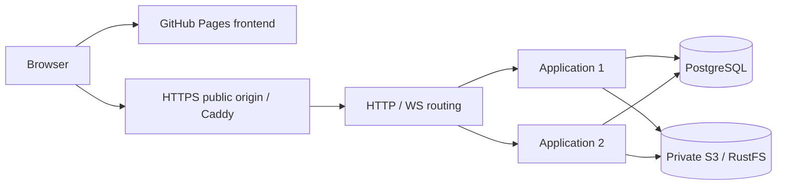

# How to Deploy Open Agricola

[English](HOW_TO_DEPLOY.md) | [中文](HOW_TO_DEPLOY_zh.md)

> 本文件是中文翻译镜像；[HOW_TO_DEPLOY.md](HOW_TO_DEPLOY.md) 是唯一权威版本。

本文档面向想要自行部署 Open Agricola 平台的开发者。

## 架构概览




GitHub Pages 在 `https://open-agricola.titanxxh.com/` 提供生产前端，API 保持 `https://openagapi.titanxxh.com`。两个 HTTPS 子域同站但跨源，保留仅属于 API host 的 HttpOnly 会话，不依赖第三方 Cookie。后端镜像另外包含可选的同源自托管前端。公共卡图和字体仍来自独立素材站。见 ADR 0035。

---

## 本机标准发版

若新请求 header 尚未被线上后端接受，先完成[后端优先的版本重叠流程](#supported-browser-and-backend-overlap)，再发布 Release。`pnpm release` 验证通过后会自动发布，不会等待后端部署。

在 owner 控制的本机准备 Node.js 24.15+（不支持 Node 25）、锁定依赖和已认证的 `gh` CLI，再运行标准发版命令：

```bash
pnpm install --frozen-lockfile
pnpm release vX.Y.Z --ref main
```

正式候选必须是所选仓库受保护 `main` 上某个已合入 PR 的最终集成快照。门禁明确解析 `refs/heads/main`，同名 tag 不能改变选择；同时核对原生仓库/PR 身份与原始 Git 对象可达性。未合入或中间快照在 dispatch、发布、安装候选和 SSH 前被拒绝。main 前进后，合格的旧最终快照仍可使用。独立固定的受保护 main producer P 为候选 C 定义编排；P 的原生 main 身份提供策略授权，双方源码配置哈希仅标识兼容执行。原生治理信任已授权的 override 权限，不证明历史策略；该新增准入策略见 ADR 0037。

命令只解析一次 C 并打印完整 SHA。`verification/candidates/<SHA>` 固定保留为候选源码 lease；已有引用指向其他提交时拒绝且不强制更新。必需任务缺失或失败时，在 main P 上请求 `candidate-verification.yml`。查找原生 run 名称 `stable / <C> / <tasks>` 及其 `Stable manifest` 绑定：仓库 ID、stable 通道、C、C/P 双方配置及 P。run head 是 P，候选 payload 仍是 C。兼容的完整证据可复用，但新的 P/C 尝试未完成、失败或配置不兼容时不能退回历史旧绿。历史回执资格由 [CI 检查](operations/ci-checks.md) 的可信 cutoff 限定。

完整证据通过后，命令才创建版本 tag 和 Release。即使验证期间 `main` 移动，Release 目标仍是固定的 SHA。已有 tag 或 Release 指向其他 SHA 时拒绝；同一 SHA 的已发布 Release 直接复用，不重写 tag，也不重复创建 Release。

某次运行中断后，用打印出的候选 SHA 重试：

```bash
pnpm release vX.Y.Z --ref <full-sha>
```

fork 仓库可传入 `--repository owner/name`，并在该仓库配置候选验证 workflow。默认仓库为 `titanxxh/open-agricola`。`--poll-seconds` 默认 15 秒，`--timeout-seconds` 默认 7200 秒。超时或任务失败时不发布。修改源码后，按需选择新的候选和版本。

标准命令在发布前核验 GitHub run 和 job 证据。通过网页或裸 `gh release create` 创建的 Release 可能尚无这些证据，Pages 与后端部署会各自拒绝未验证的候选。本机 `pnpm release:rehearse` 记录不能替代 GitHub 证据。

## 发布固定预发布候选

owner 验收独立目标前保持 `PRERELEASE_ENTRY_ENABLED=false`。正式 app 需要 `PUBLIC_APP_ORIGIN`、`PUBLIC_API_BASE`、`PRERELEASE_APP_ORIGIN` 及仅目标服务端持有的密钥，两个 Compose 入口均显式传入。正式大厅和设置只向 Beta 账号或管理员显示入口，目标缺失或关闭时明确不可用。应用发布消费新 pin 前，语言源及 packs 必须先发布并通过其独立 CI。

pre start 先建立 host-only HttpOnly verifier/state Cookie，再前往正式站根的 `?page=prerelease-handoff`，fragment 严格包含 `browserChallenge`、`state`、`targetOrigin`、`returnTo`。challenge 与 state 均为43字符base64url值。主站页面清除此片段，复核当前目标和正式根后只签发一次code。仅固定的 pre `/open-agricola/auth/handoff` 回调收到 `protocolVersion=1`、`code`、`state`、`browserChallenge`、`returnTo` fragment。pre 须校验自身state及verifier后服务端兑换。code过期由正式权威时钟在兑换时裁决，浏览器时钟偏差不参与授权。正式凭据留在正式API主机；pre认证及本地会话另行实现和验收。失败时回正式站根重新发起。

预发布使用独立通道。`prerelease` 日常 push 和 PR 运行 canonical routine plan，不自动部署。完整候选验证由可信 `main` 手动编排；候选任务只有仓库读取权限，不取得正式部署凭据。回执身份使用 VERIFICATION_CHANNEL=prerelease，普通回归命令使用正式运行默认值，预发布专用测试显式选择 prerelease。生产构建任务以 RELEASE_CHANNEL=prerelease 运行 build:hosted-frontend，包含正常类型检查及 Vite 构建。

选择候选前先同步当前 main，并在候选树维护 `prerelease-integration.json`：

```json
{
  "format": 1,
  "repository": "titanxxh/open-agricola",
  "baselineMainSha": "<full-main-sha>",
  "features": [
    { "id": "feature-name", "dependsOn": [], "sourceSha": "<source-commit>", "integratedSha": "<replayed-feature-commit>" }
  ]
}
```

各 SHA 均为完整提交身份。清单提交位于功能提交之后，`integratedSha` 指向实际集成功能提交。独立功能保留来源，以便只晋升选定功能。依赖必须指向清单中已有功能且不能成环；候选须继承 main 基线且无 merge commit。

owner 同步 main 时以 `rebase.updateRefs=false` 准备并审阅 rebase 结果，再更新清单基线与集成提交。同步前须取得该精确 head 由 `pull_request` 或 `push` 事件产生的成功 `verify`。即使通过，GitHub 也不会用 `workflow_dispatch` 的检查满足原生 required-status 规则，见 [GitHub 必需检查事件说明](https://docs.github.com/en/pull-requests/how-tos/merge-and-close-pull-requests/troubleshooting-required-status-checks#checks-from-some-workflow-jobs-are-not-evaluated)。按当前 workflow 触发条件，从同步分支向当前 main 建立 draft 对比 PR，明确标注仅作同步审阅，等待检查通过。不要将此 PR 合入 main。然后执行：

```bash
pnpm exec tsx scripts/ci/prerelease-verification.ts sync --repository titanxxh/open-agricola --sha <new-pre-sha> --expected-old <old-pre-sha> --main-sha <current-main-sha>
```

命令只以显式旧 SHA lease 更新 `refs/heads/prerelease`。远端已变化或功能来源集合发生增减时拒绝；新增和移除功能须经过可审阅 PR。命令不更新 main、固定候选引用或 tag。读回新引用、等待此次 prerelease push CI 后，关闭 draft 对比 PR，不执行合入。同步产生新 SHA 后须重新取得候选验证。

owner 本机发布与恢复命令为：

```bash
pnpm release vX.Y.Z-beta.N --channel prerelease --ref prerelease
# 失败后沿用已打印的固定候选，即使 prerelease 已前进：
pnpm release vX.Y.Z-beta.N --channel prerelease --ref <fixed-pre-sha>
```

N 从 1 开始。首次选择要求候选等于真实集成 ref 且清单以当前 main 为基线。命令固定 `verification/prerelease/<SHA>`，读取有效原生引用保护，然后在 main 派发 `prerelease-candidate-verification.yml`。回执绑定原生仓库 ID、prerelease 通道、候选 SHA、候选与可信策略配置以及 main producer 提交。producer 必须仍可从受保护 main 到达。兼容任务可分别补跑；缺失、失败、取消、跳过或配置不符均阻断。集成分支移动后仍可使用原固定候选。

所有必需任务通过后创建固定 tag 及原生 GitHub prerelease，并设置 latest=false。匹配的已有发布可复用；tag、SHA 或原生通道不符时拒绝。正式通道继续要求实际已合入 main 的最终 PR 快照，且版本只接受 vX.Y.Z；预发布回执不能授权正式发布。

配套 hosted 镜像使用 `GAME_BUILD_ID=<fixed-pre-sha>` 及 Docker build argument `RELEASE_CHANNEL=prerelease`，构建与运行通道相同。前端描述记录 releaseChannel 和 deploymentTarget=prerelease-hosted，镜像 label 记录 revision 和通道。正式产物使用 stable-hosted 或 stable-pages。预发布 Pages 构建在执行 builder 前拒绝，hosted 启动拒绝通道不匹配；旧版描述只允许正式运行。正式 Compose 固定 stable。安装时仍须核对完整候选回执及实际独立目标。

原生 prerelease published 事件不能授权正式 Pages。请求工作流排除 prerelease，main broker 还会独立读取原生已发布 Release 和未移动 tag 后才安装。发布、安装和现场验收分别记录；原生保护、资源初装、部署及开放入口由 [PRD #1655](https://github.com/titanxxh/open-agricola/issues/1655) 中 owner 票验收。

### 操作隔离的预发布目标

使用可信 main checkout、Node 24.15+、Docker Compose、Buildx、GNU `timeout`/`flock`/`tar` 及按 pin 准备的语言包。owner 入口为 `deploy-prerelease.sh`；GitHub Actions 不持有 SSH 或正式凭据。从 `deploy/prerelease-target.example.json`、`prerelease-app.env.example`、`prerelease-tools.env.example` 建立私有配置，替换全部示例值。目标指纹绑定数据库 host/port/name/role、对象 endpoint/bucket/prefix/key ID、project、目录、origin、依赖网络与可选代理网络、离站身份、builder 和预算。env 仅接受模板使用的小型凭据白名单；正式 GitHub App、OAuth、邮件、管理员 Cookie 等均拒绝。可写目录、挂载及其现存子项不能有软链或特殊文件。

owner #1662 负责独立源库、只读备份 role、独立一次性验证库/role、私有 bucket、app 的 `live/` 与工具的 `test/` 权限、依赖网络、1–40 的连接数限制、存储 quota、离站账户/目录及可用的受限 builder。撤销 PUBLIC CONNECT，使三个 pre role 均不能连接正式库、验证 role 不能连接源库。app 对象凭据必须不能读取正式 bucket 或验证 scratch；工具只获得源数据读取及自己的 scratch 操作权限。安装前真实权限探测不通过则阻断。`budget-check` 测量本地、数据库和对象字节数及主机余量，超额会关闭入口；它补充 owner 的 quota，不创建宿主 quota。

builder 必须是运行中的非 privileged rootless BuildKit 容器，用户 `1000:1000`，标签 `org.open-agricola.environment=<targetId>`，读回的 CPU、内存、PID 限额不超过清单。只允许在 `/home/user/.local/share/buildkit` 挂载自己的状态 volume。指定 Buildx **remote** driver 的 endpoint 为 `docker-container://<builder.container>`，见 [Docker 文档](https://docs.docker.com/build/builders/drivers/remote/)。#1668 前 owner 必须在实际宿主完成受限真实构建。本次本机 rootless daemon 因 Ubuntu 用户命名空间限制启动失败，没有改宿主策略或使用 privileged 回退；命令 harness 通过不能证明 builder 或部署可用。

若 Caddy 在容器内运行，将可选 `proxyNetwork` 设为它现有的入口网络，例如 `open-agricola_default`，并安装 `deploy/prerelease.Caddyfile.example` 的固定路由。只有可信网关加入该外部网络，使用从 origin 派生的别名和容器端口 `5176`。Caddy 路由使用 `plan` 输出的 `proxyUpstream`；Caddy 容器里的 `127.0.0.1` 指向 Caddy 自己。候选 app 继续只接自己的 default/依赖网络，工具只接依赖网络。网关只连接候选 default 网络的 `<targetId>-app:5175` 别名，不使用共享的 `app` 服务名。替换恢复时内部别名随 target 改变，外部网关别名保持不变。选择入口网络，不能选择正式存储网络。解析器拒绝将 pre 依赖/default 网络或 Docker 内置网络作为代理网络。Compose 重建会保留网关网络和别名。替换恢复保留 origin 和别名，只有源网关退役并停止后才启动新网关。若 Caddy 直接运行在宿主上，省略 `proxyNetwork` 并转发到 `127.0.0.1:<target.port>`；两种模式均保留 loopback 绑定。初装前确定这一密封拓扑。

正式生命周期 API 尚未部署时，先记录一个 UUID，再启动维护网关。先准备两个私有凭据文件和固定语言包；`plan` 即使带 `--ssh` 也验证本机路径，因此要在持有这些文件的宿主执行。预算必须固定为最终计划值，不能为维护初装临时调小：

```bash
./deploy-prerelease.sh plan --config "$pre_config"
./deploy-prerelease.sh initialize --config "$pre_config" --expected-current empty --generation "$pre_generation"
./deploy-prerelease.sh status --config "$pre_config" --expected-current empty
```

此阶段不需要正式回执，只启动 64 MiB 网关，不检查完整候选容量或原生存储权限。公网 HTTPS 必须显示固定语言包的双语维护页；#1662 资源准备期间正式 `PRERELEASE_ENTRY_ENABLED=false`。#1668 正式安装时，完成 target 配置后才为私有验收启用该 flag；代次准入和公网网关仍分别保持关闭，直到显式门禁通过。日常关闭/开放使用生命周期动作，无需重启正式 app。loopback 网关端口和依赖网络不能绕过 owner 控制的代理/宿主暴露。后续动作必须提供 `--expected-current <完整已装SHA|empty>`；deploy/reset/restore 重试保持相同操作 UUID。原子状态在 `<target>/control/gate.json`，失败保留维护态和阶段。所有 pre 定时任务通过 owner CLI 串行执行，不直接调用旧 shell 入口。除 `plan` 外的操作远程执行可加 `--ssh <owner-host>`；接收 checkout 必须有相同策略 SHA，回执/证据文件路径位于执行主机。文件另外传输，正式 Cookie 绝不进入候选目录。

网关只接纳规范的 `/ws` 和 `/nodes/<instance-id>/ws` WebSocket 目标；instance ID 仅含字母、数字和连字符，查询参数原样转发。按实例路由的升级请求与直接升级请求使用相同的 Host、Origin、正式策略租约及 owner 权限检查。

升级在迁移前记录来源镜像 digest。未验收的 startup 重试只在来源容器已于固定 Compose project 内干净停止时识别该精确镜像，绝不重启来源。来源身份缺失、镜像或 project 不同、来源仍在运行或未干净停止时，继续保持维护关闭。

正式 authority 安装后，在可信 owner 机器使用 `scripts/prerelease/authority.ts`。`--cookie-file` 是所有候选挂载之外、0600 的正式管理员会话文件。工具只向固定正式 HTTPS API 和 Origin 发请求，不跟随重定向。每个 authority 动作使用自己稳定的 `--operation-id` UUID 及 `--output <private.json>`。首次 prepare 的 `--previous-generation null`，以后填已验证 retire 的代次。先登记规划代次，再关闭新交接/兑换：

```bash
node --import tsx scripts/prerelease/authority.ts prepare --config "$pre_config" --cookie-file "$pre_cookie" --generation "$pre_generation" --operation-id "$prepare_op" --previous-generation null --output prepare.json
node --import tsx scripts/prerelease/authority.ts close --config "$pre_config" --cookie-file "$pre_cookie" --generation "$pre_generation" --operation-id "$close_op" --output close.json
./deploy-prerelease.sh deploy --config "$pre_config" --expected-current "$pre_current" --sha "$pre_sha" --generation "$pre_generation" --operation-id "$pre_op" --authority-receipt close.json
```

deploy 独立检查固定 SHA、同通道的完整 GitHub 回执，只归档 tracked 候选源码，构建配对 hosted 镜像，核对前端元数据及 OCI revision/channel，固定不可变 image ID。随后关闭网关、优雅停写并等待已确认提交、完成配对变更前备份和隔离恢复验证、检查源/工具权限、用候选迁移并验证保留数据、核对实际启动身份，最后停在 `acceptance`，公网仍关闭。迁移后不自动重启旧镜像。修复原因后恢复同一操作；干净 drain 失败需先调查。close 回执超过十分钟时重新执行独立 close 动作，部署 UUID 不变。日常操作不重载 Caddy、不重启正式 app 或共享存储。

候选必须提供真实 SQL view `prerelease_retained_identity_refs(user_id,source_grant_id)`，覆盖全部外部主体，包括仅存于房间/历史中的引用，并实现 `scripts/prerelease/identity-audit.ts apply <packet.json>`。adapter 删除/匿名化已删除主体，将每个保留活跃引用映射到返回的当前代次 `associationId`，不恢复会话或登录权。该持久化/清理实现由 #1663/#1667 负责；main 没有空 stub，缺 view/adapter 阻断开放。owner 读取真实行，拒绝遗漏、null 或无来源绑定，按二进制/C 顺序对 ASCII pair 去重排序并哈希共享 canonical JSON。正式 associate 校验旧来源，创建无 source、已撤销的关联，确保恢复后仍接收未来删除。

```bash
./deploy-prerelease.sh identities --config "$pre_config" --expected-current "$pre_sha"
node --import tsx scripts/prerelease/authority.ts associate --config "$pre_config" --cookie-file "$pre_cookie" --generation "$pre_generation" --operation-id "$associate_op" --manifest "$identity_manifest" --output associations.json
./deploy-prerelease.sh apply-identities --config "$pre_config" --expected-current "$pre_sha" --associations associations.json
node --import tsx scripts/prerelease/authority.ts audit-complete --config "$pre_config" --cookie-file "$pre_cookie" --generation "$pre_generation" --operation-id "$audit_op" --verification "$native_verification" --output audit.json
node --import tsx scripts/prerelease/authority.ts activate --config "$pre_config" --cookie-file "$pre_cookie" --generation "$pre_generation" --operation-id "$activate_op" --audit audit.json --output activate.json
```

使用 identities/apply-identities 打印的实际产物路径。空安装也必须有真实空 view 并完成 `[]` 审计。completion 和 activate 重查当前正式账户/删除事实；activate 必须在 completion 后 30 秒内完成。close 使旧审计失效。文件存在不代表完成真实恢复或清理。

#1668 在公网维护期间，用私有 owner 浏览器验收：

```bash
./deploy-prerelease.sh verify-access --config "$pre_config" --expected-current "$pre_sha"
node --import tsx scripts/prerelease/owner-browser.ts "$pre_config" "$verification_token_file" "$private_owner_profile"
```

pre 可以使用 `https://pre.titanxxh.com`，保留正式 Pages/API 地址；必须与两者使用不同 hostname，换端口不能代替主机隔离。仅维护页的 bootstrap 可以早于正式升级。服务候选代码，包括私有 owner 验收，要求运行中的正式浏览器认证策略为 version 2。先部署匹配的正式前后端保护并完成旧会话迁移。owner 生命周期 CLI 只接受新的 `__Host-oa-session` Cookie 文件并发送浏览器协议头；迁移后重新登录取得 owner Cookie。

网关只接受声明的 `__Host-oa-pre-session`、`__Host-oa-pre-handoff` 候选 Cookie，要求 Secure、HttpOnly、Path=/、SameSite=Lax 且没有 Domain。它移除其他候选 Cookie、Clear-Site-Data、入站 Authorization 和未声明的身份头；owner 验收 Cookie 不传给候选。HTTP 拒绝其他 Origin 及没有精确 pre Origin 的不安全方法；WS 要求精确 pre Origin 和 `/ws`。候选身份和房间权限仍由 app 负责。迁移、捕获和存储策略工具只取得数据凭据，不取得 target identity service key。同父域仍共享部分浏览器容量限制，不能承诺独立站点级的 Cookie 可用性隔离。

helper 将本地 token POST 到固定 HTTPS 网关，不放进 URL。网关的十分钟 Secure/HttpOnly/host-only Cookie 绑定 build/代次，在转发 HTTP/WS 给候选前剥离；普通浏览器仍为 503。私有浏览器执行正常正式登录和真实 pre 准入，profile 不能挂载给候选。只有候选实现完整流程后，现场才能取得身份/Beta、HTTP/WS、公开卡、Viewer、保留对局/撤回、删除、容量和正式不受影响的真实证据。复制 `deploy/prerelease-acceptance.example.json`，填写精确操作/build/image/代次/指纹、当前毫秒时间 `acceptedAt`、非空证据文件路径和 SHA256；验收三十分钟过期。

增加实际部署的正式前端/API 与同父域浏览器测试的 `browser-boundary` 证据，并采集独立的 `formal-browser-policy` 产物：

```bash
./deploy-prerelease.sh verify-formal-browser --config "$pre_config" --expected-current "$pre_sha"
```

把打印的路径与 SHA256 写入 acceptance evidence。产物绑定 pre target/build/generation/operation、实际正式策略及 Pages 的 build marker、HTML 和模块入口字节。open 不带凭据、不跟随重定向，重新读取这些 HTTPS 地址，拒绝已变更或过期的证据。源码、配置开关或已合入 main 不能代替实际部署核对。

浏览器验收后关闭 authority、执行 maintain，再恢复同一 deploy 操作使候选在关闭状态重启。该过程撤销私有入口并 drain 已确认命令。重新扫描/应用身份，紧接着完成新 audit/activate，再开放：

```bash
./deploy-prerelease.sh open --config "$pre_config" --expected-current "$pre_sha" --sha "$pre_sha" --authority-receipt activate.json --audit audit.json --verification "$native_verification" --acceptance acceptance.json
```

open 重扫 native view，核对 completion/activation 绑定、证据哈希及运行身份，仅原子开放该已验收候选；health 不会自动开放。正式入口 flag 仍由 owner 独立激活，也不能绕过代次准入和维护态。

可信网关每十秒读取固定的正式策略接口，确认期限不超过请求开始后三十秒。能力缺失、不兼容或过期时，关闭候选 HTTP/WS 及已有连接。开放状态还绑定已验收的正式 build；正式发布 SHA 改变后，pre 关闭直至重新验收。无需重建、迁移或替换 pre 数据代次，先取得新 authority close 回执再执行：

```bash
./deploy-prerelease.sh reverify --config "$pre_config" --expected-current "$pre_sha" --operation-id "$pre_op" --authority-receipt close.json
./deploy-prerelease.sh verify-formal-browser --config "$pre_config" --expected-current "$pre_sha"
```

使用新的操作 UUID。reverify 关闭公网、撤销私有 owner 入口，保留已安装 app 并创建 acceptance 操作；重试使用同一 UUID。重新执行私有浏览器验收、上述原生身份 audit/activate，绑定新操作生成 acceptance 文件后 open。该过程不重装 pre、不重置对局。计划回滚到没有新认证保护的正式版本时，必须先关闭 pre ingress 与正式 handoff，再回滚；不能以三十秒能力确认窗口容忍不安全回滚。

每日 backup 在线捕获已安装的来源，包括网关开放且没有待处理操作的状态，绝不停 app。捕获与账本操作使用独立的 stable 工具镜像，经相同的受限 rootless builder 从固定可信 main 策略 SHA 构建。工具 digest、revision 和 channel 均经核对，并缓存在 `control/`。工具来源与归档来源分开记录：配对清单取实际来源安装的 SHA 和原捕获时间，不使用工具镜像 SHA 或候选提供的元数据。无需增加 target 配置；缺少可信 owner 上下文时拒绝执行。

候选验证和迁移只取得所选归档、账本或身份 packet 的只读挂载，不能写宿主备份根目录或 owner 私有的 report/seal 目录。候选 scratch 记录保存在独立私有 run 目录，可信清理仍核对原期限及数据库/对象归属。原生 PostgreSQL 连接文件和恢复列表写入归档输入之外的私有临时目录。宿主独占创建 report，拒绝链接或非私有父目录。

配对清单绑定归档/配置哈希和大小、源/目标 SHA、代次、指纹及实际隔离恢复验证。本地和离站副本最多保留七天，独立删除账本另行保留。工具保留原 CPU/内存/PID 限额、原 deadline、run/environment 标签和定域清理。引入 pre 任务前必须升级正式备份脚本，防止旧全局 reaper 清理 pre 工具。通过 CLI 定时执行 budget-check 和每日 retention；retention 在关闭通道后无需 app 凭据或 Docker 仍可执行。离站另装 `offsite-retention.sh <独占pre目录> 7`，确保 app 宿主失联仍遵守期限。

兼容回退仍用 deploy，明确选择经过验证的旧 SHA，并重新经过备份、目标数据验证和验收。当前保留数据不能通过时留在维护态，选择 reset 或隔离恢复；换镜像不能撤销 schema 或已确认写入。reset 前取得 close 回执，运行 `reset --expected-current <SHA> --accept-loss <当前代次> --operation-id <UUID> --authority-receipt close.json`。它先备份并离站同步、合并最新独立删除账本，再验证停写后的真实库/prefix 清空，输出绑定源 build/代次/账本哈希的 `purge-<操作>.json`。authority retire 使用 `--purge <产物>` 及同一 purge 操作 UUID。最终关闭再执行 `finish-close --authority-receipt <retire.json>`；只有不可变 retirement 回执存在后才能移除正式 target 配置，在此之前保留 source cleanup/status/ack。复用资源时先以 `--previous-generation <旧UUID>` prepare 新 UUID，再 `reinitialize --generation <新UUID> --retirement-receipt <retire.json> --authority-receipt <prepare.json>`，重新部署。旧 retire 重试不会关闭新代次。

恢复时 owner 显式选择 `--backup <stem> --backup-generation <UUID>`，以 `--accept-loss <源当前代次>` 接受恢复点之后进度丢失。使用 `restore --config <全新replacement.json> --source-config <old.json> --expected-current empty --expected-source-current <old-SHA> --sha <已验证目标SHA> --generation <新UUID> --operation-id <UUID> --authority-receipt <old-close.json> ...`。replacement 的目录/project、源/验证库、role、bucket 必须独立，固定公网 origin/port 相同。工具先校验配对文件及七天期限，再安全解包纯数据，绝不安装归档凭据；使用当前独立账本，实际隔离验证目标并真实恢复。重试只清理尚未验收的 replacement，保留旧 source。关闭状态启动成功后，对旧 target purge/retire/finish-close，再 prepare replacement 代次，执行 `activate-recovery --source-config <old.json> --expected-current <new-SHA> --expected-source-current <old-SHA> --retirement-receipt <retire.json>`，只切换固定维护网关。完成全套真实身份审计和验收才开放。不能清理全宿主或复用正式资源。七天归档期限届满后，owner 仅可删除清单中的已退休 project 资源，保留 retirement 回执及独立删除账本。


恢复解包目录是可重新生成的缓存。解包前，owner 在独立保留期文件中固定操作、代次、target 指纹、归档哈希和原捕获时间。原生临时文件和重试不能刷新七天期限。startup 检查点持久化后清除缓存，startup 和 acceptance 重试会重复执行幂等清理。retention 只在固定 target 的备份目录内清理过期或缺少证明的缓存，保留尚有效的重试、其他 target 指纹及独立删除账本。
## 核验生产修复并重试站内信

正式 Release 发布且前后端部署完成后，在 owner 控制的本机运行：

```bash
pnpm exec tsx scripts/release/verify-feedback-deployment.ts vX.Y.Z \
  --host ubuntu@ten-kr --remote-dir /home/ubuntu/open-agricola \
  --frontend https://open-agricola.titanxxh.com/ \
  --receipt /path/to/private/feedback-vX.Y.Z.json
```

工具读取固定仓库的正式 Release 与准确 tag SHA，通过现有 `checkCandidateVerification` 核对同 SHA 的完整 GitHub 回执，再读取实际服务的 `frontend-build.json`。它复用 owner SSH，读取运行中 Compose app 容器的 `GAME_BUILD_ID`、健康状态和实时 readiness 响应。所有构建身份必须等于 Release SHA。非根路径前端还需传 `--base-path /expected/path/`，且 `--frontend` 必须使用完全相同的路径。

调用运行中容器内的 `BugReportFeedbackService` 前，工具先保存 mode-600 私有回执。回执保留原操作 ID、不可变核验证据和逐个 SHA 校验的完整原始 Git 祖先集合。本机仓库必须完整且不是 shallow clone。祖先遍历忽略 replace refs 和 grafts，晚到的确认结论或修复关联可复用该证据，无需再次部署。只有全部必需合入提交及每个 PR 的实际合入末提交均在集合中，修复才满足上线条件。反馈服务同时处理账号删除隔离，并按账号和稳定根修复去重。

JSON 结果分别报告 `release`、`deployment`、`verification` 和 `notification`。服务结果中的 `sentMessages` 记录本次新增信件数，`pendingFixes` 列出尚缺必需提交的根修复；这些修复继续等待后续核验。`deployment: "observed"` 表示读取了已有部署。工具不会创建 Release、dispatch 验证、部署前后端、更新 What's New 或扩大 Bug Report App 权限。Release 不合格、验证不全、前端不可读、后端停止或未就绪、构建不一致、tag 移动时均在通知前停止。通知失败退出码为 2，成功的部署观测与原回执仍然保留。

SSH 响应丢失或数据库失败后，用原回执只重试通知：

```bash
pnpm exec tsx scripts/release/verify-feedback-deployment.ts \
  --host ubuntu@ten-kr --remote-dir /home/ubuntu/open-agricola \
  --retry /path/to/private/feedback-vX.Y.Z.json
```

查看持久化的待处理操作，包括晚到结论或修复关联排队的补齐操作；也可在没有本地回执时按 ID 重试：

```bash
pnpm exec tsx scripts/release/verify-feedback-deployment.ts --host ubuntu@ten-kr --status operations
pnpm exec tsx scripts/release/verify-feedback-deployment.ts --host ubuntu@ten-kr --retry-operation <operation-id>
```

回执绑定核验时的 SSH host 和远端目录。重试未传目标时使用原目标，显式传入不一致目标会在 SSH 前被拒绝。重试保留原操作身份和已存证据，不重复创建 Release、请求候选验证、部署或读取生产构建。保留回执至操作完成。重复核验、重试和晚到重复关联不会为同账号同根修复再发一封信。已有消息和已读时间保持不变。


登记修复关联时，维护者必须填写具体修复摘要，说明改变了什么；空白或仅“已修复”等状态词会被拒绝。摘要与完整 PR/提交集合共同形成根修复修订。新上线信将摘要原文固定在消息中，根修复后来修订也不改写旧信或重复发信。升级前没有摘要的根修复返回 `missing_fix_summary`，补充摘要后可复用已有正式核验证据，无需重新部署；历史已发空摘要消息保留原貌。

## 预览并执行十二条历史报告反馈

此操作独立于发布、部署、迁移和启动。从 owner 本机通过既有 SSH 连接在运行中的 app 容器执行，使用其数据库环境及已完成的迁移。核对主机和目录，并将 `ADMINISTRATOR_SITE_ID` 替换为当前管理员的准确站点 ID。审阅输入和输出文件都留在本机。owner 命令不会迁移、部署、新建 issue 或改写 GitHub 报告。先按上一节保留正式生产核验证据；没有包含修复的已核验部署时，可发送处理结论，上线通知继续等待。

准备私有且经过审阅的 JSON 文件。空对象 `{}` 使用已有报告映射，并因缺少维护者说明跳过 #1595。只有审阅过具体的非缺陷或体验建议理由后，才提供 `explanation1595`；仅写“无效”或“体验建议”不够。固定 allowlist 为 #1464、#1465、#1479、#1490、#1504、#1564、#1574、#1586、#1591、#1595、#1622、#1637。

```bash
umask 077
ssh ubuntu@ten-kr \
  'cd /home/ubuntu/open-agricola && docker compose --env-file .env -f docker-compose.prod.yml exec -T app node --import tsx server/bug-report/historical-feedback-cli.ts' \
  < /private/reviewed-feedback.json > /private/feedback-preview.json
ssh ubuntu@ten-kr \
  'cd /home/ubuntu/open-agricola && docker compose --env-file .env -f docker-compose.prod.yml exec -T app node --import tsx server/bug-report/historical-feedback-cli.ts --execute --actor=ADMINISTRATOR_SITE_ID' \
  < /private/reviewed-feedback.json > /private/feedback-result.json
```


输入、预览和结果可能包含站点身份，使用 mode 600 保存。默认只预览。预览先开启 PostgreSQL 只读事务，再逐项显示接收映射、完整结论及上线文案、缺失项、合入修复证据、版本来源、去重结果和跳过原因。逐项审阅后再显式执行。`projectedMessages` 不是发送回执。

原映射确实缺失时，可提供 `imports` 条目，字段为 `issueNumber`、原 marker 的 `submissionId`、审阅过的 `reporterSiteId`、已有 `roomId`、原公开 issue 完整正文的 SHA-256 `bodySha256`，以及非空 `auditReference`。与已审阅的 #1652 审计和固定项目的原 issue 核对，并将文件保留在 Git 外。导入只创建通知对象，但仍承担原有 GitHub 公开站点 ID 的账号删除匿名化义务。既有 App 核对准确 issue、唯一 marker 和映射版本，完成全部公开匿名化后才清除本地映射；远端失败或证据冲突时保留删除等待状态，可信删除事件沿用既有 tombstone 语义。可编辑的公开座位或 Anchor 不会授予原生报告、Replay、取证、保留或 Room 权限。已有匿名化、删除中、歧义或冲突映射不能靠旧 issue 正文恢复。缺少 Game Context 或公开证据冲突时逐项跳过。

执行跳过已有处理历史，不覆盖后来的结论；先确认，再发送上线反馈。复用日常账号/根修复唯一键，持久 reconciliation 限定已审阅对象和准确修复版本。`newMessages` 是本次已提交的 `insertedTriages` 与 `releasedMessages` 之和，不计并发发送者的信件。`errors` 列出部分失败，`reconciliation.operations` 保留持久操作 ID 和待核验或通知失败详情。四条历史修复提供已审阅的具体摘要；已有根修复的维护者摘要优先，预览与实际信件均显示该原文。历史首次包含版本来自审计，与首次核验生产版本及观测时间分开。

中断后重新预览，再用同一审阅输入执行 `--execute`。已发送信件和已读状态保持不变。通知事务仍 pending 时，在 owner 本机运行 `pnpm exec tsx scripts/release/verify-feedback-deployment.ts --host ubuntu@ten-kr --remote-dir /home/ubuntu/open-agricola --retry-operation OPERATION_ID`，将 `OPERATION_ID` 替换为保存的操作 ID，仅重试该通知操作。持久对象/修复校验阻止重试更换接收人或发送不同修复。遇到 `historical_subject_changed` 时重新审阅预览，不绕过校验，也不重做 Release 或部署。齐备的隔离 fixture 首次产生 16 封，重跑新增 0；实际操作逐项报告跳过，包括默认缺少 #1595 说明。

## 一、部署后端

后端部署分两种情况：
- **情况 A**：全新 VPS，只有公网 IP，没有域名
- **情况 B**：有域名 + 已有 HTTPS（Nginx + Let's Encrypt / Certbot）

两种情况都需要先完成基础步骤。

### 1. 基础步骤（两种情况通用）

准备 Node.js 24.15+（不支持 Node 25）、pnpm、Docker Compose、Git。生产 Compose 在同一台机器的 app 容器内启动两个独立应用进程，通过公开 HTTP/WS 路由进程接入，共享 PostgreSQL 18 和 RustFS。生产配置固定 `APP_INSTANCES=2`，即使 `.env` 中保留本地开发的 `1` 也会启动两个。无需申请外部服务。本地开发仍默认一个应用进程，使用 `./restart-local.sh --instances 2` 即可在本机验证相同的双进程路由。

旧 SQLite 单实例的性能报告仅是历史基线；继续保留应用的既有容量上限，不把这些数字当作 PostgreSQL、双实例或高可用认证。本次只验正常功能和重启，不做故障注入或恢复计时。

```bash
git clone https://github.com/YOUR_USER/open-agricola.git
cd open-agricola
pnpm install --frozen-lockfile
cp .env.example .env
```

生产镜像同时保留冻结安装时使用的原始 `pnpm-lock.yaml`。工坊沙盒标识将它与部署源码和运行时版本一起计算摘要；缺少锁文件会使契约加载失败，不会静默忽略依赖变动。同源前端在裁剪生产依赖前构建，复制到 `/app/frontend-dist`，镜像将 `FRONTEND_ROOT` 设置为这个目录。

设置 `.env` 中原有 `PUBLIC_API_BASE`、`PUBLIC_APP_ORIGIN`、`CORS_ORIGIN` 和账号/OAuth 参数；已有 callback 不改。把 `DATABASE_URL` 与 `S3_*` 连接组留空即使用本机服务。配置外部 S3 时需要完整 endpoint、region、bucket、access key 和 secret，桶必须私有。

```bash
node --env-file=.env scripts/local-services.mjs
GAME_BUILD_ID="$(git rev-parse HEAD)" docker compose -f docker-compose.prod.yml build app
```

依赖使用独立持久卷，生成凭据保存在 mode-600 的 `data/local-services.env`；主机工具使用 `data/dependencies.local`，容器使用 `data/dependencies.compose.env`。应用重建不清空数据库或资源。镜像包含 PostgreSQL 18 原生客户端和一个不可变 Viewer，启动时校验并上传到 S3。所有正式 Room 强制录制，资源不齐时拒绝开局。

#### 首次 SQLite 迁移

导入器只接受当前发布的 SQLite 结构（版本 33）。旧结构的逐级升级链已退役；切换存储前应先用当前 `main` 版本导出。源数据以只读方式打开，并保留到目标验证成功。

先停止旧应用，再复制它的数据目录。源目录挂载为只读，导入目标必须为空；禁止把旧卷覆盖为空数据库。下面的 `legacy-data` 必须包含原数据库、卡图、Replay 资源、Viewer 和 JSONL 删除 ledger。

```bash
docker compose -f docker-compose.prod.yml stop app
mkdir -p legacy-data backups
chmod 700 legacy-data backups
docker cp "$(docker compose -f docker-compose.prod.yml ps -aq app):/app/data/." legacy-data/
docker compose -f docker-compose.prod.yml run --rm --no-deps \
  -v "$PWD/legacy-data:/legacy:ro" -v "$PWD/backups:/backup" app \
  node --import tsx scripts/import-sqlite.ts /legacy /backup/sqlite-import.json --applications-stopped
```

导入校验原始行值、恢复文本、Replay 字节/hash、Room-owned 恢复及资源引用。只丢弃已证实未录制的活动局，不补造历史；账号、工坊、录制局、结果和被引用资源保留。失败会留下启动屏障，继续处理该导入，不删除无关数据。全新安装无需旧库复制和导入，只执行下面的目标库校验。

```bash
docker compose -f docker-compose.prod.yml run --rm --no-deps app \
  node --import tsx scripts/storage-archive-cli.ts check-live "$(git rev-parse HEAD)" --applications-stopped
mkdir -p data
touch data/postgres-cutover.validated
# Configure deploy/Caddyfile using the existing public backend domain first.
docker compose -f docker-compose.prod.yml up -d --no-build --wait app caddy
```

开发环境同样使用 `scripts/import-sqlite.ts`，加载 `data/dependencies.local` 后指向只读旧目录，再运行 `./restart-local.sh`。历史源数据应保留到目标版本验证完成。

公开 API origin 保持不变。浏览器先通过 API 查询 Room 目录，再通过其 `/nodes/<instanceId>/ws` 连接 owner；私有实例端口不开放到公网。默认 Compose 本地入口只绑定 loopback。Caddy 生产入口继续支持现有 443/8443，OAuth callback、cookie 和跨域配置沿用现有值。

Bug Report GitHub App、Workshop PR 和账号 OAuth 都仍是可选集成；配置表和独立 OAuth 文档保留它们的权限与回调要求。迁移 PostgreSQL/S3 不要求重新授权第三方账号。

---

### 情况 A：全新 VPS，只有公网 IP，没有域名

> 适用于：刚买的 VPS，没有域名，想用最简单的方式让后端跑起来。

#### 方案 A1：纯 HTTP（仅限测试，前端也需 HTTP）

最简单的方式。缺点：**GitHub Pages 是 HTTPS，无法直接连接 HTTP 后端**（浏览器会拦截混合内容）。所以前端也必须用 HTTP 方式部署（不用 GitHub Pages，用 VPS 自身提供静态文件）。

**步骤：**

1. 编辑 `.env`：

   ```env
   CORS_ORIGIN=*
   ```

2. 修改 `docker-compose.yml`，在 app 容器中挂载前端构建产物：

   ```bash
   # 本地构建前端（指向 VPS 公网 IP）
   VITE_API_BASE=http://YOUR_VPS_IP:5175 pnpm run build
   ```

3. 把 `dist/` 目录上传到 VPS，然后用简单 HTTP 服务器托管：

   ```bash
   # 在 VPS 上
   cd dist
   python3 -m http.server 8080 &
   ```

4. 访问 `http://YOUR_VPS_IP:8080`

5. WebSocket 地址：`ws://YOUR_VPS_IP:5175/ws`

> ⚠️ 此方案不安全（明文传输密码），仅用于本地测试或内网。

#### 方案 A2：Caddy 自签 / IP 直连 + 自动 HTTPS（推荐，需要域名）

如果你有域名（即使是免费的），Caddy 可以自动申请 Let's Encrypt 证书，零配置 HTTPS。

**获取免费域名（可选）：**

- [DuckDNS](https://www.duckdns.org/) — 免费子域名，如 `your-game.duckdns.org`
- [No-IP](https://www.noip.com/) — 免费 DDNS
- [FreeDNS](https://freedns.afraid.org/) — 免费子域名

**步骤：**

1. 把域名 DNS A 记录指向你的 VPS IP

2. 创建 `deploy/Caddyfile`：

   ```
   your-game.duckdns.org {
       reverse_proxy app:5175
   }
   ```

3. 使用仓库中的 `docker-compose.prod.yml`，保留完整 PostgreSQL/S3、OAuth 和入口配置。

4. 启动：

   ```bash
   docker compose -f docker-compose.prod.yml up -d --build
   ```

5. 验证：

   ```bash
   curl https://your-game.duckdns.org/api/health
   ```

6. 前端 `VITE_API_BASE` 设为 `https://your-game.duckdns.org`

> Caddy 会自动申请和续期 Let's Encrypt 证书，你无需手动管理。

---

### 情况 B：已有域名 + HTTPS（Nginx + Let's Encrypt）

> 适用于：VPS 上已经跑了 Nginx，已通过 Certbot 配了 HTTPS 证书。

这种情况最简单——Docker 只暴露 HTTP 端口，Nginx 做反向代理 + TLS 终止。

**步骤：**

1. 编辑 `.env`：

   ```env
   CORS_ORIGIN=https://YOUR_USER.github.io
   ```

2. 确保 `docker-compose.yml` 端口映射绑定到 `127.0.0.1`（仅本地可访问）：

   ```yaml
   ports:
     - "127.0.0.1:5175:5175"
   ```

3. 启动 Docker：

   ```bash
   docker compose up -d --build
   ```

4. 为后端 API 添加一个 Nginx server block 或 location。

   因为下面配置会覆盖 `X-Forwarded-For`，同时在后端 `.env` 设置 `REPLAY_TRUST_PROXY=true`。

   **方式一：子域名（推荐）**，如 `api.your-domain.com`

   先申请子域名证书：

   ```bash
   sudo certbot --nginx -d api.your-domain.com
   ```

   然后添加 Nginx 配置 `/etc/nginx/sites-available/open-agricola-api`：

   ```nginx
   server {
       listen 443 ssl;
       server_name api.your-domain.com;

       ssl_certificate     /etc/letsencrypt/live/api.your-domain.com/fullchain.pem;
       ssl_certificate_key /etc/letsencrypt/live/api.your-domain.com/privkey.pem;

       location / {
           proxy_pass http://127.0.0.1:5175;
           proxy_http_version 1.1;

           # WebSocket 支持（必须，否则多人游戏不工作）
           proxy_set_header Upgrade $http_upgrade;
           proxy_set_header Connection "upgrade";

           proxy_set_header Host $host;
           proxy_set_header X-Real-IP $remote_addr;
           proxy_set_header X-Forwarded-For $remote_addr;
           proxy_set_header X-Forwarded-Proto $scheme;

           # WebSocket 超时设长一些
           proxy_read_timeout 86400s;
           proxy_send_timeout 86400s;
       }
   }

   server {
       listen 80;
       server_name api.your-domain.com;
       return 301 https://$host$request_uri;
   }
   ```

   **方式二：子路径**，如 `your-domain.com/agricola-api/`

   在现有 server block 里添加：

   ```nginx
   location /agricola-api/ {
       rewrite ^/agricola-api/(.*) /$1 break;
       proxy_pass http://127.0.0.1:5175;
       proxy_http_version 1.1;
       proxy_set_header Upgrade $http_upgrade;
       proxy_set_header Connection "upgrade";
       proxy_set_header Host $host;
       proxy_set_header X-Real-IP $remote_addr;
       proxy_set_header X-Forwarded-For $remote_addr;
       proxy_read_timeout 86400s;
       proxy_send_timeout 86400s;
   }
   ```

5. 启用配置并重载 Nginx：

   ```bash
   # 仅子域名方式需要
   sudo ln -s /etc/nginx/sites-available/open-agricola-api /etc/nginx/sites-enabled/

   sudo nginx -t          # 测试配置
   sudo systemctl reload nginx
   ```

6. 验证：

   ```bash
   curl https://api.your-domain.com/api/health
   ```

7. 前端 `VITE_API_BASE` 设为 `https://api.your-domain.com`（或 `https://your-domain.com/agricola-api`）

   后端使用子路径时，生产 `PUBLIC_API_BASE` 需设置为相同的公开 API base（包含 `/agricola-api`，末尾不加斜杠）。Nginx 转发前去掉该前缀；运行看板交接、Cookie 路径和私有 Grafana 代理保留此前缀供浏览器访问。Grafana root URL 使用同一 base 加 `/ops/`。

> **关键：Nginx 必须转发 WebSocket**。如果忘了 `Upgrade` / `Connection` 头，HTTP API 正常但多人游戏会断连。

---

## 二、部署前端

### GitHub Pages 使用同站的前端域名

生产前端保留 GitHub Pages 托管，使用与 API 同一可注册域的独立子域：

```env
PUBLIC_APP_ORIGIN=https://open-agricola.titanxxh.com/
PUBLIC_API_BASE=https://openagapi.titanxxh.com
CORS_ORIGIN=https://open-agricola.titanxxh.com
```

`CORS_ORIGIN` 只包含前端 origin，不含路径。账号 Cookie 仅属于 API host，使用 `HttpOnly; Secure; SameSite=Lax`，不要把 Domain 扩大到 `titanxxh.com`。两个 HTTPS 子域跨源但同站，携带凭据的 HTTP 和 WS 不依赖第三方 Cookie。OAuth provider callback 保持在 `PUBLIC_API_BASE`。

1. 修改生产配置前，先验证目标代码与实际 Pages 生产构建。
2. 仓库 Pages custom domain 设置为 `open-agricola.titanxxh.com`，发布来源保留 GitHub Actions。添加精确 DNS CNAME：`open-agricola.titanxxh.com → titanxxh.github.io`，不带仓库路径。等待证书签发，再启用 HTTPS。Actions 发布不需要 `CNAME` 文件。见 [GitHub 自定义域名文档](https://docs.github.com/en/pages/configuring-a-custom-domain-for-your-github-pages-site/managing-a-custom-domain-for-your-github-pages-site#configuring-a-subdomain)。
3. 发布匹配的根路径 Pages 前端，并通过既有备份、目标恢复校验和部署流程应用上述 API 配置。保留上一份已验证镜像及配置，供回退使用。
4. 比较 Pages host 实际 HTML、JS/CSS、语言包和卡牌 manifest 字节与目标构建。验证严格 WebKit 与 Chromium 下的登录、刷新、持久 profile 浏览器重开、工坊、routed WS 和原 Room 恢复，再登出。Linux WebKit 覆盖不能替代实体 Safari/iPhone 验收。

上线验收不创建正式对局，也不向已有 Room 发送游戏操作。开局、起始交互和持久化测试只通过本机隔离的 `pnpm release:rehearse` 执行，见 [CI 检查](operations/ci-checks.md#发布工具演练与必需浏览器用例)。

`pnpm run build:pages-frontend` 将根路径 `/` 的构建写入 `dist-pages/`，显式使用 `VITE_API_BASE` 与可选 `VITE_WS_BASE`。`frontend-build.json` 记录 `{ format: 1, gameBuildId, basePath }`，标识须匹配所选后端。社区卡默认启用，工坊沙盒默认使用 `browser`，仍允许显式 `VITE_*` 覆盖。

应用保留在 Pages origin。旧 API 的 `/open-agricola`、`/open-agricola/`、`/open-agricola/index.html` GET/HEAD 入口跳转到配置的同站前端，保留公开 Room/Replay 查询参数。跳转显式清除 fragment，旧源 onboarding 重新开始，不跨源传递绑定凭据。GitHub 管理旧 `github.io` 入口到自定义域名的跳转。浏览器本地草稿、LLM 设置、偏好和命令 journal 不自动跨源迁移；账号、Room、座位和存档仍在同一后端。

### 可选的同源自托管

生产镜像保留 `FRONTEND_ROOT=/app/frontend-dist` 以及 `pnpm run build:hosted-frontend`，供 `/open-agricola/` 同源自托管使用。仅 `PUBLIC_APP_ORIGIN` 位于 API origin 且路径匹配时启用静态托管；缺失文件或构建元数据不一致时启动失败。公开 `/api/app-location` 描述这个可选入口，前端启动不再通过它迁移访客。API、WS、运行看板和不可变 Replay Viewer 路由保留在网页 base 之外。

### GitHub Pages 前置条件

- GitHub 仓库 Settings → Pages → Source 选 **GitHub Actions**
- 默认分支保持 `main`。仓库 Settings → Environments → `github-pages` → Deployment branches and tags 使用自定义策略，只允许名为 `main` 的 **branch**。删除全部 tag 策略，包括 `v*`。broker 在构建前读取并核验该设置。
- 保持已退役的 `.github/workflows/deploy-pages.yml` workflow 为禁用状态。从 main 删除 YAML 不会禁用历史版本。仅允许 main 的环境能阻止旧 tag 部署，但无法阻止原来记录于 `main` 的旧手动运行被重新执行，必须同时禁用旧 workflow。[GitHub 禁用 workflow 后同时阻止触发和重新运行](https://docs.github.com/en/actions/how-tos/manage-workflow-runs/disable-and-enable-workflows)。

### 迁移已有的 Pages 部署

新请求 workflow 和 broker 合入 `main`、本地入口测试通过后，完成以下原生配置变更：

1. 通过 GitHub API 保存 `github-pages` 环境、部署分支策略和旧 workflow 元数据。入口为 `GET repos/<owner>/<repo>/environments/github-pages`、其 `/deployment-branch-policies` 端点，以及 `GET repos/<owner>/<repo>/actions/workflows/deploy-pages.yml`。
2. 先等待旧 Pages 运行结束，或取消仍在运行的旧任务，再修改规则。禁用 workflow 不会取消已经运行的任务。
3. 按记录的 ID 禁用旧 workflow。`titanxxh/open-agricola` 的旧 ID 为 `253270751`。保持新建的 `pages-release-request.yml` 和 `deploy-pages-broker.yml` 启用。
4. 删除全部 tag 策略和 `main` 之外的分支策略，保留原 main 策略及无关环境设置。主仓迁移时，`v*` tag 策略为 `56008318`，保留的 main 策略为 `56205883`。修改前先读取当前 ID。
5. 重新读取旧 workflow 状态和环境策略，确认旧 workflow 为 `disabled_manually`，自定义允许列表只有 `name=main,type=branch`。这些原生设置也是部署门禁的一部分。

应用回退时保留两项保护，通过 main broker 指定此前完整验证通过且符合最终集成准入的 SHA。缺少所需验证配置的历史提交仍被拒绝。若要回退门禁本身，先停止 Pages 发布，再有意恢复已备份的 workflow 状态和策略。策略按名称和类型恢复，因为 GitHub 会分配新 ID。重新启用旧 workflow 或允许 tag 都会撤销历史 workflow 保护。

### GitHub Pages 配置

在 Settings → Secrets and variables → Actions → **Variables** 标签中添加：

| Variable | 值 | 示例 |
|----------|---|------|
| `VITE_API_BASE` | 后端完整 URL | `https://api.your-domain.com` 或 `http://VPS_IP:5175`（仅 HTTP 方案） |
| `VITE_WS_BASE` | WebSocket URL（可选，自动推导） | `wss://api.your-domain.com/ws` |
| `VITE_SANDBOX_EXECUTOR` | 工坊试玩沙盒执行器（可选） | `browser` = 试玩全程在浏览器本地运行（引擎 Worker + 本地编译，零服务器参与）；缺省 / 其他值 = 走服务端 `/api/game/new-sandbox` |

### 触发部署

使用[本机标准发版命令](#本机标准发版)，先固定候选并完成验证，再创建 Release：

```bash
pnpm release vX.Y.Z --ref main
```

Release 指向的提交包含 `.github/workflows/pages-release-request.yml` 时，发布后启动 **Pages Release Request**。该 workflow 只记录请求。它成功完成后，通过 `workflow_run` 启动 `.github/workflows/deploy-pages-broker.yml`；[该事件从默认分支执行 broker](https://docs.github.com/en/actions/reference/workflows-and-actions/events-that-trigger-workflows#workflow_run)。

手动部署或回退历史版本时，从 `main` 运行 broker，并传入固定的候选 SHA：

```bash
gh workflow run deploy-pages-broker.yml --ref main -f candidate_sha='<full-sha>'
```

broker 分别固定 main 策略 SHA 和候选 SHA。Release 请求使用原始请求 run 的 `head_sha`，同时核对 GitHub 返回的 workflow ID、路径、仓库、事件和成功完成的 run 元数据。手动请求必须提供完整小写提交 SHA。broker 不会重新解析 release tag；从其他分支或 tag 运行会被拒绝。

共享 `pages` 并发锁只在验证构建成功后的 deploy job 上获取，不取消正在执行的部署；被拒绝的请求不会获取该锁。该串行约束不定义版本先后顺序。

`node scripts/ci/pages-deployment.ts` 使用 Node.js 24 原生 TypeScript 支持，无需先安装策略依赖。它先确认受保护 main 上的最终 PR 快照，再从 Git 对象计算候选验证配置，在检出或安装候选代码前核验可信完整 GitHub 证据。必需任务缺失、失败、取消、跳过或不兼容时，任务在上传 artifact 和部署前停止。普通 PR 检查不能满足该门禁。只有通过后，可信 helper 才创建独立临时 worktree、安装依赖并构建固定候选。复制发布产物前检查源码干净状态和 `frontend-build.json` 中的 SHA。候选版本的 gate 不会被执行。

仍可通过 Releases → Draft a new release 或裸 `gh release create` 创建尚未验证的 Release，但无法绕过部署门禁。较旧版本可能没有新的请求 workflow，完成候选验证后使用手动 broker。查看失败 broker 步骤中的阻塞任务，补齐验证后用同一完整 SHA 重试。Release 不会自动部署后端。

部署成功后的生产入口是 `https://open-agricola.titanxxh.com/`，由 GitHub Pages 提供。自托管部署可按相同拓扑配置自己的 Pages 自定义域名。

### 本地构建

```bash
VITE_API_BASE=https://api.your-domain.com pnpm run build:pages-frontend
```

该命令将构建写入 `dist-pages/`，供本地检查。发布时使用上述 Release 或手动 Actions 工作流，在部署前执行候选门禁。

### 主站图片资源

`public-assets.ref` 固定图片仓的 Git commit，`public-assets.required.json` 声明主站需要的全部路径。构建和默认本地启动读取图片站的 `asset-version.txt` 和 `asset-manifest.json`；两者都必须与 `public-assets.ref` 一致，且清单必须包含所有必需路径。元数据不可达、响应无效、版本不一致或缺少文件都会使启动/构建失败。请求只访问公共 Pages 地址，不携带 GitHub API 凭据。测试配置只读取本地契约，不依赖网络。新构建统一从 `https://titanxxh.github.io/open-agricola-assets/assets/...` 加载公共图片和字体，并用 `?v=<public-assets.ref>` 更新缓存。主站、初始 HTML 背景预加载、生成的 CSS 和不可变 Replay Viewer 对所有访客使用同一 Pages 来源，Replay CSP 允许该图片站路径的图片和字体，也保留旧 raw 图片仓路径的许可，供已有房间锁定的不可变 Viewer 使用；新构建仅包含 Pages 资源 URL。不按地域分流，也不在运行时回退 raw。公共资源本身不再打进主站 Pages artifact。图片仓按既有设计只发布当前文件，查询参数是缓存键，不是历史文件快照。

本地修改图片时可全量切到一个资产仓 checkout：

```bash
PUBLIC_ASSET_LOCAL_DIR=../open-agricola-assets pnpm dev
```

启动前会检查全部必需文件；缺少任一文件即失败，不会混用或回退到远端。该覆盖仅用于本地开发服务器，CI 和生产构建不接受它。

本地验收或构建时，可直接校验固定版本的素材仓，避免联网获取 Pages 元数据：

```bash
PUBLIC_ASSET_VALIDATION_DIR=/absolute/path/open-agricola-assets pnpm verify prepush
```

素材仓 HEAD 必须等于 `public-assets.ref`，`assets/` 必须干净，全部必需文件必须已纳入该提交且实际存在。该设置同样适用于 `pnpm verify` 和 Replay Viewer 构建。构建 URL 仍使用固定版本的 Pages 来源。这证明本地素材内容有效，不代表线上 Pages 已验证；未显式设置时仍检查远端元数据。

更新公共资源时先把 `open-agricola-assets` 发布到图片仓 Pages，等待其 workflow 将所有线上文件与该 commit 逐一校验，再把主仓 `public-assets.ref` 更新为线上 `asset-version.txt`，同步 `public-assets.required.json`，随后走主仓正常 Release。只修改文档的图片仓 commit 也会改变部署版本标记。旧 Viewer Build 保留代码，公共卡图和字体跟随图片站当前文件。

---

## 三、更新部署

### 保留对局的升级兼容性

Open Agricola 已上线。升级必须保留所有尚在保留期内的 Room，包括离线存档，以及颜色确认、父母选择、轮抽、单人选牌和正式游戏阶段。支持的来源格式包括当前部署版本，以及实际保留快照中仍存在的更旧格式。本地测试夹具可以重建；没有保留状态或受支持客户端依赖的内部 API 与 action alias 无需永久保留。

修改存档状态、引擎游标、pending continuation、action ID 或命令格式时：

1. 盘点保留数据中受影响的格式和阶段。所有玩家离线，或写入存档的版本早于当前部署，都不代表该存档可以丢弃。
2. 新代码不能直接读取保留格式时，提供明确、有版本的迁移。重复迁移不得改变已迁移的存档。保留座位、已确认选择、资源、私密信息、未完成流程、撤销历史和命令回执。迁移与普通 Session 恢复分开；恢复对局不得重新发牌、重置进度或静默过期 Game Context。
3. 验证旧状态恢复后的下一条真实命令、快照发布和重连。覆盖受影响的中间态与重试，包括部分玩家已提交的轮抽和 pending 选择。仅能构造 Session 或加载 JSON，不足以证明玩家能继续游戏。浏览器命令变化时，明确支持的新旧构建重叠范围，并在接受不兼容输入前要求不受支持的客户端刷新。
4. 启动新应用代际前，执行现有目标构建的归档恢复及实际数据校验。这些部署检查仍是必需项，也不能替代格式变化的行为测试。缺少必要迁移、丢失已确认状态或恢复后不能继续游戏，均阻断 PR 批准与部署。

已完成 Replay 保留原始 Frame、哈希和固定 Viewer Build，历史播放不运行当前后端规则。这项策略不要求永久支持所有历史存档或浏览器构建。退役线上保留对局是独立的运维决定，需要对受影响对局的明确授权，不能从功能、合入或发布请求中推定。遇到不兼容升级，延后部署，直到受影响存档完成迁移，或已核实这些对局离开受影响状态。

[#1661](https://github.com/titanxxh/open-agricola/issues/1661) 的 Beta 业务直接迁出将旧 Team、Multihand 与协作存档排除在此次切换之外。main 移除这些业务路径，不新增旧 Beta 排空、库存门禁、迁移或参与者补偿。此例外不减弱普通保留局恢复要求，也不授权修改生产数据。已执行迁移 034/035 和不可变历史 Replay、Viewer 产物继续作为历史记录保留。pre 以干净 main 为基线正向重建业务；整体反转清理会覆盖正式身份、入口和运维基础设施。

<a id="supported-browser-and-backend-overlap"></a>

### 支持的浏览器与后端版本重叠

HTTP 游戏请求携带 `X-Open-Agricola-Client-Capabilities`。CORS 预检不允许此 header 的后端不能服务当前 Pages，普通 HTTP 沙盒请求也会受影响。先部署后端能力与 CORS 支持，再发布 Pages。普通客户端可省略能力声明；空声明或未知 token 不授予额外行为。

本次升级按以下顺序使用现有独立验证与部署入口：

1. 固定合格的已合入候选 SHA，以及指向它的 ref。只有 `main` 仍等于该 SHA 时才能使用 `main`。请求完整验证，等待 `check` 返回 `status: passed` 且退出码为0：

    ```bash
    pnpm exec tsx scripts/ci/candidate-verification.ts request --repository titanxxh/open-agricola --sha <full-sha> --ref <fixed-ref> --tasks all
    pnpm exec tsx scripts/ci/candidate-verification.ts check --repository titanxxh/open-agricola --sha <full-sha>
    ```

2. 在 owner 本机部署同一固定后端候选。后端门禁不要求已有已发布的 Release：

    ```bash
    ./deploy-backend.sh ubuntu@ten-kr <full-sha>
    ```

3. 按现有部署流程核对后端构建标识、保留数据检查和健康状态。发布 Pages 前，确认公共 API 对以下预检返回204，并允许能力 header。将两个 origin 占位符替换为实际地址：

    ```bash
    curl -i -X OPTIONS '<api-origin>/api/game/state' \
      -H 'Origin: <frontend-origin>' \
      -H 'Access-Control-Request-Method: GET' \
      -H 'Access-Control-Request-Headers: X-Open-Agricola-Client-Capabilities'
    ```

4. 发布同一固定候选。标准发版命令复用完整验证，已发布的 Release 会请求 Pages 部署：

    ```bash
    pnpm release vX.Y.Z --ref <full-sha>
    ```

等待 Pages workflow 完成，并核对前端实际构建标识。手动调用 `deploy-pages-broker.yml` 也必须先满足后端已升级的条件；broker 的验证门禁不证明线上后端已更新。不要先发布 Release，再假设手动后端部署会先于 Pages 完成。

### 后端

在 owner 控制的本机准备锁定依赖和已认证的 `gh` CLI，再运行 `./deploy-backend.sh <ssh-host> [ref] [remote-dir]`。默认参数为 `ubuntu@ten-kr`、`main` 和 `/home/ubuntu/open-agricola`。

```bash
./deploy-backend.sh ubuntu@ten-kr <full-sha>
```

第一次连接生产 SSH 前，脚本只解析一次 ref，并独立核验该 SHA 的完整 GitHub 证据。直接调用和默认 ref 使用同一门禁。证据缺失或失败时停止，不访问生产。fork 仓库可设置 `RELEASE_REPOSITORY=owner/name`。命令拒绝在 CI 中执行，生产 SSH 凭据继续只保存在 owner 本机。

远端按固定 SHA fetch，检查 `FETCH_HEAD` 与 detached checkout 均匹配，再把该 SHA 用作 `GAME_BUILD_ID`，分支移动不能替换源码。脚本拒绝覆盖远端已跟踪文件的本地修改。目标镜像构建时旧应用继续运行；之后停止整组应用，在维护锁内导出 PostgreSQL 和 S3，先在隔离数据库/对象 prefix 中使用目标镜像恢复与校验，再迁移并验证实际目标库，最后启动同一部署代际的全部应用。

预检失败可重启未修改数据的旧容器。实际迁移开始后若校验失败，保持维护状态，不自动把旧程序连到可能已变更的 schema。`data_imports` 持久屏障阻止失败目标启动。脚本等待容器健康检查；这不是生产部署授权，也不是故障恢复认证。

### 前端

Pages 前端与后端使用相同的目标构建标识。发布 GitHub Release 后，既有 workflow 部署 `dist-pages/`（见上文「触发部署」），随后校验前端域实际提供的文件。可选同源前端仍随后端镜像交付。

---

## Auth OAuth

生产环境可启用密码注册（需要 Resend 邮箱验证）和 GitHub / Google OAuth；`ACCOUNT_REGISTRATION_POLICY` 统一控制注册入口。

OAuth 所需后端环境变量：

- `PUBLIC_APP_ORIGIN`：用户在浏览器中打开的前端地址，须包含 base path。生产使用 GitHub Pages 上的 `https://open-agricola.titanxxh.com/`，API origin 保持独立。
- `PUBLIC_API_BASE`：用户浏览器可访问的后端 origin，例如 `https://api.your-domain.com`，用于 OAuth provider callback URL 和邮箱验证链接；生产环境必填。
- `CORS_ORIGIN`：前后端不同源时必须等于前端 origin。
- `ACCOUNT_GITHUB_OAUTH_CLIENT_ID` / `ACCOUNT_GITHUB_OAUTH_CLIENT_SECRET`：账号登录/注册用 GitHub OAuth App 凭据。
- `ACCOUNT_GOOGLE_OAUTH_CLIENT_ID` / `ACCOUNT_GOOGLE_OAUTH_CLIENT_SECRET`：账号登录/注册用 Google OAuth Client 凭据。

OAuth callback URL 填后端 origin：

```text
https://<backend-origin>/api/auth/oauth/github/callback
https://<backend-origin>/api/auth/oauth/google/callback
```

生产环境不要设置：

- `ALLOW_ANONYMOUS_WS=true`
- `ENABLE_AUTH_TEST_HELPERS=1`

---

## 四、验证清单

部署完成后逐项验证：

- [ ] `curl https://your-backend/api/health` 返回 `{"ok":true}`
- [ ] 访问前端 URL，能看到登录页
- [ ] 首次部署时先用 `ACCOUNT_REGISTRATION_POLICY=open` 注册 `ADMIN_USERS` 中的第一个管理员账号
- [ ] 管理员能进入 Settings 生成邀请码后，将 `ACCOUNT_REGISTRATION_POLICY` 改为 `invite_only` 并重启后端
- [ ] 通过 GitHub 或 Google + 邀请码注册新用户
- [ ] 登录成功，进入大厅
- [ ] 创建房间，开始游戏
- [ ] WebSocket 连接正常（浏览器 Console 无 WS 错误）
- [ ] 双人模式：两个浏览器窗口加入同一房间
- [ ] 进行局与结束局原参与者都能打开三步 Bug Report，非参与者被拒绝
- [ ] 本人 GitHub 与 Hosted Identity 各创建一个 Issue，正文只含现象、Reporter ID 和对局锚点
- [ ] Settings 能断开 Issue Submission Connection，GitHub 撤销授权后连接状态失效
- [ ] Workshop：创建/浏览自定义卡牌
- [ ] Card art 上传和显示正常
- [ ] `docker compose down && docker compose up -d` 后数据仍在（SQLite 持久化）

---

## 五、环境变量参考

房间保留时间通过管理员的 **设置 → 平台运行看板 → 房间保留时间** 配置，不使用环境变量。等待房间默认 3 天，进行中对局默认 7 天，允许 1 到 90 天的整数。保存后两个应用实例共享配置，无需重启；新值从下次全员离线时生效，已有截止时间保持不变。离线 Session 可在闲置 30 分钟后卸载内存，存档仍保留。见 [ADR 0039](adr/0039-runtime-room-retention-policy.md)。

### 后端（Docker / .env）

| 变量 | 默认值 | 说明 |
|------|--------|------|
| `DATABASE_URL` | 本机自动生成 | PostgreSQL URL；外部切换前先搬迁、校验数据 |
| `S3_ENDPOINT`, `S3_REGION`, `S3_BUCKET` | 本机自动生成 | 私有 S3 地址和桶 |
| `S3_ACCESS_KEY_ID`, `S3_SECRET_ACCESS_KEY` | 本机自动生成 | S3 凭据，不写入 Git |
| `S3_PREFIX` | 空 | 当前环境对象 namespace |
| `APP_INSTANCES` | 本地：`1`；生产：`2` | 本地启动可选 `1` 或 `2`；生产 Compose 固定同机两个应用进程 |
| `BACKEND_PORT` | `5175` | HTTP/WS 监听端口 |
| `BACKEND_HOST` | `0.0.0.0` | 绑定地址 |
| `NODE_ENV` | — | 设为 `production` 启用生产模式 |
| `ALLOW_ANONYMOUS_WS` | `true`(dev) / `false`(prod) | 是否允许未登录调用者使用匿名 WebSocket 房间和 HTTP 调试沙箱（`/api/game/*`） |
| `CORS_ORIGIN` | `*` | 允许的前端域名，生产环境必须设置 |
| `PUBLIC_APP_ORIGIN` | — | 前端公开地址；Pages 子路径部署要包含 `/open-agricola/` |
| `PUBLIC_API_BASE` | — | 后端公开 origin，用于 OAuth provider callback URL 和邮箱验证链接；生产环境必填 |
| `EMAIL_DELIVERY` | `log` | 邮件发送模式；生产用户名密码注册必须设为 `resend` |
| `RESEND_API_KEY` | — | Resend API key，只给后端容器 |
| `EMAIL_FROM` | — | 发信地址，例如 `Open Agricola <no-reply@mail.example.com>` |
| `EMAIL_REPLY_TO` | — | 可选回复地址 |
| `ACCOUNT_GITHUB_OAUTH_CLIENT_ID` | — | 账号 GitHub OAuth App client id |
| `ACCOUNT_GITHUB_OAUTH_CLIENT_SECRET` | — | 账号 GitHub OAuth App client secret |
| `ACCOUNT_GOOGLE_OAUTH_CLIENT_ID` | — | 账号 Google OAuth client id |
| `ACCOUNT_GOOGLE_OAUTH_CLIENT_SECRET` | — | 账号 Google OAuth client secret |
| `BUG_REPORTS_ENABLED` | `false` | 是否允许创建新的 Bug Report 草稿 |
| `BUG_REPORT_GITHUB_APP_ID` | — | 独立 Bug Report GitHub App ID；唯一可写权限为 `Issues: write` |
| `BUG_REPORT_GITHUB_CLIENT_ID` | — | GitHub App Client ID |
| `BUG_REPORT_GITHUB_CLIENT_SECRET` | — | GitHub App Client secret |
| `BUG_REPORT_GITHUB_PRIVATE_KEY` | — | GitHub App private key，使用单行 `\n` 转义 |
| `BUG_REPORT_GITHUB_WEBHOOK_SECRET` | — | GitHub App webhook secret |
| `BUG_REPORT_GITHUB_INSTALLATION_ID` | — | 可访问 `titanxxh/open-agricola` 的 App installation ID |
| `BUG_REPORT_GITHUB_REPOSITORY_ID` | — | `titanxxh/open-agricola` 数字 repository ID：`1164782262` |
| `BUG_REPORT_TOKEN_ENCRYPTION_KEYS` | — | AES-256-GCM key ring JSON；每个值为 32 字节 base64 |
| `BUG_REPORT_TOKEN_ACTIVE_KEY_ID` | — | 新令牌使用的 key ring key ID |
| `ENABLE_AUTH_TEST_HELPERS` | — | 仅本地/E2E 可设 `1`，生产禁止设置 |
| `REPLAY_VIEWER_BUILD_ID` | — | 新 Room 锁定的不可变 Viewer Build ID |
| `REPLAY_TRUST_PROXY` | `false` | 仅当后端只能经会覆盖 `X-Forwarded-For` 的可信反向代理访问时设为 `true` |
| `GAME_BUILD_ID` | — | 当前后端 Git commit；自动部署脚本会填入 |
| `FRONTEND_ROOT` | 生产镜像内为 `/app/frontend-dist` | 打包的前端目录；托管模式还要求匹配的同源 `PUBLIC_APP_ORIGIN` |
| `ADMIN_USERS` | — | 管理员用户名，逗号分隔 |
| `ACCOUNT_REGISTRATION_POLICY` | 必填 | 账号注册策略：首次部署用 `open` 创建第一个管理员，之后改为 `invite_only`；`disabled` 禁止新账号注册 |
| `GITHUB_UPSTREAM_OWNER` / `GITHUB_UPSTREAM_REPO` | `titanxxh` / `open-agricola` | Workshop PR 目标仓库 |
| `WORKSHOP_PR_ENABLED` | `false` | 是否开放 Workshop → PR |
| `WORKSHOP_REVIEW_GITHUB_APP_ID` | — | Workshop submission and review GitHub App ID |
| `WORKSHOP_REVIEW_GITHUB_PRIVATE_KEY` | — | App private key，使用单行 `\n` 转义 |
| `WORKSHOP_REVIEW_GITHUB_INSTALLATION_ID` | — | App 在主仓库的 installation ID |
| `WORKSHOP_REVIEW_GITHUB_WEBHOOK_SECRET` | — | `/api/github/webhook` HMAC secret |
| `WORKSHOP_REFERENCE_GITHUB_TOKEN` | — | 可选的项目 GitHub 只读凭据，用于公开工坊资料元数据；未设置时使用 Workshop App 的只读 token。仅后端使用，禁止加 `VITE_` 前缀或填入 LLM key。 |
| `OFFSITE_BACKUP_TARGET` | — | 定时异机备份的 ssh 目标（如 `root@1.2.3.4`）；仅 `backup-offsite.sh` 读取，不进应用容器 |
| `OFFSITE_BACKUP_REMOTE_DIR` | `/root/open-agricola-backups` | 异机上的备份存放目录；仅 `backup-offsite.sh` 读取 |

### Bug Report 仓库

Game Bug Reports 交付到公开的 `titanxxh/open-agricola` 仓库。将独立 Bug Report GitHub App 安装到该仓库，仅授予 `Issues: write` 可写权限，并在部署后端前配置对应 installation ID 和 repository ID（`1164782262`）。沿用现有 callback、webhook 和令牌加密配置。当提交身份无法设置标签时，`bug-report-triage.yml` workflow 为游戏内报告补上 `needs-triage`。

修改目标不会转移已有 GitHub Issue，也不会重写已保存的报告引用。切换已有部署前，先对账未完成的提交，再转移需要保留的报告，并将已保存的 Issue 编号和 URL 更新为目标仓库中的引用；完成后再废弃原仓库。

### Resend 邮箱验证

1. 在 Resend 添加并验证发信域名。
2. 创建 Sending access API key。
3. 在后端 `.env` 中设置：

   ```bash
   EMAIL_DELIVERY=resend
   RESEND_API_KEY=re_xxx
   EMAIL_FROM="Open Agricola <no-reply@mail.example.com>"
   ```

4. 确认 `PUBLIC_API_BASE` 是用户可访问的后端 HTTPS 地址，`PUBLIC_APP_ORIGIN` 是前端地址。

### 前端（构建时注入）

| 变量 | 默认值 | 说明 |
|------|--------|------|
| `VITE_API_BASE` | `''`（空=同源） | 后端 API 地址 |
| `VITE_WS_BASE` | 从 API_BASE 推导 | WebSocket 地址 |
| `PUBLIC_ASSET_LOCAL_DIR` | — | 仅本地开发：完整图片仓 checkout；设置后禁止远端混用或回退 |
| `PUBLIC_ASSET_VALIDATION_DIR` | — | 直接校验 `public-assets.ref` 对应的干净素材仓，替代 Pages 元数据请求；构建 URL 仍使用 Pages 来源 |

---

## 六、常见问题

### WebSocket 连接失败

- 确认后端 HTTPS 配置正确（GitHub Pages 是 HTTPS，WS 必须用 `wss://`）
- 确认反向代理转发 WebSocket upgrade 头（Nginx 需要 `proxy_set_header Upgrade`）
- 检查 `VITE_WS_BASE` 是否正确设置
- Nginx `proxy_read_timeout` 太短会导致 WS 连接被切断，建议 `86400s`

### CORS 错误

- 检查 `.env` 中 `CORS_ORIGIN` 是否与前端域名完全匹配（含 `https://`，不含尾部 `/`）
- 如果使用自定义域名，确保 `CORS_ORIGIN` 与实际访问域名一致

### 混合内容被拦截（Mixed Content）

- 浏览器会阻止 HTTPS 页面加载 HTTP 资源
- 解决：后端必须配置 HTTPS（方案 A2 或情况 B）
- 临时方案：前端也用 HTTP 部署（方案 A1），但不安全

### 卡牌图片不显示

- 不影响游戏功能，仅影响显示
- 确认 `public-assets.ref` 指向已发布的素材仓 commit，且 `public-assets.required.json` 列出了所有需要的路径

### 数据备份

普通归档包含 PostgreSQL 原生 custom-format dump、S3 不可变对象及 SHA-256/长度清单。最新删除 ledger 独立保存，绝不从旧归档恢复覆盖。`env-<stem>` 是 mode-600 的配置 tar，包含 `.env`、容器连接配置和本机凭据/加密密钥；不要当作明文 `.env` 直接复制。

```bash
bash scripts/backup-storage.sh "manual-$(date -u +%Y%m%dT%H%M%SZ)"
./backup-offsite.sh                 # Optional configured offsite copy
./backup-offsite.sh ledger-only     # Refresh deletion facts without stopping applications
```

正式站的每日和普通手动备份在线执行。脚本检查运行中应用镜像及其资源删除协议，再使用该不可变的受保护 main 镜像完成捕获和隔离恢复验证。启用这些脚本前，先部署支持在线备份的完整应用代际。旧镜像或混合代际会使备份失败，不会停止或重启应用。

捕获先保护资源字节免受物理回收，再为数据库 dump 和对象清单固定同一个 PostgreSQL 快照。游戏命令和上传继续执行。逻辑下架仍立即禁止访问，恢复时以最新删除事实为准。快照后的新对象属于后续备份。发布前调用者显式传 `--already-stopped`，维护停机由部署调用者持有。

捕获、验证、打包、异机同步及有界清理共用 30 分钟预算。取得资源删除保护最多等待 60 秒。超时使本轮失败，不降级停机，也不立即自动重试。具名工具容器有独立的截止时间监督；后续备份回收过期工具和已记录的临时资源。`backups/.backup-scratch-*.json` 私有记录只含资源身份和期限，不含凭据，清理成功前应保留。

验证使用隔离 PostgreSQL 数据库和 S3 prefix。报告记录源/目标构建以及归档、配置的 hash 和长度；先发布数据和配置，最后发布 manifest。仅完整且验证成功的组合会进入异机暂存，远端校验 hash 后才提交 manifest。半成品不占保留份额，也不替换上次验证成功的报告。默认验证账号需要 `CREATEDB`；托管服务可提供单独的空 `VALIDATION_DATABASE_URL`，工具会独占该验证目标并在使用后恢复为空。旧 SQLite 的写入/容量数字不能用于这些能力的声明。

每日备份与部署共用 `backups/.maintenance.lock`。保留策略仍是本地 daily 7 份、pre 5 份，异机 daily 30 份、pre 10 份，所有普通归档及其配置快照最多 30 天。保留 `deploy/offsite-retention.sh` 的异机独立 cron，删除 ledger 不受归档清理影响。配置 `OFFSITE_BACKUP_TARGET` 和 `OFFSITE_BACKUP_REMOTE_DIR` 后安装仓库 `deploy/open-agricola-backup.cron` 与 logrotate 配置；无异机时仍可执行本机手动备份。

cron 模板按宿主机的 `Asia/Shanghai` 时区调度：每日 04:00 备份，05:30 执行异机独立保留清理。安装前在两台主机分别运行 `timedatectl show -p Timezone --value` 核对。Ubuntu cron 不使用 `CRON_TZ` 选择单个任务的调度时区；其他宿主机时区需要相应调整表达式。

异机 ledger 同步先读远端副本，合并到当前 S3 的 CAS ledger，再导出其并集。旧普通备份、旧本地副本都不能抹掉较新的删除事实。立即删除后的异机同步仍使用 `ledger-only`。

#### 恢复或切换外部服务

停止全部应用。准备目标版本镜像、原始归档、配对 manifest、最新独立 ledger、保留的加密密钥，以及一个空目标数据库和隔离的目标对象 namespace。先核对 tar 的 SHA-256/长度与 manifest，然后解包到私有目录；恢复工具还会核对内层数据库和每个对象的 hash/长度。配置目标连接组后运行：

```bash
# /restore/archive contains archive.json, database.dump, and objects/.
# The current ledger was obtained independently, not extracted from the archive.
docker compose -f docker-compose.prod.yml run --rm --no-deps \
  -v "$PWD/restore:/restore"   -e CURRENT_ERASURE_LEDGER=/restore/replay-removals.latest.json app \
  node --import tsx scripts/storage-archive-cli.ts restore /restore/archive --applications-stopped
docker compose -f docker-compose.prod.yml run --rm --no-deps app \
  node --import tsx scripts/storage-archive-cli.ts check-live "$(git rev-parse HEAD)" --applications-stopped
docker compose -f docker-compose.prod.yml up -d --no-build --wait app caddy
```

恢复先合并当前删除事实，再放置允许保留的对象、恢复 PostgreSQL、应用目标 migration，并验证 Room-owned 恢复、Replay 全链及资源。恢复出的路由租约会与来源的运行中进程解除关联，保留 ownership epoch、游戏记录和座位。失败不能启用目标库；保留原数据端点并处理报错。切换配置不是迁移数据，不能省略导出/恢复/校验。当前单机功能不承诺故障时间或物理主机高可用。

### Replay 下架

CLI 只接受精确 Room ID 和 `removed`、`moderation`、`legal` 三种原因。先停后端并 dry-run，确认输出的 Room 与资源 Hash 后再执行：

```bash
OA_ROOM_ID=replace-with-exact-room-id
docker compose -f docker-compose.prod.yml stop app
docker compose -f docker-compose.prod.yml run --rm --no-deps app \
  node --import tsx scripts/replay-removal.ts remove \
  --room-id "$OA_ROOM_ID" --reason moderation --dry-run
docker compose -f docker-compose.prod.yml run --rm --no-deps app \
  node --import tsx scripts/replay-removal.ts remove \
  --room-id "$OA_ROOM_ID" --reason moderation
mkdir -p backups
docker compose -f docker-compose.prod.yml run --rm --no-deps \
  -v "$PWD/backups:/backup" app node --import tsx scripts/storage-archive-cli.ts \
  ledger-export /backup/replay-removals.latest.json
docker compose -f docker-compose.prod.yml up -d app
```

法律请求明确要求删除 Game Result Archive 时，仅可使用 `legal` 原因并追加 `--erase-result`；该模式不能和 `--asset-hash` 组合：

```bash
OA_ROOM_ID=replace-with-exact-room-id
docker compose -f docker-compose.prod.yml stop app
docker compose -f docker-compose.prod.yml run --rm --no-deps app \
  node --import tsx scripts/replay-removal.ts remove \
  --room-id "$OA_ROOM_ID" --reason legal --erase-result --dry-run
docker compose -f docker-compose.prod.yml run --rm --no-deps app \
  node --import tsx scripts/replay-removal.ts remove \
  --room-id "$OA_ROOM_ID" --reason legal --erase-result
mkdir -p backups
docker compose -f docker-compose.prod.yml run --rm --no-deps \
  -v "$PWD/backups:/backup" app node --import tsx scripts/storage-archive-cli.ts \
  ledger-export /backup/replay-removals.latest.json
docker compose -f docker-compose.prod.yml up -d app
```

若违规对象是自定义卡图片本身，再传精确的 64 位内容 Hash；dry-run 会列出所有引用该资源、将一并 Tombstone 的 Room：

```bash
OA_ASSET_HASH=replace-with-64-character-sha256
docker compose -f docker-compose.prod.yml stop app
docker compose -f docker-compose.prod.yml run --rm --no-deps app \
  node --import tsx scripts/replay-removal.ts remove \
  --room-id "$OA_ROOM_ID" --reason legal \
  --asset-hash "$OA_ASSET_HASH" --dry-run
docker compose -f docker-compose.prod.yml run --rm --no-deps app \
  node --import tsx scripts/replay-removal.ts remove \
  --room-id "$OA_ROOM_ID" --reason legal \
  --asset-hash "$OA_ASSET_HASH"
mkdir -p backups
docker compose -f docker-compose.prod.yml run --rm --no-deps \
  -v "$PWD/backups:/backup" app node --import tsx scripts/storage-archive-cli.ts \
  ledger-export /backup/replay-removals.latest.json
docker compose -f docker-compose.prod.yml up -d app
```

资产下架可使用 ledger 已证明引用关系的既有 Tombstone Room 作为入口。违规 Hash 会作为永久规则写入 ledger：旧备份恢复时自动下架新增引用，后续 Room 也不能重新归档同一内容。操作幂等；普通整局下架只删除不再被其他 Replay 引用的资源。成功后立即执行 `./backup-offsite.sh ledger-only` 异机备份最新 `replay-removals.jsonl`。

### Bug Report token 密钥轮换

1. 生成新的 32 字节随机 key，加入 `BUG_REPORT_TOKEN_ENCRYPTION_KEYS`，保留旧 key。
2. 把 `BUG_REPORT_TOKEN_ACTIVE_KEY_ID` 改为新 key id，重启后端；新连接和后续 token refresh 会使用新 key。
3. 旧 key 仍用于解密尚未刷新连接，不能提前删除。检查 `issue_submission_connections.key_id`，并等待旧 key 行数归零；仍有效的旧 `oauth_states.pkce_verifier_key_id` 也必须归零或过期。
4. 确认 Hosted 与本人 GitHub 提交都成功后，才从 key ring 删除旧 key 并再次重启。轮换期间不要修改已有 key id 对应的 key 内容。

### 本地开发与自包含依赖

```bash
pnpm install
./restart-local.sh
```

`VITE_API_BASE` 未设置时默认为空字符串（同源），开发模式下前端自动连接 `localhost:5175`。

## 运行监控

预置 Grafana 看板使用中文标题、指标说明、图例及回合筛选显示标签。Grafana 默认界面语言为简体中文（`zh-Hans`）；指标名称、标签值及 PromQL 保持不变。

Grafana 关闭预装插件自动更新（`plugins.preinstall_auto_update=false`），数据源插件使用固定镜像内自带的版本。插件随监控镜像升级，避免启动时替换正在服务的数据源。

在线用户与已连接座位、房间数量、完成对局数量分别展示。在线房间分类要求当前 epoch 的连接数大于零，Room ownership 为 active，所属应用实例为 ready，且两者租约均有效。`rooms_retained` 单独统计没有有效在线 presence、仍保留未完成存档的普通和 hotseat 房间；这些存档不占在线房间容量。受阻、重试和永久失败的房间数量放在计数图中。最早待保存提交的阻塞时间单独按秒展示，不包含回放头加载重试或永久失败的等待时间。

本地监控在启动前用 host-network 容器访问宿主机临时 loopback HTTP 服务。有限时检测失败时打印提示，继续启动普通应用；缺失监控数据保持未知。[Docker Desktop host networking](https://docs.docker.com/engine/network/drivers/host/#docker-desktop) 需 4.34+，并在 Settings → Resources → Network 中启用 Enable host networking。启用功能、准备好监控镜像后重新运行启动脚本。Docker Desktop 的 Node Exporter 主机指标对应其 Linux VM，不代表 macOS 物理主机。

`./restart-local.sh` 先启动后端，等待数据库初始化后的监听就绪，再初始化并启动 Prometheus、Grafana、Node Exporter 和账户采集器；`--instances 2` 验证两个应用 slot。Grafana 使用选定的本地后端绑定地址（包括 `--intranet`），不受 `.env` 中生产 `PUBLIC_API_BASE` 影响；Prometheus 采集该绑定地址，监控服务端口仍仅监听 loopback。关联 worktree 显式传递共享数据目录，继续使用主 checkout 的观测数据。本地监控也初始化同一个受限登录；密码以 0600 权限保存在 `data/observability/accounts-password`，owner URL 仅传给一次性初始化进程。本地监听仅绑定 **127.0.0.1**：Prometheus 19090、Grafana 13000、Node Exporter 19100、账户采集器19201。`OBSERVABILITY_ENABLED=false ./restart-local.sh` 跳过监控启动，不删除已有数据。运行密钥、配置及 TSDB/Grafana 数据位于主 checkout 的忽略目录 `data/observability/`。metrics bearer secret 在 `data/local-services.env` 生成，以 0600 权限复制，不交给浏览器。

生产监控使用独立 Compose project 和 owner 本机部署入口：

```bash
./deploy-operations.sh <ssh-host> [ref] [operations-dir] [game-dir]
```

默认值为 `ubuntu@ten-kr`、`main`、`/home/ubuntu/open-agricola-operations` 和 `/home/ubuntu/open-agricola`。该命令只发布指定提交的 `operations/`，构建轻量账户采集器，启动 Prometheus、Grafana、Node Exporter 和账户采集器。不创建 GitHub Release、不构建游戏镜像、不运行游戏迁移、不停止应用。每次部署核对游戏容器 ID、镜像和启动时间保持不变。`deploy-backend.sh` 只管理 app/Caddy，并跳过监控配置生成。

首次部署先停止旧监控容器，再复用现有 TSDB、Grafana 数据目录和采集密钥；启动失败时重新启动旧容器。后续失败恢复上一个运维版本。版本化源码和私有配置保存在 `<operations-dir>/releases/<sha>/`，仅成功后写入 `deployed-build-id`。回滚时仅可选择支持聚合函数的运维提交，并以同一命令重新部署。权限收紧后，旧的原始查询采集器无法工作；监控切换失败也保留聚合权限，应使用支持聚合函数的版本恢复。应先完成首次独立运维部署，再部署新版游戏，因为游戏部署会清理旧监控容器。移除容器时保留 `data/observability/{prometheus,grafana}`。

账户采集器使用专用 PostgreSQL 登录，事务默认只读。应用数据只能通过固定的 `operations_account_metrics()` 和 `operations_opening_metrics()` 聚合函数读取；账号、房间、关联和快照的原始列均不可读。数据库将观测截止时间固定到当前 Unix 分钟，调用者不能传入历史时间；带时间参数的重载仅供 owner 验证精确边界。owner 初始化为函数固定关系名及 `pg_catalog,pg_temp` 搜索路径，撤销 PUBLIC 执行权，并清除旧的表、列授权和角色 membership。若共享权限仍允许原始读取，或 reader 拥有数据库对象，初始化会失败，不修改无关授权。密码在私有运维目录中一次生成。首次初始化需要现有数据库 owner 创建受限登录。指标不输出账户身份。四项统计分别为现存账户、今日新增现存账户、近24小时新增现存账户和近7天新增现存账户；今日按 `Asia/Singapore`（UTC+8）自然日计算。包括尚未验证邮箱的账户，注销后不再计入，因此不是历史累计注册量。最多每分钟采集一次；即时 stat 查询在采集失败或样本超过120秒时显示未知。

房间面板左轴显示在线等待、进行中、同屏和开发房间，右轴显示离线保留房间和总房间。总房间为等待、进行中、同屏和离线保留之和，不含开发、已完成或已过期房间。两轴都不堆叠。

管理员鉴权仍由游戏应用的 `/ops/` 网关处理。监控独立发布不保证游戏停服期间该网关可用。

所有监控服务都不发布生产主机端口。私有 dependency network 是可信服务器边界，不能另加 Caddy 直连监控服务；公网仅通过应用网关访问 `/ops/`。不挂 Docker socket；Node Exporter 只读挂载 host root，并使用 host PID 可见性。部署账号不是 1000 时设置 `OBSERVABILITY_UID/GID`，确保该账号可读写 `data/observability/{prometheus,grafana}` 并读取 token 文件；应用继续使用 `APP_UID/GID`。

### 玩家开局看板

平台运行看板新增 **Open Agricola 玩家开局与对局情况** 入口，UID 为 `open-agricola-players`。通过 `node operations/build-player-dashboard.mjs` 生成已提交的 JSON；加 `--check` 可只检查生成结果。统计窗口包括 UTC+8 今日、滚动 24 小时和滚动 7 天。成熟注册批次包括近 7 天或近 30 天注册、且截至观察时已满 24 小时的账号。

| 面板 | 口径 |
|---|---|
| 开局与开局账号 | 持久确认的开局数及现存认证账号去重数，按单人、热座、联机分组。总账号跨模式去重，热座座位不代表独立玩家。 |
| 当前阶段 | 等人、确认颜色、选父母牌、轮抽、单人选牌和正式游戏，区分当前在线与离线保留存档，排除开发局。 |
| 首个 24 小时转化 | 观察满 24 小时的新注册账号，以及在各自注册后 24 小时内开局或进入正式游戏的比例。分母为零显示未知。 |
| 等人与准备耗时 | 建房到开局、开局到首次正式游戏的 p50/p90 和样本数。只统计有明确起止时间的已完成区间，至少 5 个样本才显示分位数。 |
| 开局批次后续情况 | 同一批开局当前仍可续局、正常完赛、协商结束、过期和下架的数量。当前完赛占比包含尚未结束的局，不代表最终完局率。 |
| 人数与扩展 | 开局配置座位数，以及各独立扩展开关。扩展计数可以重叠，不可相加作为总局数。 |

`game_opening_facts` 和 `game_opening_accounts` 在现有 Room 事务内保留确认的里程碑。等待房间预构造的 `phase=playing` 不代表已开局。首次正式游戏必须来自已开局 Room 的持久化最终快照。重试、撤销和恢复不改变首次时间；已经在玩的旧存档不补造首次正式游戏时间。房间及 Replay 清理不删除标量事实；账号删除级联清除开局账号关联，内容下架清除该局关联。

看板显示完整记录启用时间。开局统计仅使用该时间之后的开局，转化批次仅使用该时间之后注册的账号。历史回填只把仍有证据的开局记为 `legacy`，不声称完整历史覆盖。启用未满 24 小时时，成熟批次分母自然为零。采集失败或超过 120 秒仍显示未知，开局采集与注册采集分别报告状态。

首次部署必须先通过现有后端维护部署安装迁移 031 和新写入逻辑，再独立部署运维源码。维护部署应在迁移前停止所有旧应用写入者，保证迁移时间之后只有新版本记录开局。这次首次安装需要部署后端；之后只改面板或查询继续使用 `deploy-operations.sh`。运维 provisioning 安装由 owner 执行的固定聚合函数，并向受限登录授予执行权；不授予原始事实、身份、Room 私有 JSON 或 Replay payload 访问权。若先部署到旧后端，注册指标仍可用，开局指标报告不可用；后端升级后需再次部署运维，将不可用的开局函数替换为实际聚合查询。

exporter 沿用单连接池、两秒 SQL 超时和每分钟最多一次的采集，单次用一条聚合 SQL 获得一致快照，不重建私有状态，也不为每个账号创建 Prometheus 标签。 监控连接关闭 PostgreSQL JIT，避免聚合计划的编译开销在资源受限的机器上消耗短查询预算。

Prometheus 每 15 秒 scrape（超时 5 秒），每 15 秒发现有效应用租约，TSDB 保留 7 天。全站 DB 查询、认证用户 presence、cgroup/备份检查最多每 60 秒执行一次，复用进行中的采集。稳定 slot target 避免进程 UUID 产生长期 series。用 `rate`/`increase` 处理重启 counter reset，**先** `sum by(le,...)` 合并桶，再 `histogram_quantile`。看板提供 24h/7d 范围和 15 秒刷新。7 天属于 TSDB block 保留，不是逐样本精确删除时钟；部署前历史不补造，停机缺口保留为空，分布不能还原精确最大值。

| 指标族 / 边界 | 口径与汇总 |
|---|---|
| `agricola_http_*`，应用及入口 HTTP | 有界 route/method/status，结束或中止；入口与应用 role 分开 |
| command total、command/response histogram | 尝试及 ok/committed/unchanged/规则拒绝/重复/stale/blocked/取消/系统失败；解析 dispatch 到最终本地工作，与首次相关响应区分 |
| operation histogram：queue/preflight/commit/snapshot/encode/persist/publication/projection/json/send | 同一单调时钟；嵌套阶段不可相加；send 是入队，不是送达 |
| rule histogram | 命令与 native/Worker 模式；含 Worker 等待，不等于 Worker CPU |
| WS outgoing size histogram | 每个实际收件人的完整 UTF-8 JSON，有界 round/message type；count/sum 推导样本数/mean/频率/字节量；分位数面板要求 5 分钟内至少 20 样本 |
| publication payload / recipients | 一次提交发布的逐收件人字节总量及 fanout，不二次序列化 |
| WS errors / incoming bytes / buffered bytes | parse/send/socket 错误和应用背压；host 指标覆盖传输开销 |
| persistence payload / commit attempts | 确认提交的快照引用/主体 JSON、新插入 history/recovery JSON、Replay gzip；冲突/失败/重试算尝试，不算确认写入 |
| DB histogram / pool / errors | query 含 pool 等待；事务获取连接等待；BEGIN 到 COMMIT/ROLLBACK；有界 timeout/deadlock/connection-limit/unavailable/query 错误，不含 SQL |
| 全站 platform gauge | 认证 WS 用户去重、当前 epoch 且 owner/实例租约有效的在线房间数、开发/hotseat 分类、离线保留存档、容量、连接及 24h/7d 完成局 |
| 运行 gauge / Node 默认指标 | 队列深度/年龄、blocked/retrying/permanent 房间数及最早待保存提交年龄、Worker active/reserved/busy/pending/capacity/timeouts、CPU/RSS/heap/ELU/lag/GC |
| cgroup / Node Exporter | app 容器限额、用量、throttle、IO；主机 CPU/内存/文件系统/磁盘/网络。两个应用 slot 共享 cgroup，不重复求和 |
| PostgreSQL / object / task gauge | 连接、锁、>30s 长事务、deadlock、数据库大小、cluster WAL；对象库存/staging；报告/删除/revocation backlog 和报告最早年龄 |
| S3 histogram / bytes | 公开存储操作墙钟，含 SDK 重试与完整读取；成功 payload 字节。SDK attempt 与 missing object 不单独成 series |
| 浏览器 duration / events | 10% 会话抽样：命令 RTT、连接到首快照、快照到 React layout commit；上传有界，无账号/房间/payload 身份 |
| collector success/status/errors / scrape | 最近真实成功采集、错误、scrape 耗时/样本数、exporter 可用性及观测开销 |
| 备份新鲜度 | 可选已验证 manifest 时间；缺失/无效为未知，不宣称正在备份的进度或恢复测试 |

`backup-storage.sh` 成功验证后原子更新 `backups/observability.latest.json`。生产只读挂载 backups，并设置 `OBSERVABILITY_BACKUP_MANIFEST`。本地可显式设置该变量指向有效 manifest。备份存在不等于恢复验证成功。

健康默认值是运行起点，不是容量认证：全站采集缺失/失败、年龄 ≥120 秒或应用来源覆盖不全为**未知**；没有 up 应用为**不可用**；就绪 slot 少于 `APP_INSTANCES`、任意 blocked Room、近期 DB 基础设施/S3 失败、命令 p95 >1 秒（5 分钟至少 20 样本）、5 分钟系统错误率 >2% 或就绪实例版本不一致、报告最早等待 >15 分钟、验证备份 >48 小时为**异常**。其余应用/DB 总览正常。S3 在 120 秒内无成功调用、备份缺失分别为未知，即使核心就绪正常。来源刷新/滚动窗口移出后恢复；没有外部通知或运维写入。刷新失败清空展示数值，保留最近采集时间。阈值不套用旧 SQLite 性能数据。

18 种回合、5 种消息、13 个 size bucket/count/sum series、两个应用 target，outgoing histogram 最多 2340 series，publication 族最多增加 792。常规运行预期应用 series 少于 15,000；15 秒/7 天约 6.05 亿样本。初期预留至少 5GB TSDB，观察实际磁盘、series 和 scrape 成本，不承诺压缩率。采集使用独立单连接 pool，获取连接最多 1 秒、语句最多 2 秒，在游戏命令路径之外执行，不遍历快照；初始开销预算为每个返回包额外 CPU 小于 0.5ms、本地正常负载全站采集小于 100ms。这不是生产延迟或容量验收。

回滚显示可用对应 Compose 停止 `prometheus grafana node-exporter accounts-exporter`，保留数据供恢复；不要删除卷。趋势存储不可用时应用显示未知，游戏仍由原权威持久化与路由链路处理。本次不发布生产、不注入故障、不认证容量。

配置遵循官方 [Grafana auth proxy 文档](https://grafana.com/docs/grafana/latest/setup-grafana/configure-access/configure-authentication/auth-proxy/)和 [Prometheus 发现/配置文档](https://prometheus.io/docs/prometheus/latest/configuration/configuration/)。

## 玩家群二维码

顶部提供独立的微信和飞书按钮。每次打开弹窗时，从 API 域名读取各自的 `/api/community/wechat-qr` 或 `/api/community/feishu-qr` 图片。首次安装需要应用代码和 `docker-compose.prod.yml` 中只读挂载的 `data/community`。后续换图无需 Release、Pages 构建、游戏镜像构建、应用重启或运维重新部署。

从已安装依赖的工作树使用维护者控制的入口：

```bash
./deploy-operations.sh --wechat-qr ubuntu@ten-kr /absolute/path/wechat-group.png
./deploy-operations.sh --feishu-qr ubuntu@ten-kr /absolute/path/feishu-group.png
# 自定义游戏目录：
./deploy-operations.sh --feishu-qr ubuntu@ten-kr /absolute/path/feishu-group.jpg /home/ubuntu/open-agricola
# 本地应用，使用其 COMMUNITY_DATA_DIR 或 SHARED_DATA_DIR/community：
./deploy-operations.sh --feishu-qr --local /absolute/path/feishu-group.png /absolute/path/data/community
```

两个子命令共用 `operations/update-community-qr.mjs`，校验 PNG 或 JPEG，保留原始字节，通过 SSH 更新 `<game-dir>/data/community/wechat-qr` 或 `feishu-qr`。图片和替换锁各自独立，更新其中一个群不会覆盖另一个群的图片。图片最大 5 MiB，宽高分别为 200–4096 像素。本地工作树需要 `pnpm install --frozen-lockfile` 安装现有图片解码器；远端使用 Bash、`flock`、`sha256sum` 和普通文件权限。部署账户须拥有该目录，与其他游戏数据保持一致。远端先校验传输哈希，再通过原子重命名替换；校验失败或传输中断时保留旧图。成功输出包含 `wechatQrSha256` 或 `feishuQrSha256`、宽和高。再次使用相应子命令传入旧图片，即可恢复该群的旧图。

公开接口只允许 GET/HEAD，成功和错误响应均带 `Cache-Control: no-store`。未配置图片时返回 404，图片不可读时返回 503，弹窗提供重试。每次打开弹窗也使用新的请求 URL。没有公开上传接口。更新应用时保留 `data/community`，另存各群最新原图供恢复；数据库/S3 归档备份不包含该宿主机目录。本地 `restart-local.sh` 默认将 `COMMUNITY_DATA_DIR` 设为 `$SHARED_DATA_DIR/community`。

按对应平台标注的有效期及时换图。这些命令不会延长群邀请本身的有效期。弹窗保留导出原图及其中的有效期文字。换图后重新打开相应弹窗，并核对接口字节或 SHA-256 与原图一致。

## 更新内容

顶部的“更新内容”按钮通过 `/api/whats-new` 展示最近 5 个面向玩家的版本说明。说明由维护者为玩家手写，属于宿主机数据而非源码，与 Release notes 无关。文件位于现有只读社区目录的 `<game-dir>/data/community/whats-new.json`，服务端每次请求重新读取。发布或修改说明无需 Release、Pages 构建、游戏镜像构建或应用重启。

```json
{
  "releases": [
    {
      "version": "v0.11.9",
      "date": "2026-11-02",
      "items": [
        { "zh": "卡牌描述中的行动格名称可以点开预览", "en": "Tap action-space names in card text to preview them" }
      ]
    }
  ]
}
```

版本按从新到旧排列，日期自上而下不得递增。`version` 是唯一标签，最多 32 个字符。每个版本 1–30 条说明；每条说明以 `zh`、`en` 等语言 id 映射到不超过 500 个字符的单行文本。弹窗依次使用玩家当前语言、英文、首个已写语言。文件最多保留 200 个版本、256 KiB，接口只返回前 5 个。

```bash
./deploy-operations.sh --whats-new ubuntu@ten-kr /absolute/path/whats-new.json [game-dir]
# 本地应用，使用其 COMMUNITY_DATA_DIR 或 SHARED_DATA_DIR/community：
./deploy-operations.sh --whats-new --local /absolute/path/whats-new.json /absolute/path/data/community
```

`scripts/update-whats-new.ts` 上传前用服务端同一解析器校验文件，再沿用二维码的哈希校验与原子替换。无效文件会报出具体字段（如 `releases[1].date`）并被拒绝，线上说明保持不变。成功输出包含 `whatsNewSha256`、版本数和最新版本。保留源文件；重新发布旧副本即可恢复旧说明。

接口只允许 GET/HEAD，并返回 `Cache-Control: no-store`。文件缺失返回 404，手工改坏返回 503，两种情况都隐藏按钮。浏览器每次加载页面读取一次。红点标记玩家上次打开之后的新版本，记录保存在各自浏览器；首次访问只把最新版本计为未读。
