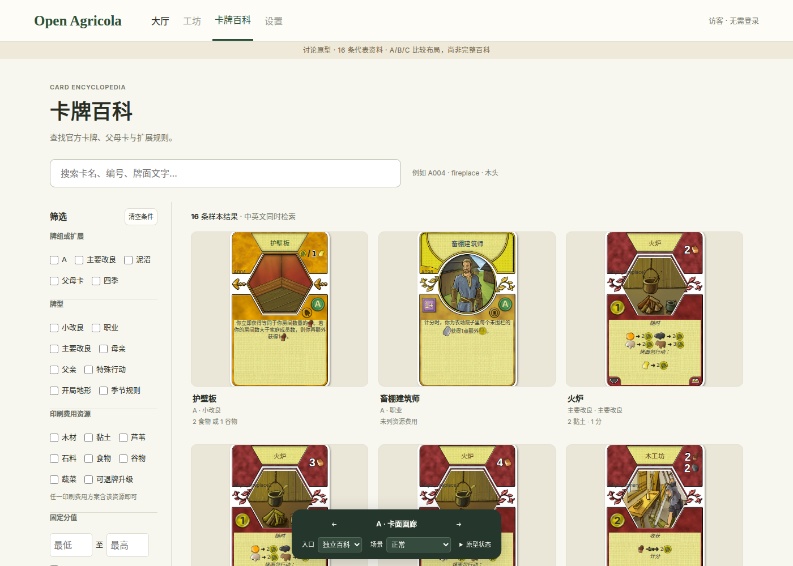
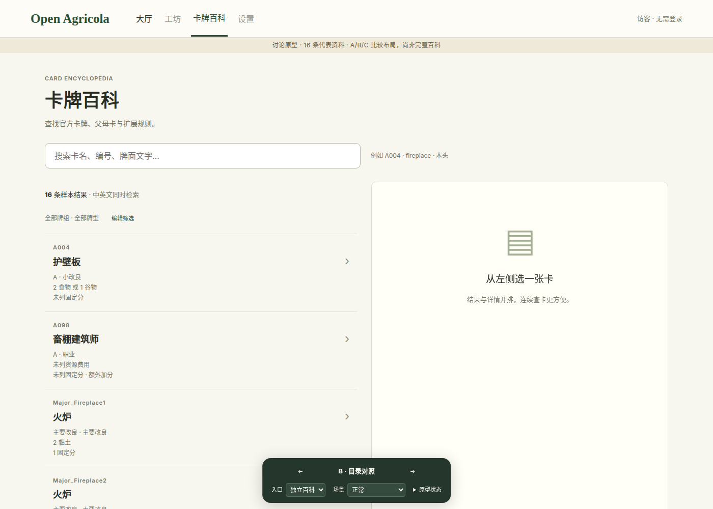
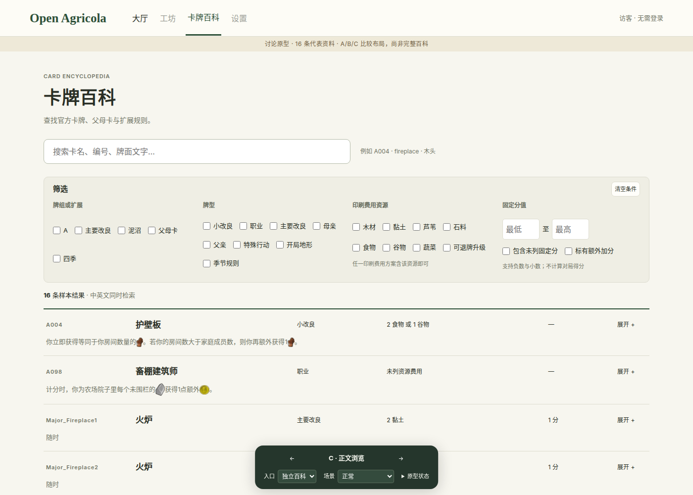
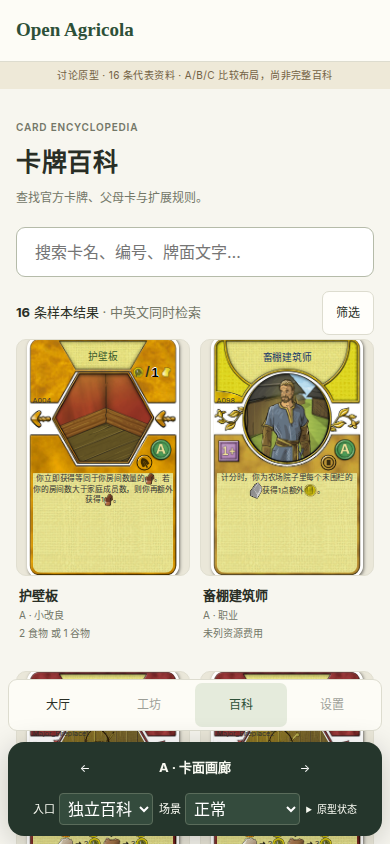
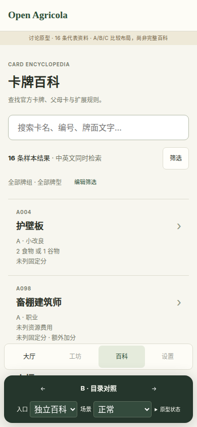
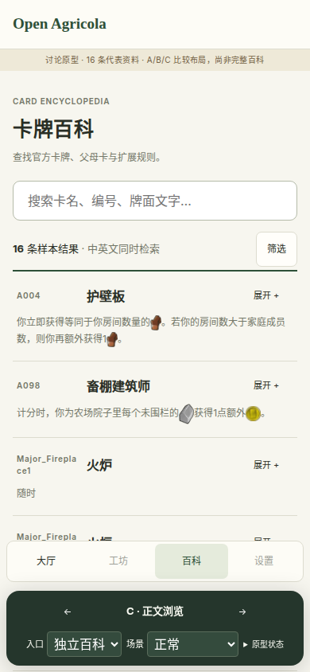

# Encyclopedia interaction prototype

This disposable prototype answers the interaction question in [the Wayfinder ticket](https://github.com/titanxxh/open-agricola/issues/1502). It is not the product implementation. The user selected A as the base; the final interaction contract belongs to the linked decision ticket.

Run `pnpm prototype:encyclopedia` from this worktree. The command uses `restart-local.sh`, frontend port 5194, backend port 5196, an isolated test database schema and S3 prefix, and an ownership file for its processes. Existing app listeners are left running.

Open `http://127.0.0.1:5194/?page=encyclopedia-prototype&variant=A`. The bottom bar switches between three structures. Left and right arrow keys also switch layouts outside text fields.

- A shows card faces with sidebar filters and a detail drawer.
- B keeps a compact result list beside the selected card on desktop. Narrow screens show details in a separate view.
- C emphasizes searchable text and expands a card inside the result list.

The prototype uses 16 representative entries generated from the existing card manifest, pinned language packs and dedicated expansion definitions. It does not claim full catalog coverage. Regenerate the fixture with `python3 docs/prototypes/encyclopedia/build-fixtures.py` after generating the manifest and language packs.

The bottom controls simulate lobby and game entry, no results, loading failure, missing artwork, English fallback and unknown IDs. Game updates are a local counter. The editable draft demonstrates preservation without connecting to a real room. These controls and the raw state display belong to the prototype.

Review both desktop and a narrow viewport. Check direct card links, search, filters, details, returning to a list, and returning to an unchanged game draft. Browser emulation does not establish physical-phone behavior.

All draft state lives in memory. A copied card URL contains only the prototype page, variant and public entry identity. The development entry is disabled in production builds. Keep the branch as decision evidence and rewrite the chosen design when implementing the product.

## Browser evidence

Chromium checks cover 1400×1000 and 390×844 viewports, literal and bilingual search, input arrow keys, copied public card links, negative fractional scores, game-draft and query preservation, Escape return, retry, mobile filters and missing artwork or locale text. The game background is a local demonstration, not WebSocket acceptance.

| A: gallery | B: comparison | C: text |
|---|---|---|
|  |  |  |
|  |  |  |

Additional views: [detail drawer](evidence/desktop-detail-A.png), [narrow filters](evidence/mobile-filters.png), and [fallback](evidence/mobile-fallback.png).

The archived prototype stays outside application source directories. Its frozen bilingual sample and public entry IDs are discussion fixtures; production language and interaction-boundary checks retain their existing scope. The app loads this archive only in development.
