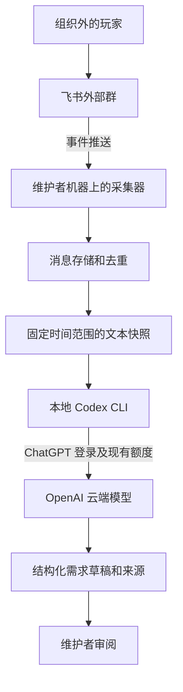

# 飞书玩家群与本地 Codex 需求分析调研导航

核对日期：2026-10-29。本分支只保存调研资料，没有部署采集器、创建真实群、运行模型或安排定时任务。

决策索引以 [飞书玩家社群与本地 Codex 需求分析：决策地图](https://github.com/titanxxh/open-agricola/issues/1455) 为准。本页用于找到操作步骤，不替代各研究票的结论或用户决策。

## 按顺序准备接入

1. 阅读 [飞书组织、外部群与机器人开通步骤](feishu-community-onboarding.md)。先创建或选择自己能管理的免费组织，再建立带“外部”标签的玩家群，保存永久加群二维码和群链接。
2. 按该文档完成应用机器人权限、对外共享、发布和进群。先验证机器人确实能收到组织外成员发送的普通文本消息。客户端里能看见机器人不等于消息采集已成功。
3. 若先做人工分析试验，可按飞书研究文档中的官方 CLI 路线读取已授权的群历史；持续采集再采用 SDK 长连接。已开启对外共享的应用需要使用应用身份读取历史，不能照搬个人授权示例。
4. 按 [Codex 订阅、命令范式与额度边界](feishu-codex-subscription-analysis.md) 检查本地认证方式和运行上下文，为一次人工触发准备固定文本快照，保留消息 ID、时间和必要上下文。验证快照中有测试成员刚发的非提及消息。命令示例需要在后续实施时执行，帮助检查不等于模型运行验证。
5. 进行一次维护者本人发起的摘要分析，检查结果引用的消息 ID 全部存在，并核对独立反馈人数、重复需求和未复现问题。失败时保留同一输入快照，不提前推进成功分析的游标。
6. 与维护者确认 [玩家反馈分析流程：触发、结果去向与人工操作边界](https://github.com/titanxxh/open-agricola/issues/1458)，再安排定时分析或外部发布。当前尚未收到触发方式和结果去向的选择。

这些步骤是后续实施与验收的操作顺序，本次研究没有执行真实接入。

## 检查一次完整数据流

下面是用于讨论的运行方案，尚未实施或由用户选定。

验证时分别检查飞书事件接收、固定快照生成、Codex 执行与结果保存。不要把上一段成功推断成整条流程成功。

## 留下需要真实账号核实的证据

后续实施时，至少记录下列结果，私密原始消息和凭据留在本机，不放进公开研究分支。

- 当前组织的免费版、群人数上限、认证状态和 API 剩余额度。
- 组织外测试成员发送的非提及文本确实被采集到。
- 主动制造短暂离线后，缺失范围可在权限允许的历史中补齐，无法补齐的范围有明确标记。
- 同一消息重复推送不造成重复记录，分析重试不重复生成或公开需求。
- 后台任务使用预期的 ChatGPT 登录方式，实际输出可校验且附带真实消息来源。
- 登录失效、额度不足或执行失败时任务明确失败，没有自动购买或切换成另一个付费调用链。
- 外部群的截图和附件能力单独验收，通过前仅承诺已核实的文本链路。

