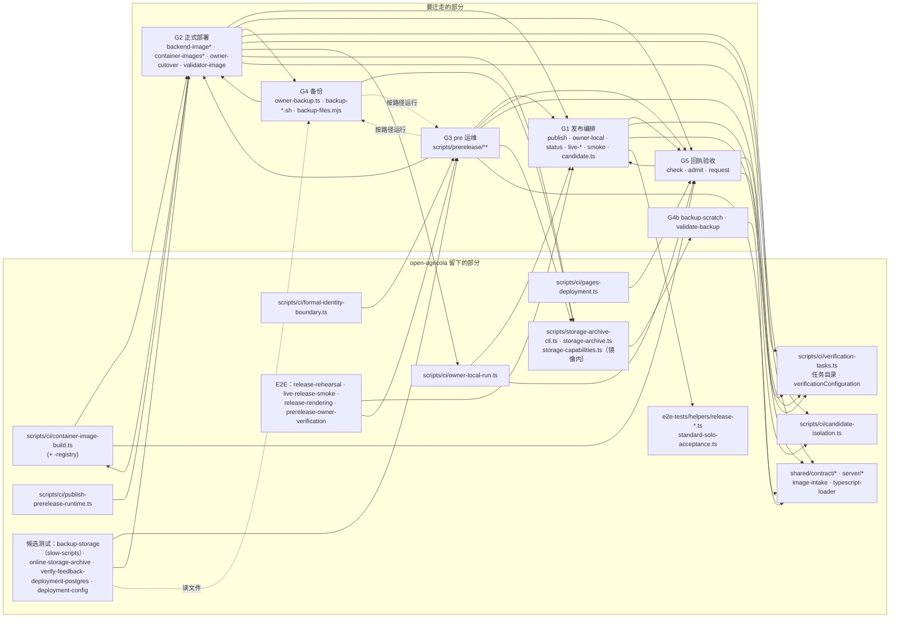
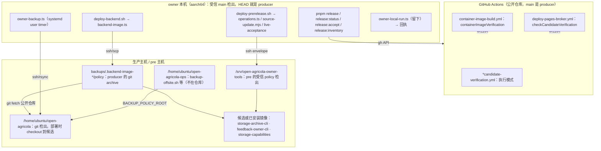

# 要迁走的脚本和 open-agricola 之间是怎样耦合的？

调研票 [#1961](https://github.com/titanxxh/open-agricola/issues/1961)，地图 [#1959](https://github.com/titanxxh/open-agricola/issues/1959)，边界表见 [#1915](https://github.com/titanxxh/open-agricola/issues/1915)。

- 基线：`origin/main` = `b2638e9a1`（建图基线），另读了 `origin/prerelease` = `79aa0b78` 的 `scripts/prerelease/` 文件清单。
- 方法：对全仓 4974 个 TS/JS 源文件做静态 import 图（`import` / `require` / 字面量动态 `import()`），再人工核对字符串路径、SSH 和 stdin 远程执行、`git archive` 和 `git ls-tree` 用到的路径表、workflow、`package.json`、Vitest 项目（`scripts/test-project-globs.ts`）、Dockerfile 和文档。没有运行测试，没有连接主机。
- 标注：从代码直接读出的事实不加标记。根据代码推断、没有在主机或 CI 上实测的结论，标为“（推断）”。

## 1. 结论摘要

1. **门禁被留下来的 workflow 直接调用。** `container-image-build.yml` 经过 `scripts/ci/container-image-build.ts` 调用 `scripts/release/container-images.ts` 的 `containerImageVerification`，它又调用 `checkCandidateVerification` / `checkPrereleaseVerification`。`deploy-pages-broker.yml` 经过 `scripts/ci/pages-deployment.ts` 调用 `checkCandidateVerification`。`prerelease-runtime.yml` 不调用门禁，只从 `scripts/release/container-images.ts` 取 `CONTAINER_IMAGE_REGISTRY` 常量；但加载这个模块时会把门禁模块一起加载进来。所以 #1915 里“三个 workflow 都在构建前调用门禁”应更正为两个调用门禁、一个只在模块层面依赖。
2. **留下来的执行侧反过来依赖要迁走的代码。** `owner-local-run.ts`（本机 harness，留下）和 `prerelease-verification.ts` 的执行模式（`manifest` / `source` / `run-task`，由 `prerelease-candidate-verification.yml` 调用）都 import 了 `scripts/release/candidate.ts`。`formal-identity-boundary.ts` import 了 `scripts/prerelease/identity-boundary-paths.ts`。三个回执验收文件都同时含有执行、准入、回执格式和验收四类代码；`admitFinalSnapshot` / `admitPrereleaseSnapshot` 同时被执行模式和验收调用。
3. **候选自己的测试 import 了要迁走的代码。** chromium 任务里的 5 个 E2E spec、`slow-scripts` 的 `backup-storage.test.ts`、`fast-scripts` 的 `online-storage-archive.test.ts` 和 `verify-feedback-deployment-postgres.test.ts`、`fast-tests` 的 `tests/deployment-config.test.ts`，都直接用到 `scripts/release/`、`scripts/prerelease/` 或备份脚本。只把 tooling A 类测试迁走，候选验证就会失败。
4. **部分“要迁走”的文件其实是候选或镜像里的代码。**
   - `backup-scratch.ts`、`validate-backup.ts` 是镜像里 `storage-archive-cli` 用的代码。
   - `backup-storage.sh`、`backup-process.sh`、`backup-files.mjs` 在主机上从已安装候选的检出运行。主机定时备份是这样（#1950），`owner-sync-capture.sh` 也 source 了 `backup-process.sh`。
   - pre 候选树里的 `scripts/prerelease/prepare-frontend-worker.mjs` 和 `identity-audit.ts` 由运行时镜像或候选工具容器执行。
5. **主机把公开仓库的 git 对象当作信任锚。**
   - 正式部署时，主机从 GitHub 公开仓库 `git fetch` producer SHA，再用 `git archive` 把 `package.json scripts/ci scripts/release scripts/image-intake.ts scripts/backup-*.sh scripts/backup-files.mjs` 放进 stage。`observeBackendOperation` 用 `git ls-tree <producer>` 逐个 blob 复核。
   - pre 的主机端工具在 `/srv/open-agricola-owner-tools` 运行，这是一个 open-agricola 检出。envelope 绑定这个检出的 `HEAD`，也就是 `policySha`。
   - 迁到私有仓库后，主机拿不到 producer 代码，需要新的传输方式和信任锚。这是协议层面的变更，会影响保留期内进行中操作的 `status` / `resume`（推断）。
6. **隐式的哈希和路径契约。**
   - `verificationConfiguration` 对 `scripts/ci/**`、`package.json`、`pnpm-lock.yaml`、`tsconfig*.json`、`scripts/test-project-globs.ts`、`scripts/release/requirements.json` 等文件做哈希，并且要求 `scripts/ci/candidate-verification.ts` 必须存在。凡是改到这些文件的迁移 PR，都会改变 main 的验证配置。
   - `container-images.ts` 的 `trustedProducer` 用 `git diff` 检查一张写死的路径表，里面列了 `scripts/release/backend-*`、`deploy-backend.sh`、`scripts/backup-*` 等。`formal-identity-boundary.ts` 的哈希输入包含 `deploy-backend.sh` 和 `scripts/prerelease/browser-policy.ts`。这些文件删掉以后，`git diff` 检查会静默通过，正式身份边界哈希也会变一次（推断）。
7. **测试和文档的规模。**
   - A 类是 52 个文件，约 9.8k 行。它们依赖留下的 `verification-tasks.ts`、`server/__tests__/_helpers/postgres.ts`、`scripts/__tests__/_helpers/*`，并且有 `@covers` 指向留下的文件：`feedback-owner-cli.ts`、`owner-sync-capture.sh`、`observability.mjs`、`operations/deploy.mjs`、`docker-compose.prod.yml`。
   - 门禁的验收测试在 B 类，不在 A 类：`candidate-verification{,-owner-local,-prerelease,-cli}.test.ts`，约 1.5k 行。
   - 文档引用：`HOW_TO_DEPLOY.md` 和中文镜像各 94 处，`ci-checks.md` 12 处，architecture、ADR、AGENTS、CONTRIBUTING 还有若干处。

## 2. 分组和边界修正

| 组 | 文件 | 本调研的归类 |
|---|---|---|
| G1 发布编排 | `scripts/release/{publish,owner-local,candidate,status,live-inventory,live-smoke-cli,live-smoke,live-smoke-guard,smoke,render,durability,verify-feedback-deployment}.ts`、`requirements.json`、`pnpm release*` | 编排可以迁。`smoke` / `render` / `durability` / `live-smoke*` 被候选 E2E 引用，`candidate.ts` 被留下的执行侧引用，见第 5、6 节 |
| G2 正式部署 | `scripts/release/{backend-*,container-images*,owner-cutover,owner-validator,validator-image}.ts`、`deploy-backend.sh`、`cleanup-backend-images.sh`、`deploy-operations.sh` | 本机端可以迁。主机端（`backend-image-receiver` / `-maintenance` / `-progress` / `-cleanup`）要先重做传输协议。`container-images.ts` 和 `container-images-archive.ts` 是镜像构建 CI 的依赖 |
| G3 pre 运维 | `scripts/prerelease/**`（47 个）、`deploy-prerelease.sh` | 大部分可以迁。`prepare-frontend-worker.mjs`、`identity-audit.ts`（只在 prerelease 分支上）是候选构建或迁移代码，`identity-boundary-paths.ts` 被正式镜像构建引用 |
| G4 备份 | `backup-storage.sh`、`backup-process.sh`、`backup-files.mjs`、`owner-backup.ts`；主机上的 `backup-offsite.sh` 等 | 只有 `owner-backup.ts`（及 `deploy/owner-backup/` 单元）是纯本机工具。三个备份脚本由已安装检出运行（推断应留下或改成随镜像发布）。`backup-offsite.sh` 本来就不在仓库里 |
| G4b | `backup-scratch.ts`、`validate-backup.ts` | 名字像备份脚本，实际是镜像里的代码（`storage-archive-cli`、`tsconfig.storage-tools.json`），应留下 |
| G5 回执验收 | `scripts/ci/candidate-verification.ts`、`owner-local-verification.ts`、`prerelease-verification.ts` 的 check 部分 | 必须先拆文件。验收能不能迁，取决于镜像和 Pages 构建放在哪里 |

## 3. 依赖图

### 3.1 静态 import 图

实线表示静态 import，虚线表示在进程外按路径或字符串调用。

各组 import 的留下模块（只列非测试代码）：

| 组 | import 的 open-agricola 模块 |
|---|---|
| G1 | `scripts/ci/verification-tasks.ts`；`shared/contract/{browser-auth,client-capabilities,game-creation,protocol/ws}.ts`；`server/{http-origin,database/postgres,game/creation-configuration,game/persistence/room-body-codec,bug-report/deployment-proof}.ts`；`e2e-tests/helpers/{release-browser,release-diagnostics,standard-solo-acceptance}.ts` |
| G2 | `scripts/ci/{verification-tasks,candidate-isolation,container-image-build,owner-local-run}.ts`；`scripts/{image-intake,storage-archive,typescript-loader}.ts`；以字符串形式在镜像里运行 `./scripts/storage-capabilities.ts`、`./server/database/postgres.ts` |
| G3 | `scripts/ci/verification-tasks.ts`；`scripts/{image-intake,storage-archive,typescript-loader}.ts`；`server/{database/postgres,storage/erasure-ledger,storage/s3-store}.ts`；`shared/contract/{authoritative-command,browser-auth,protocol/app-location}.ts` |
| G4 | `owner-backup.ts` 只 import `scripts/storage-archive.ts`，并动态 import `release/validator-image.ts`。`backup-process.sh` 按路径调用 `scripts/prerelease/archive-policy.ts`、`scripts/ci/docker-bind-user.ts`，在镜像里运行 `storage-archive-cli.ts` 和 `server/storage/backup-coordination.ts` |
| G4b | `server/{db,database/postgres,database/migrations,storage/runtime,storage/resource-store,storage/s3-store,game/replay-removal}.ts`、`scripts/storage-validation.ts` |
| G5 | 只 import `scripts/ci/verification-tasks.ts`、`scripts/ci/candidate-isolation.ts`（执行模式用）和 `scripts/release/candidate.ts`（`github` / `commitRef` / `ensureCommitRef` / `ownerMachine`） |

外部 npm 依赖：`@playwright/test` / `playwright`（smoke、live-smoke、owner-browser、live-acceptance），`@aws-sdk/client-s3`（`prerelease/storage*.ts`），`vite`（`prepare-frontend-worker.mjs`，属于构建代码）。G5 只用 Node 内置模块和 `gh`。

### 3.2 执行拓扑

## 4. 分组详情

### 4.1 G5 回执验收

- **文件内部的四类代码**
  - 执行：`assertCandidateCheckout`、`candidateManifest`、`runCandidateTask`、`runPrereleaseCandidateTask`、`pull-fixture-images`，以及 `formal-*`、`manifest`、`source`、`run-task` 这些 CLI 模式。
  - 准入：`admitFinalSnapshot`、`mainCommit`、`assertMainProtection`、`assertRawCommit`、`admitPrereleaseSnapshot`、`validateIntegrationManifest`。
  - 回执格式：`owner-local-verification.ts` 里的类型、`canonicalOwnerLocalCommands`、`rebind*OwnerLocalReceipt`、`parse*OwnerLocalProof`，以及 `OWNER_LOCAL_CONTEXT`、`PRERELEASE_OWNER_LOCAL_CONTEXT`、`OWNER_LOCAL_ASSET` 三个常量。
  - 验收：`evaluateCandidateVerification`、`checkCandidateVerification`、`historicalStableSnapshot` / `LEGACY_STABLE_CUTOFF`、`checkPrereleaseVerification`、`checkLocalVerification`，以及 owner 动作 `request*`、`fixPrereleaseCandidate`、`syncPrerelease`。
- **被谁引用**
  - workflow：`candidate-verification.yml`、`candidate-rehearsal.yml`、`prerelease-candidate-verification.yml` 调用执行模式。
  - 留下的代码：`container-image-build.ts`（`assertCandidateCheckout`，并经 `container-images.ts` 调用验收）、`pages-deployment.ts`（验收）、`owner-local-run.ts`（执行和回执格式）。
  - 要迁走的代码：G1 的 publish、owner-local、backend-candidate、verify-feedback-deployment，G2 的 container-images，G3 的 operations、source-verification。
  - 测试：B 类的 `candidate-verification*.test.ts`、`owner-local-run.test.ts`；A 类的 `release-*`、`container-images`、`prerelease-source-verification`；`fast-scripts` 的 `_helpers/feedback-deployment-fixture.ts`。
  - 文档：`HOW_TO_DEPLOY.md:54-81`、`ci-checks.md`、`architecture/testing.md`、ADR 0037。
- **在哪里执行**
  - owner 本机，从受信 main 检出运行：publish、deploy、pre 运维、本机回执发布。
  - GitHub：镜像构建、Pages broker，以及执行模式本身。
  - 主机上不调用 GitHub。pre 主机只用 `verifyReceipt` 检查 envelope 里回执的结构。
  - 运行的总是 producer 的代码，也就是受信 main。
- **凭据和外部依赖**
  - `gh` 只读访问：仓库元数据、规则集和分支保护、PR、Actions 的 runs、jobs 和 artifacts、commit statuses、releases 和 assets 的下载。
  - 需要 open-agricola 的完整 git 历史：raw commit 自校验、`merge-base`，以及对候选、producer、main 三棵树各算一次 `verificationConfiguration`。
- **隐式契约**：验收依赖 workflow 的一批命名，详见第 7 节。

### 4.2 G1 发布编排

- **import**：见 3.1 的表。`smoke.ts`、`live-smoke.ts` 复用 `e2e-tests/helpers/release-*`。`durability.ts` 直接读 `server/game/persistence/room-body-codec.ts` 和 PostgreSQL。
- **被谁引用**
  - `package.json`：`release`、`release:accept`、`release:inventory`、`release:status`、`release:rehearse`（后者使用 `scripts/release/requirements.json`）。
  - E2E：`release-rehearsal.spec.ts`（`smoke`、`durability`）、`live-release-smoke.spec.ts`（`live-smoke`、`live-smoke-guard`）、`release-rendering.spec.ts`（`render`）、`release-diagnostics.spec.ts`（只有 `@covers scripts/release/`）。
  - `owner-local-run.ts` 和 `prerelease-verification.ts` 引用 `candidate.ts`。
  - `tsconfig.verification-tools.json` 把 `scripts/release/**` 纳入 `check:verification-types`，这是 quality 任务的一部分。
- **在哪里执行**
  - owner 本机。`ownerMachine()` 拒绝在 CI 中运行。
  - `live-inventory.ts` 通过 SSH 把一段脚本经 stdin 交给主机 node，在已安装的 app 容器里执行一段内联查询，这段查询 import 了 `./server/database/postgres.ts`，也就是已安装候选的代码。
  - `verify-feedback-deployment.ts` 通过 SSH 运行 `docker compose exec app ... server/bug-report/feedback-owner-cli.ts`。
  - `smoke` / `render` / `durability` / `live-smoke*` 还会在候选验证的 chromium 任务里运行，这时它们是候选代码。
- **凭据**
  - owner 的 `gh` 写权限：`verification/candidates/*` 引用、tag、Release、asset 上传、commit status、workflow dispatch。owner-local 证明要求 status 创建者、Release 作者和 asset 上传者都是仓库的 User owner 本人。
  - SSH 访问生产主机。
  - live 验收的凭据文件（`MY_TEST_USER_ID` / `MY_TEST_PASSWORD`）、Playwright 的 chromium 和 webkit、可选的 `RELEASE_SMOKE_PROXY`。

### 4.3 G2 正式部署

- **import**：除了 3.1 表中列出的，`validator-image.ts` 还 import 了 `scripts/ci/container-image-build.ts` 的 `isolatedImageBuildScript` 和 `CONTAINER_IMAGE_BUILDERS`、`owner-local-run.ts` 的 Node 路径，以及 `candidate-isolation.ts` 的类型。
- **被谁引用**
  - `deploy-backend.sh` 执行 `backend-image.ts`。
  - `cleanup-backend-images.sh` 把 `backend-image-cleanup.ts` 的字节经 stdin 交给主机的 `node --input-type=module-typescript -`。主机运行的是 owner 检出里的副本，这份代码不经过 git 复核。
  - `deploy-operations.sh` 用 `git archive <ref> operations` 发布 `operations/`，`--whats-new` 和 `--wechat-qr` 分别转到 `scripts/update-whats-new.ts` 和 `operations/update-community-qr.mjs`。它和 `scripts/release` 无关，耦合对象是留下的 `operations/` 目录和社区内容工具。
  - 留下的 CI：`container-image-build.ts` 和 `-registry.ts` 依赖 `container-images.ts`、`container-images-archive.ts`；`publish-prerelease-runtime.ts` 只用到常量。
  - `owner-backup.ts` 依赖 `validator-image.ts`。
  - 文档：`HOW_TO_DEPLOY.md`、ADR 0045、ADR 0047。
- **在哪里执行，代码身份**
  - owner 本机：`backend-image.ts`、`container-images-owner.ts`、`owner-cutover.ts`、`validator-image.ts`、`owner-validator.ts`。要求 owner 检出的 `HEAD` 等于镜像回执里的 `producerSha`，并且检出是干净的。
  - 生产主机：`backend-image-receiver.ts`、`backend-image-maintenance.ts`、`backend-image-progress.ts`，从 stage 目录 `policy/` 运行。这份代码是主机自己从 GitHub 公开仓库 `git fetch` producer 后用 `git archive` 取出的，路径表见第 7 节。
  - maintenance 把 `/home/ubuntu/open-agricola` 切到候选 SHA（`git checkout --detach`），但备份时运行的是 stage 里 producer 的 `backup-storage.sh`（`BACKUP_POLICY_ROOT=policy`）。
  - 在候选镜像里运行：`storage-archive-cli.ts` 的 `check-empty` / `check-live`、`storage-capabilities.ts` 探针、`BACKEND_CHECKPOINT_QUERY`（import `./server/database/postgres.ts`）。
  - GitHub：`container-images.ts` 的 `containerImageVerification`、`parseContainerImageReceipt`，以及 `container-images-archive.ts`，在镜像构建 workflow 里作为 producer 代码运行。
- **凭据**
  - owner 侧：`gh`（读 Actions run、attempt 和 artifact）、GHCR 只读 auth 文件（`--auth-file`）、Docker classic image store、rootless Docker 和候选 UID（构建 validator 镜像用）、SSH 和 scp 到生产主机。
  - 主机侧：Docker Compose、`.env`、`data/dependencies.compose.env`（数据库和 S3 凭据），并能 `git fetch` 公开的 origin。
  - GitHub 侧：environment `prerelease-image-publish` 里的 `GHCR_PUBLISH_TOKEN`、`GHCR_PUBLISH_USER`、`GHCR_PRIVATE_PACKAGE_ID`。

### 4.4 G3 pre 运维

- **import**：见 3.1 的表。它对 G1 的 `candidate.ts`、G2 的 `container-images*`、G5 的 `prerelease-verification` 和 `owner-local-verification` 都有依赖。
- **被谁引用**
  - `deploy-prerelease.sh` 执行 `operations.ts` 和 `source-update.mjs`。
  - `deploy/open-agricola-prerelease-storage-guard.service` 在 `/srv/open-agricola-owner-tools` 运行 `storage-guard-cli.ts`。
  - `deploy/prerelease-runtime/prepare.sh` 在候选树里运行 `scripts/prerelease/prepare-frontend-worker.mjs`。
  - `formal-identity-boundary.ts` 引用 `identity-boundary-paths.ts`。
  - E2E `prerelease-owner-verification.spec.ts` 引用 `gateway.ts`、`owner-browser.ts`。
  - `slow-scripts` 的 `backup-storage.test.ts`、`fast-scripts` 的 `online-storage-archive.test.ts` 引用 `config.ts`、`runtime.ts`、`docker.ts`、`backup.ts`。
  - `backup-process.sh` 引用 `archive-policy.ts`。
  - 文档：`HOW_TO_DEPLOY.md:98-392`、ADR 0046、ADR 0051、`ci-checks.md`、`architecture/server.md`。
- **在哪里执行，代码身份**
  - owner 本机，`policyRoot` 是 owner 的检出：`operations.ts` 的 owner 侧、`source-update.mjs`、`source-verification.ts`、`authority.ts`、`live-acceptance/*.mjs`（Playwright）、`owner-browser.ts`。
  - pre 主机：`operations.ts receive` 在 `target.policyDirectory` 运行，也就是 `/srv/open-agricola-owner-tools`。它要求 `HEAD` 等于 envelope 里的 `policySha`，进而运行 `flow.ts`、`runtime.ts`、`docker.ts`、`storage*.ts`、`image-import.ts`、`source-preparation.ts` 等。
  - 这个 policy 检出提供的东西：`node_modules`（挂进 `node:24` 容器）、整棵 policy SHA 的 `git archive`（`policyTool` 用）、已准备好的 `public/i18n` 和 `i18n.ref`（`runtime.ts` 会复核）、`scripts/backup-*.sh`、`scripts/typescript-runtime.mjs`。
  - gateway 容器挂载 `gateway.ts`、`storage-guard-state.ts`、`browser-policy.ts` 和 `shared/contract/browser-auth.ts`。
  - `trustedArchiveImage` 用的是 GitHub 以 `purpose=trusted-policy` 从 main 构建的 app 镜像。
  - 候选侧：`candidateTool` 在候选镜像里运行 `storage-archive-cli.ts` 和 `scripts/prerelease/identity-audit.ts`，后者只在 prerelease 分支上。`owner-accounts/*.mjs` 被 base64 注入正式容器，用正式 app 的 node 运行。
- **凭据**
  - owner 侧：`gh`（pre 的不可变引用、dispatch、artifact）、GHCR 只读 auth 文件、SSH。
  - 验收用：A–E 验收账号、Beta 参与者账号、正式 owner cookie。
  - 主机侧：`/etc/open-agricola/prerelease-main*.json`（target 和 guard 配置）、pre 的 `.env` 和 `data/dependencies.compose.env`（pre 专用的数据库和 S3 凭据、`PRERELEASE_IDENTITY_SERVICE_KEY`）、离站 SSH 账号、`data/backup-scripts.json`（主机脚本的摘要）。

### 4.5 G4 备份

- **`owner-backup.ts`**
  - 在 owner 本机由 systemd user timer 运行，工作目录是 `OWNER_BACKUP_CHECKOUT`（open-agricola 检出），见 `deploy/owner-backup/*`。
  - 通过 SSH 在主机 `/home/ubuntu/open-agricola` 运行 `bash scripts/owner-sync-capture.sh`，这个脚本来自已安装候选的检出。
  - 用 rsync 拉取数据，本地用 Docker 和 validator 镜像运行 `storage-archive-cli.ts validate`。
  - 依赖：rsync（带 zstd 更好）、Docker、SSH。
- **`backup-storage.sh`、`backup-process.sh`、`backup-files.mjs`** 有四个调用方：
  1. 主机定时任务经 `/home/ubuntu/open-agricola-ops/backup-offsite.sh` 调用，`BACKUP_POLICY_ROOT` 指向仓库检出，也就是已安装候选。这就是 `backup-storage.test.ts` 留在 `slow-scripts` 的原因（#1950）。
  2. 正式部署的 maintenance，从 stage 里 producer 的副本运行。
  3. pre 的 `flow.ts` 和 `docker.ts`，从 owner-tools 的 policy 检出运行。
  4. `owner-sync-capture.sh`，在已安装检出里 source `backup-process.sh`。

  这三个脚本会在镜像里运行 `storage-archive-cli.ts`，读运行中容器里的 `server/storage/backup-coordination.ts`，并调用 `scripts/ci/docker-bind-user.ts` 和 `scripts/prerelease/archive-policy.ts`。`tests/deployment-config.test.ts`（fast-tests）直接读这些脚本的内容。
- **`backup-offsite.sh`、`deploy/commit-backup-set.sh`、`deploy/offsite-retention.sh`**：已经只存在于主机的 `/home/ubuntu/open-agricola-ops`，没有 git。pre 通过 `scripts/prerelease/backup-scripts.ts` 的 `MACHINE_BACKUP_SCRIPTS` 和 `data/backup-scripts.json` 里的 SHA-256 来固定它们。它们和仓库的耦合只有两处：`BACKUP_POLICY_ROOT`，以及这张摘要表。
- **凭据**：主机 `.env`、`OFFSITE_BACKUP_TARGET` / `OFFSITE_BACKUP_REMOTE_DIR` 和离站 SSH key；owner 本机需要 SSH 访问主机，以及 `OWNER_BACKUP_ROOT`。

## 5. 留下的代码对要迁走代码的反向依赖

| 留下的模块 | 依赖的迁走模块 | 用途 | 处理方向（推断） |
|---|---|---|---|
| `scripts/ci/container-image-build.ts`（GitHub 镜像构建） | `release/container-images.ts`（验收和回执格式）、`release/container-images-archive.ts` | 构建前跑门禁，校验镜像归档 | 只要镜像在 GitHub 上构建，这两个模块就留下 |
| `scripts/ci/container-image-build-registry.ts`、`publish-prerelease-runtime.ts` | `release/container-images.ts` | 只用 `CONTAINER_IMAGE_REGISTRY` | 常量挪进 `scripts/ci` |
| `scripts/ci/pages-deployment.ts`（Pages broker） | `ci/candidate-verification.ts` 的 `checkCandidateVerification` | Pages 门禁 | 和镜像构建一起决定 |
| `scripts/ci/owner-local-run.ts`（本机 harness） | `release/candidate.ts`（`github`、`ownerMachine`、`RELEASE_REPOSITORY`）；`owner-local-verification.ts` 的回执格式 | 读仓库 ID，拒绝在 CI 中运行，生成回执 | 把 `candidate.ts` 的这三项挪进 `scripts/ci`；回执格式留下 |
| `scripts/ci/prerelease-verification.ts` 的执行模式（GitHub） | `release/candidate.ts`（`commitRef` 等）、`admitPrereleaseSnapshot` | manifest 阶段的准入 | 准入和执行留下，验收拆出去 |
| `scripts/ci/candidate-verification.ts` 的 `formal-manifest` / `formal-source` | `admitFinalSnapshot` | manifest 阶段的准入 | 同上 |
| `scripts/ci/formal-identity-boundary.ts` | `prerelease/identity-boundary-paths.ts` | 正式身份边界哈希 | 路径表挪进 `scripts/ci` |
| `scripts/storage-archive-cli.ts`（镜像内） | `backup-scratch.ts` | scratch 记录 | 留下（G4b） |
| `deploy/prerelease-runtime/prepare.sh`（运行时镜像，候选树） | `prerelease/prepare-frontend-worker.mjs` | 构建 Worker 资产 | 留下 |
| pre 候选的 `flow.ts` → `candidateTool` | prerelease 分支上的 `scripts/prerelease/identity-audit.ts` | 候选迁移 | 候选侧文件留在候选树里 |

## 6. 候选自己的测试引用了要迁走的代码

| 测试（项目） | 引用 | 后果 |
|---|---|---|
| `e2e-tests/release-rehearsal.spec.ts`（chromium） | `release/smoke.ts`、`release/durability.ts` | 文件删掉后 chromium 任务失败；把 spec 一起迁走会改变 chromium 任务的组成 |
| `e2e-tests/live-release-smoke.spec.ts`（chromium） | `release/live-smoke.ts`、`release/live-smoke-guard.ts` | 同上 |
| `e2e-tests/release-rendering.spec.ts`（chromium） | `release/render.ts` | 同上 |
| `e2e-tests/release-diagnostics.spec.ts`（chromium） | 只有 `@covers scripts/release/` | 声明会悬空。`check:test-covers` 只检查子进程运行的脚本有没有 `@covers`，不检查目标是否存在，所以不会报错，但 Routine 按改动选择测试时再也匹配不到它（推断） |
| `e2e-tests/prerelease-owner-verification.spec.ts`（chromium） | `prerelease/gateway.ts`、`prerelease/owner-browser.ts` | 同上 |
| `scripts/__tests__/backup-storage.test.ts`（slow-scripts） | `prerelease/{config,runtime,docker,backup}.ts`、`release/container-images` 的类型、`deploy/prerelease-target.example.json` | slow 任务失败 |
| `scripts/__tests__/online-storage-archive.test.ts`（fast-scripts） | `prerelease/{config,backup}.ts` | fast 任务失败 |
| `scripts/__tests__/verify-feedback-deployment-postgres.test.ts`（fast-scripts） | `@covers release/verify-feedback-deployment.ts`；helper import 了 `candidate-verification`、`owner-local-verification` | fast 任务失败 |
| `tests/deployment-config.test.ts`（fast-tests） | 读 `scripts/backup-storage.sh`、`scripts/backup-files.mjs` 的文本 | fast 任务失败 |
| `validate-backup.test.ts`、`backup-scratch.test.ts`（fast-scripts） | G4b | G4b 留下就没有影响 |

`release:rehearse` 这条本机演练入口，以及 `scripts/release/requirements.json`（同时是 `verificationConfiguration` 的输入），都会随 G1 一起改变。

## 7. 隐式契约：字符串路径、git 树和哈希

1. **`verificationConfiguration(cwd, sha)`**（`scripts/ci/verification-tasks.ts:182-224`）
   - 输入：三个候选 workflow、`scripts/ci/**`、`scripts/verification*.ts`、`scripts/verify*.{ts,sh}`、`scripts/test-project-globs.ts`、`scripts/release/requirements.json`、`package.json`、`pnpm-lock.yaml`、`vitest.config.ts`、`playwright.config.ts`、`vite.config.ts`、`tsconfig*.json`。
   - 必须存在的文件：`scripts/ci/candidate-verification.ts`。
   - 迁移中拆分 `scripts/ci` 文件、删掉 `package.json` 的 `release*` 脚本、改 `test-project-globs.ts` 或 `tsconfig.verification-tools.json`，都会改变 main 的配置哈希。stable 的验收要求 producer 配置等于当前 main 的配置，不做延续；pre 只在 `continuity` 或 `producerSha` 下接受旧配置。所以每个这样的 PR 都会让在途的 stable 候选证据作废（推断：应当批量合并，避开发布窗口）。
2. **workflow 证据的命名契约**（`evaluateCandidateVerification`）
   - run 标题：`stable / <sha> / ` 和 `prerelease / <sha> / `。
   - job 名：`candidate-manifest`、`candidate / <task> / <configuration>`。
   - manifest 绑定 step 名：`Stable manifest / <repoId> / stable / <sha> / <config> / <producer> / <tasks>`，pre 版本为 `Prerelease manifest / …`，旧格式为 `Candidate manifest / …`。
   - 必须成功的 step：`Generate candidate manifest`、`Checkout candidate`、`Install dependencies`、`Verify candidate checkout`、`Execute verification task`、`Prepare candidate isolation`、`Prove native candidate isolation`、`Stop candidate descendants and collect private diagnostics`、`Install browsers`。
   - pre 的源更新（`source-verification.ts`）还依赖 `ci.yml` 的 job 和 step 名 `plan` / `Compute canonical verification plan`、`verify` / `Require every selected check to succeed`，以及 artifact `verification-plan-<run>-<attempt>` 里的 `scoped-plan.json`（`schemaVersion`、`mode`、`identity.*`）。
3. **owner-local 证明**
   - commit status 的 context：`owner-local-verification`、`owner-local-prerelease-verification`。
   - status 描述：`owner-local sha256:<hex>`。
   - Release asset：`owner-local-verification.json`。
   - 回执格式：stable 为 format 1，pre 为 format 2，带 `execution.evidenceSha256`。
4. **镜像回执**：artifact `container-image-receipt-<run>-<attempt>`；run 标题 `image / <purpose> / <sha>`；`purpose` 取值 `candidate`、`formal-candidate`、`trusted-policy`；registry `ghcr.io/titanxxh/open-agricola-images`。
5. **主机上的 producer 路径表**
   - 位置：`backend-image.ts:102` 的 `git archive`，以及 `backend-image-maintenance.ts:427` 的 `git ls-tree` 复核。
   - 路径：`package.json scripts/ci scripts/release scripts/image-intake.ts scripts/backup-storage.sh scripts/backup-process.sh scripts/backup-files.mjs`。
6. **`trustedProducer` 的 `git diff` 路径表**（`container-images.ts:125-140`）：`container-image-build.yml`、`scripts/release/container-images*.ts`、`scripts/release/backend-*`、`scripts/image-intake.ts`、`deploy-backend.sh`、`docker-compose.prod.yml`、三个备份脚本。路径从 main 删掉后，`git diff` 两边都不存在，检查会静默通过（推断：需要改成检查私有仓库对应的 SHA）。
7. **正式身份边界**（`formal-identity-boundary.ts`）
   - 哈希输入：wiring 列表含 `deploy-backend.sh`，modules 含 `scripts/prerelease/browser-policy.ts`。
   - 删掉这些文件后，下一次正式构建的边界哈希会变（推断：pre 的快速路径会要求一次完整验收）。
8. **主机和镜像里的入口**：`scripts/storage-archive-cli.ts` 的子命令（`export`、`export-online`、`ledger-export`、`ledger-merge`、`cleanup-scratch`、`validate`、`check-empty`、`check-live --counted`）、`scripts/storage-capabilities.ts` 的 `STORAGE_CAPABILITIES`、`server/bug-report/feedback-owner-cli.ts`、`server/storage/backup-coordination.ts` 的 `RESOURCE_DELETION_PROTOCOL`、`scripts/typescript-runtime.mjs`、`scripts/container-entry.ts`、`/api/health` 和 `/api/app-location`、镜像 label `org.opencontainers.image.revision`、`/app/formal-identity-boundary`、`docker-compose.prod.yml`、`scripts/owner-sync-capture.sh`、`backups/.maintenance.lock`、`data/*.json` 的格式。
9. **两段内联查询**：`LIVE_INVENTORY_QUERY` 和 `BACKEND_CHECKPOINT_QUERY` 直接 import `./server/database/postgres.ts`，依赖 `PostgresDatabase` 的 API 和表结构（`data_imports`、`app_instances` 等）。迁走后，服务端重构会悄悄破坏私有工具（推断：改成镜像里一个有版本的 CLI 更稳）。
10. **固定写死的仓库名**：`RELEASE_REPOSITORY = 'titanxxh/open-agricola'`、`historicalStableSnapshot` 里的 `'titanxxh/open-agricola'`、`LEGACY_STABLE_CUTOFF`，以及 `https://github.com/<repo>.git` 的 fetch 地址。

## 8. open-agricola 需要保留的公共接口

私有仓库无论怎样切，都需要 open-agricola 的一个受信 main 检出：git 对象、`node_modules` 和 TypeScript 源码。原因是验收要对 open-agricola 的树计算哈希、做 raw commit 校验。下面的接口应该作为有版本的公共面保留，并在文档里写明。

1. **任务目录和配置**：`scripts/ci/verification-tasks.ts` 的 `FULL_TASK_IDS`、`selectedTasks`、`verificationTask`、`taskCommands`、`browserSpecWeights` / `browserSpecWeightsAt`、`verificationConfiguration`、`fullSha`、`TASK_FIXTURE_IMAGES`。
2. **准入库**：`admitFinalSnapshot`、`mainCommit`、`assertMainProtection`、`assertRawCommit`、`assertCandidateCheckout`、`admitPrereleaseSnapshot`、`validateIntegrationManifest`、`prereleaseCandidateRef`。执行模式也要用到它们，所以必须留下。
3. **回执格式库**：owner-local 的 format 1 和 2，包括类型、`canonicalOwnerLocalCommands`、`rebind*`、`parse*Proof`、`ownerLocalRepository` 和几个常量；镜像回执 `parseContainerImageReceipt`、`parseContainerImageTransfer`，以及 `CONTAINER_IMAGE_*` 常量；`container-images-archive.ts` 的 `validateContainerImageArchive`、`nativeContainerImageId`、`inspectLoadedContainerImage`。
4. **门禁 CLI**（取决于镜像和 Pages 构建放在哪里）
   - 如果镜像或 Pages 仍在 GitHub 上构建，验收必须至少有一份留在公开仓库。现有 CLI 已经是 JSON 接口，私有仓库可以直接调用：`candidate-verification.ts check|request`，`prerelease-verification.ts check|request|select|sync`。
   - 私有仓库调用的方式是 `node <oa>/scripts/ci/*-verification.ts check --sha … --repository …`，或者 import `checkCandidateVerification` / `checkPrereleaseVerification` / `containerImageVerification`。
   - 迁走的只是编排：何时请求、怎样发布、怎样部署。
5. **GitHub 证据契约**：第 7 节第 2 到 4 条列出的 workflow 路径、输入、run 标题、job 和 step 名、artifact 名和 schema、status context。这些现在只写在代码里，迁移后私有仓库要依赖它们，应当有测试固定下来。
6. **镜像和主机入口**：第 7 节第 8 条的 CLI 和文件，加上把第 9 条的内联查询改成镜像里的 CLI 子命令（推断，建议）。
7. **共享库**：`shared/contract/{browser-auth,authoritative-command,client-capabilities,game-creation,protocol/*}.ts`、`server/{http-origin,storage/s3-store,storage/erasure-ledger,database/postgres,game/persistence/room-body-codec,game/creation-configuration,bug-report/deployment-proof}.ts`、`scripts/{storage-archive,image-intake,typescript-loader,typescript-runtime.mjs}`、`e2e-tests/helpers/{release-browser,release-diagnostics,standard-solo-acceptance}.ts`。
8. **测试支撑**：`server/__tests__/_helpers/postgres.ts`、`scripts/local-services.mjs --test`、`scripts/__tests__/_helpers/{docker-fixture-environment,backend-image-fixture,candidate-provenance,reusable-temp-roots}.ts`。私有仓库的测试离不开这些（推断：可以通过 open-agricola 检出加 `vitest --root` 复用，也可以复制一份）。

## 9. 可行的切分点

| 切分点 | 内容 | 对 open-agricola 的改动 | 风险 |
|---|---|---|---|
| C0 先挪回公开侧 | 把 `candidate.ts` 的 `github`、`ownerMachine`、`RELEASE_REPOSITORY` 挪进 `scripts/ci`；`CONTAINER_IMAGE_*` 常量、镜像回执解析和 `container-images-archive.ts` 挪进 `scripts/ci`；`identity-boundary-paths.ts` 挪进 `scripts/ci`；`smoke` / `render` / `durability` / `live-smoke*` 挪进 `e2e-tests/helpers`（或者把相关 spec 一起迁走）；`prepare-frontend-worker.mjs` 挪到构建脚本旁边；`backup-scratch.ts` / `validate-backup.ts` 留下 | 只改 import 路径，行为不变 | 会改配置哈希（`scripts/ci/**`），需要和后面的切分批量合并；正式身份边界会变一次（推断） |
| C1 拆门禁文件 | 把三个 verification 文件拆成执行、准入、回执格式、验收 | 保留 `scripts/ci/candidate-verification.ts` 这个文件名，因为它在 required 列表里 | 改配置哈希；B 类测试约 1.5k 行要跟着拆 |
| C2 迁走本机编排 | publish、owner-local、status、live-*、backend-image（本机侧）、container-images-owner、owner-cutover、owner-validator、validator-image、verify-feedback-deployment、owner-backup、`deploy-*.sh`、pre 的 owner 侧和 live-acceptance | 删掉 `package.json` 的 `release*` 脚本（改配置哈希），删文档段落；私有仓库 import open-agricola 检出 | 低。open-agricola 里没有生产代码依赖它们（C0 完成后）；A 类测试和 `@covers` 跟着搬，留下的 `feedback-owner-cli.ts`、`owner-sync-capture.sh`、`observability.mjs`、`operations/deploy.mjs`、`docker-compose.prod.yml` 需要在公开侧补测试 |
| C3 主机端代码 | `backend-image-receiver`、`-maintenance`、`-progress`、`-cleanup`；pre 的 `receive`、`flow`、`runtime`、`docker`、`storage*`、`image-import`、`gateway`、`storage-guard` | 无 | 高。需要新的 policy 传输方式（owner scp 一个 archive，加上 request 里绑定的摘要）和新的信任锚（私有仓库 SHA）；pre 的 `policyDirectory` 要变成两份检出，`policySha` 要变成一对 SHA；保留期内进行中操作的 `status` / `resume` 要兼容（推断） |
| C4 门禁本身 | 验收迁到私有仓库 | 镜像和 Pages 的 workflow 失去门禁，除非构建也迁走 | 由“门禁和构建位置”决策票决定；本机是 aarch64，正式镜像是 amd64（ADR 0047） |
| C5 备份脚本 | 三个备份脚本是否迁走 | 如果迁走，主机定时任务、`owner-sync-capture.sh` 和部署 stage 都要改成从私有仓库取脚本 | 中。推断更稳的做法是留在 open-agricola，作为已安装检出和镜像提供的接口，`slow-scripts` 的测试继续守护它们 |

建议顺序（推断）：C0，加 C1 的拆分（尽量合成一次配置哈希变更），然后 C2，最后 C3。C4 和 C5 等决策票结论出来再定。每一步都要保证 `pnpm release`、`deploy-backend.sh` 和 `deploy-prerelease.sh` 继续可用，私有仓库先验证通过，再删除公开侧的旧文件。

## 10. 留给其他票的问题

- **门禁和构建位置**：见第 1 节第 1 条、第 9 节 C4。如果镜像和 Pages 继续在 GitHub 上构建，“回执验收”这一行至少要在公开仓库留一份。
- **回执延续**：第 7 节第 1 条的配置哈希、第 7 节第 5 条的主机路径表、第 7 节第 10 条的写死仓库名，决定了保留期内的旧回执和进行中操作能不能复核。迁移 PR 本身就会改变 producer 的配置。
- **文档拆分**：主要是 `HOW_TO_DEPLOY.md` 和中文镜像（各 94 处引用），其次是 `ci-checks.md`、`architecture/{server,testing}.md`、ADR 0037/0045/0046/0047/0051、`AGENTS.md` 的 Deployment 段、`CONTRIBUTING*.md`。
- **PR 切分**：第 9 节的 C0 到 C3 可以作为起点。
